# 名人雷达（Celebrity Radar）

[English](./README.en.md) · **简体中文**

[](./LICENSE)
[](https://taro-docs.jd.com/)
[](https://www.typescriptlang.org/)
[](https://nodejs.org/)
[](#开发与测试)
[](./CONTRIBUTING.md)

> 面向微信生态的**名人动态情报台**小程序：输入任意名人名字 → 联网检索近期公开报道 → 大模型提炼成结构化报告（简介 / 人物档案 / 动态 / 语录 / 点评 / 争议与回应 / 时间线 / 名词解释…），再在端上聚合出词云、情绪走势与热度趋势。

- 技术形态：Taro 3（React）+ Taro UI ｜ 云后端：腾讯云 CloudBase（微信云开发）
- 许可：[Apache-2.0](./LICENSE) ｜ 更新日志：[`CHANGELOG.md`](./CHANGELOG.md)
- 仓库：[gitee.com/qianlonglove_admin/celebrity-radar](https://gitee.com/qianlonglove_admin/celebrity-radar) ｜ English: [`README.en.md`](./README.en.md)

---

## 目录

- [这是一个什么样的项目](#这是一个什么样的项目)
- [功能特性](#功能特性)
- [界面预览](#界面预览)
- [技术栈](#技术栈)
- [架构与核心链路](#架构与核心链路)
- [快速开始](#快速开始)
- [配置说明](#配置说明)
- [部署](#部署)
- [项目结构](#项目结构)
- [核心模块](#核心模块)
- [安全与合规](#安全与合规)
- [开发与测试](#开发与测试)
- [常见问题](#常见问题)
- [已知限制](#已知限制)
- [贡献指南](#贡献指南)
- [反馈与支持](#反馈与支持)
- [版本与更新日志](#版本与更新日志)
- [许可与致谢](#许可与致谢)

---

## 这是一个什么样的项目

一个完整、可编译运行的微信小程序工程：端上 19 个页面，云侧 10 个云函数与 18 张数据库集合，
覆盖「搜索 → 消歧 → 检索 → 生成 → 缓存 → 订阅 / 收藏 / 分享 / 问答 / 对比」的全链路。

设计重心只有两条：

1. **不买也能用** —— 缓存命中的报告不限次浏览；关注 / 收藏 / 历史 / 热门榜全部免费开放，不设付费墙。
2. **不烧冤枉钱** —— 报告是**全局共享缓存**（同一人只生成一次，所有用户复用）、`building` 字段作跨设备生成互斥锁、
   冷却只拦「值得等待」的那类失败、配额计数服务端化。三套机制把上游成本压在可控范围。

> ⚠️ **这是一份完整的代码，不是一个可以直接上线运营的产品。**
> 仓库里**没有任何可用凭据**：appid、云开发环境 ID、上游 API Key 全部是占位符，需要你自备。

---

## 功能特性

### 内容生产

- **发现与消歧** —— 搜索框 + 热门领域卡；同名人物候选列表（带领域筛选项）+「都不是 TA」兜底，产出稳定 `personKey`（形如 `雷军#tech`）
- **报告生成** —— 博查联网检索 → LLM 生成结构化 JSON → zod 全字段校验 + 来源 URL 白名单清洗；**逐段卡片化渲染**（简介 / 人物档案 / 关系图谱 / 近期动态 / 经典名言 / AI 点评 / 近期争议与回应 / 时间线 / 后续关注 / 名词解释 + 一行溯源摘要），骨架屏 + 逐段呈现，附「生成于 xx 前 / 刷新最新」双入口；事实类段落**必须指出素材出处**，指不出一律整条剔除，段落真的为空也出卡写明原因
- **端上聚合卡** —— 人物速览 / 立场与舆情 / 关键词云 / 语录主题 / 热度趋势 —— **纯端上聚合**，存量缓存同样生效，不新增模型调用与生成额度
- **出处核对** —— 只核对「能核对的事实」（这条名言的出处链接是否在本次素材内、那篇报道里有无相同表述），**不做 AI 真伪判定**

### 浏览与沉淀

- **关注** —— 关注列表 + 变化概览（谁有新动态）+ 聚合流（`feed_cache` 归并 + 下拉刷新，每账号每日 ≤ 10 次）
- **周报** —— 一键汇总关注对象最近 7 天的动态 → 逐人要点 + 本周综述 + 话题词；素材取自缓存，**人与其条目以材料为准**，按 ISO 周本机缓存
- **收藏 / 历史** —— 四类收藏（名言 / 报告 / 动态 / 时间线，`openid#type#hash` 主键防重）+ 浏览历史（保留 50 条）；收藏页名言可直接出**名言卡**
- **消息中心** —— 一条时间流：关注更新 / 周报提醒 / 平台公告 / 关键词预警；已读**逐条记**，只存本机（零新增集合 / 云函数 / 模型调用）
- **分享** —— 名言卡（Canvas 2D 端上出图，图片不落云存储）+ 原生转发；落地页统一为「具体某个人的报告页」

### 探索

- **热门榜** —— AI 每日生产（`hot_board`），三级回退（AI 榜 → 已有缓存报告 → 静态清单）；**全员可见全部位数**，不分档
- **关键词预警** —— 订阅关键词 → 云函数每日定时按词检索 → 端上列出「上次看过之后新增的条目」，并按订阅消息推送
- **名人风险监控** —— 在报告页「+ 监控风险」盯住一个人 → 云函数每日定时按人检索 → 命中司法 / 税务 / 合作 / 维权 / 表态这类词时汇总到预警页并推送（**只陈述命中与出处，不评级、不预测**）
- **主题知识库** —— 把「以人为中心」的报告缓存翻转成「以话题为中心」的视图：一个话题 → 谁在说 / 说过什么 / 有哪些报道 / 何时被讨论
- **对比** —— 两位名人横向对比（复用两方缓存报告，零模型调用），可一键关注 / 分享
- **AI 问答** —— 语料 = 该名人**已缓存报告**摊成的带编号片段（按可信度排序、按汉字二元组命中选片段）；提问时**额外做一次联网检索**并合流竞争预算，检索不通静默降级为「只依据报告作答」

### 会员（freemium）

- **额度** —— 免费版每日 3 次主动生成、会员 30 次（缓存命中不计次）；AI 提问免费 5 次 / 会员 30 次；配额在「我的」页透明展示
- **「质」权益** —— **模型供应商自选**（DeepSeek / 通义千问 / 智谱 GLM / Moonshot 任选，key 全在云函数，用户零配置）+ 模型档位（免费版锁定「极速版」，会员可用「标准版 / 深度推理」；换供应商时档位清单整组跟着换，用户选的那一档不变）+ 报告**深度模式**（检索加厚 + 对比视角 / 风险提示 / 信源分歧三段专享内容）
- **定价** —— 月 ¥9.9 / 季 ¥25 / 年 ¥68；**价格源唯一**（云函数 `payCreate` 的 `PLANS`，端上拉取展示，改价无需发版）

### 平台能力

- **合规** —— 敏感名单一级拦截（命中即拒答，**不发任何网络请求**）、来源 URL 白名单、全链路标注「AI 生成，仅供参考」
- **端上零密钥** —— 所有上游请求经云函数代发；配额计数服务端化（原子自增 + 服务端日期）；会员闸门在云侧强校验（改包绕不过）

---

## 界面预览

#### 发现与检索

<table>
  <tr>
    <td align="center">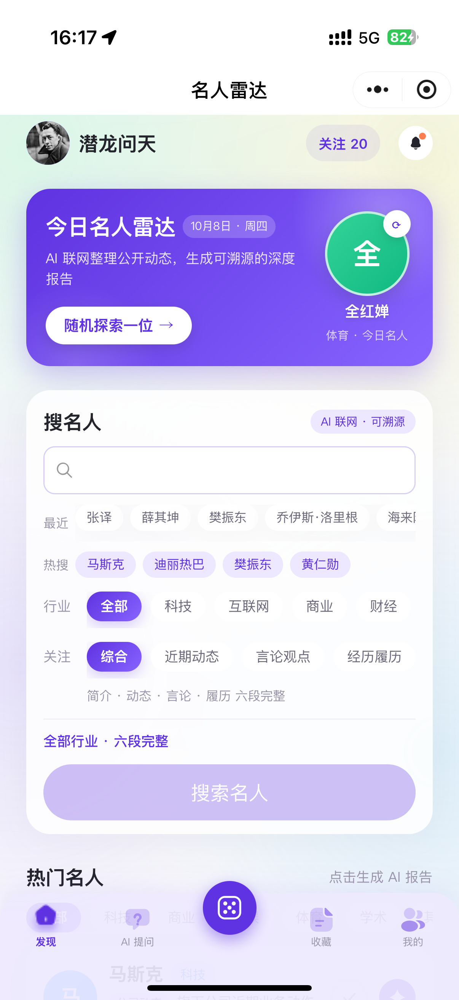<br><sub><b>首页</b> · 搜索入口 / 热门领域 / 今日热门</sub></td>
    <td align="center">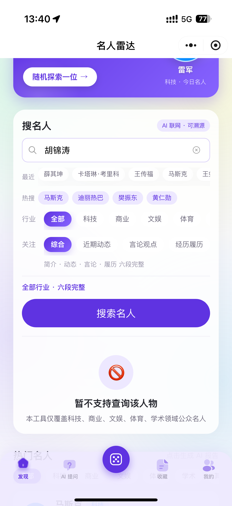<br><sub><b>搜索与消歧</b> · 同名候选列表 + 领域筛选</sub></td>
  </tr>
  <tr>
    <td align="center">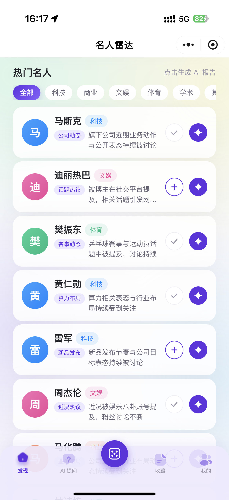<br><sub><b>热门榜</b> · AI 每日生产，全员可见全部位数</sub></td>
  </tr>
</table>

#### 关注与消息

<table>
  <tr>
    <td align="center">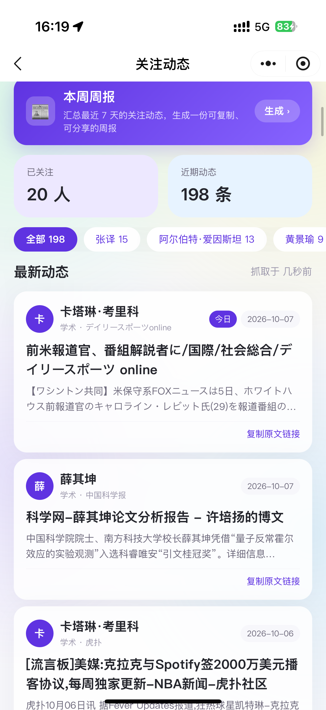<br><sub><b>关注动态</b> · 聚合流 + 下拉刷新</sub></td>
    <td align="center">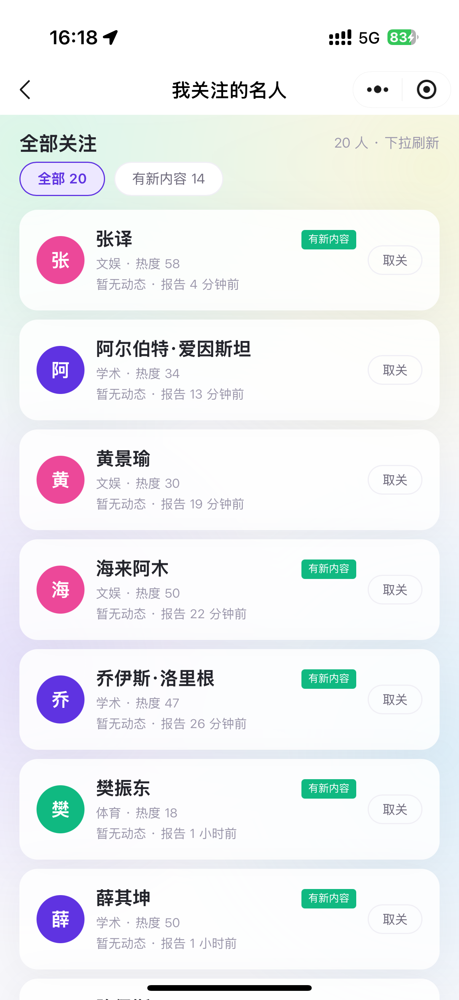<br><sub><b>关注列表</b> · 变化概览：谁有新动态</sub></td>
  </tr>
  <tr>
    <td align="center">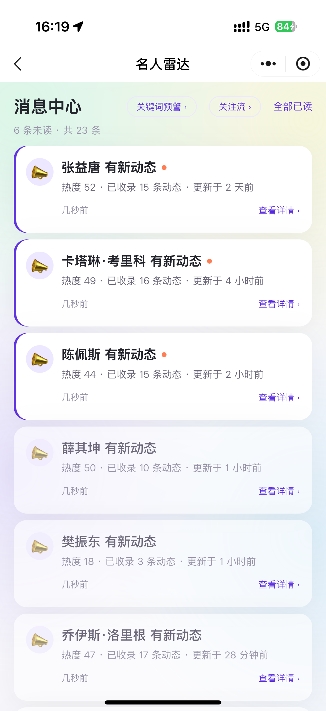<br><sub><b>消息中心</b> · 关注更新 / 周报 / 预警一条时间流</sub></td>
  </tr>
</table>

#### 探索与问答

<table>
  <tr>
    <td align="center">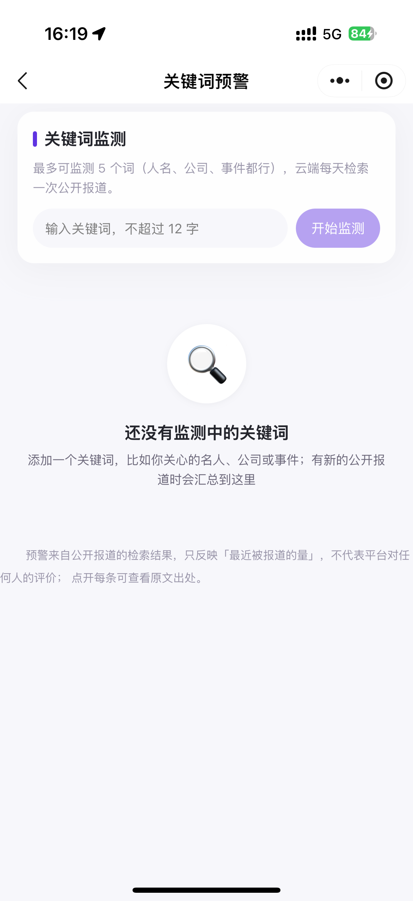<br><sub><b>关键词预警</b> · 只列出上次看过后新增的条目</sub></td>
    <td align="center">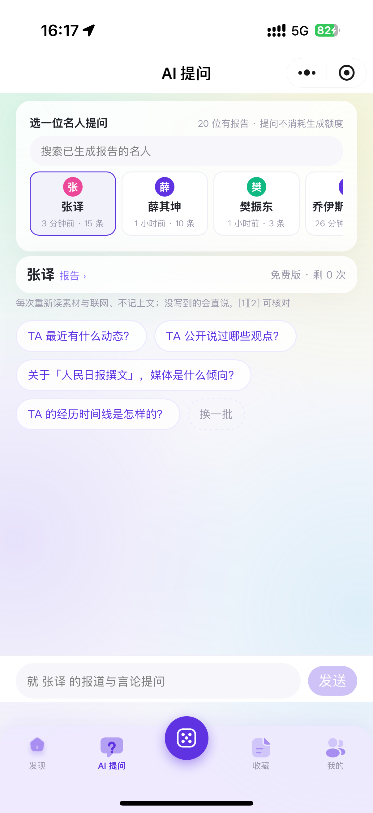<br><sub><b>AI 问答</b> · 语料为你已缓存的报告，带编号来源作答</sub></td>
  </tr>
</table>

#### 名人深度报告

逐段卡片化渲染（简介 / 人物档案 / 关系图谱 / 近期动态 / 经典名言 / AI 点评 / 争议与回应 / 时间线 / 后续关注 / 名词解释），事实类段落必须指得出素材出处。

<table>
  <tr>
    <td align="center">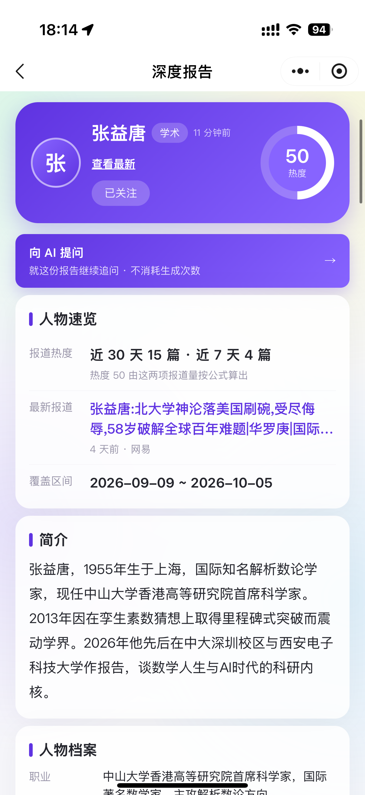<br><sub><b>报告页 1 / 7</b></sub></td>
    <td align="center">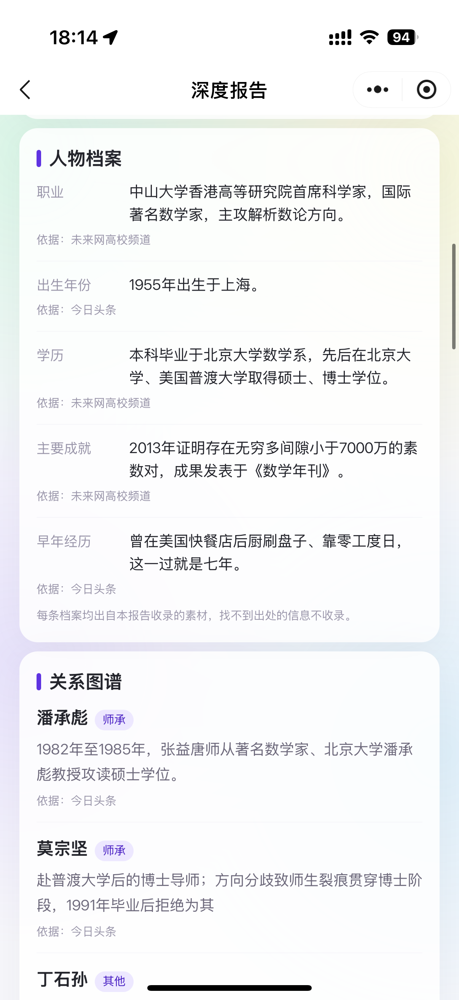<br><sub><b>报告页 2 / 7</b></sub></td>
  </tr>
  <tr>
    <td align="center">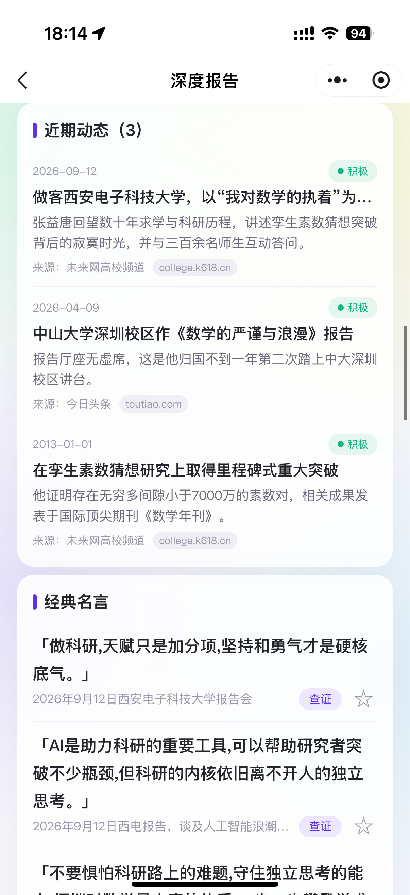<br><sub><b>报告页 3 / 7</b></sub></td>
    <td align="center">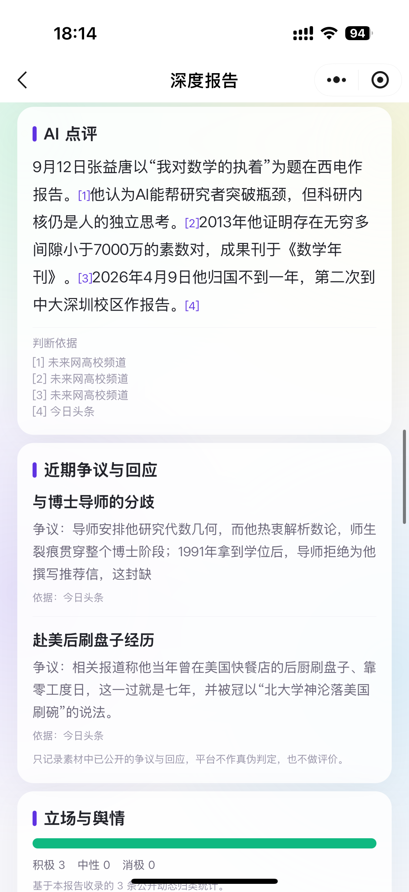<br><sub><b>报告页 4 / 7</b></sub></td>
  </tr>
  <tr>
    <td align="center">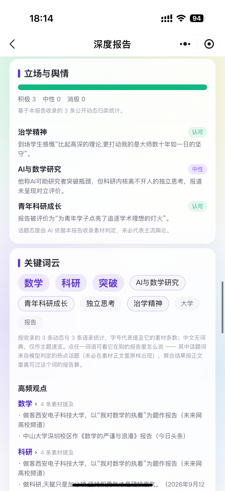<br><sub><b>报告页 5 / 7</b></sub></td>
    <td align="center">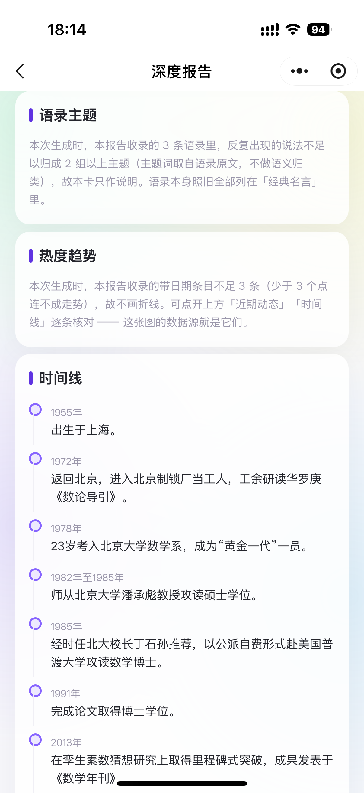<br><sub><b>报告页 6 / 7</b></sub></td>
  </tr>
  <tr>
    <td align="center">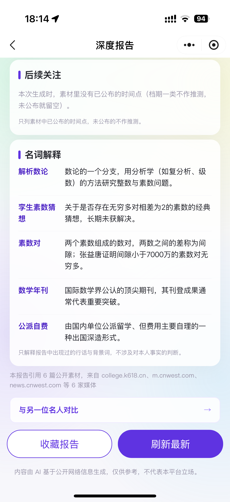<br><sub><b>报告页 7 / 7</b></sub></td>
  </tr>
</table>

#### 名人对比

复用两方缓存报告，零模型调用，可一键关注 / 分享。

<table>
  <tr>
    <td align="center">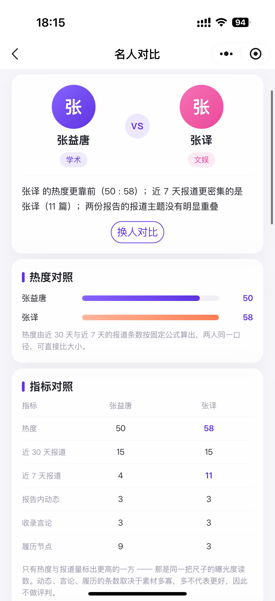<br><sub><b>对比页 1 / 3</b></sub></td>
    <td align="center">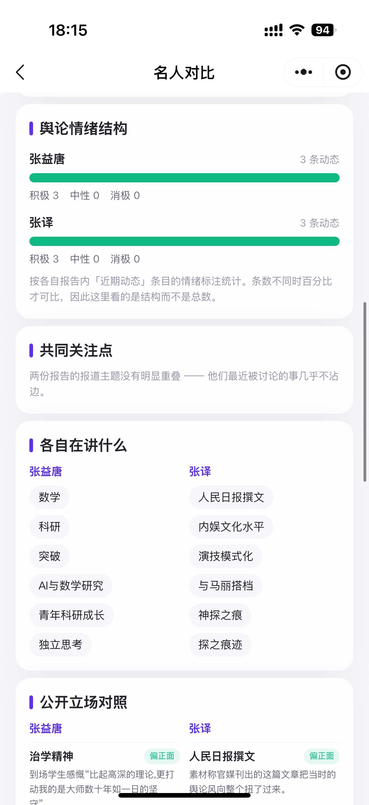<br><sub><b>对比页 2 / 3</b></sub></td>
  </tr>
  <tr>
    <td align="center">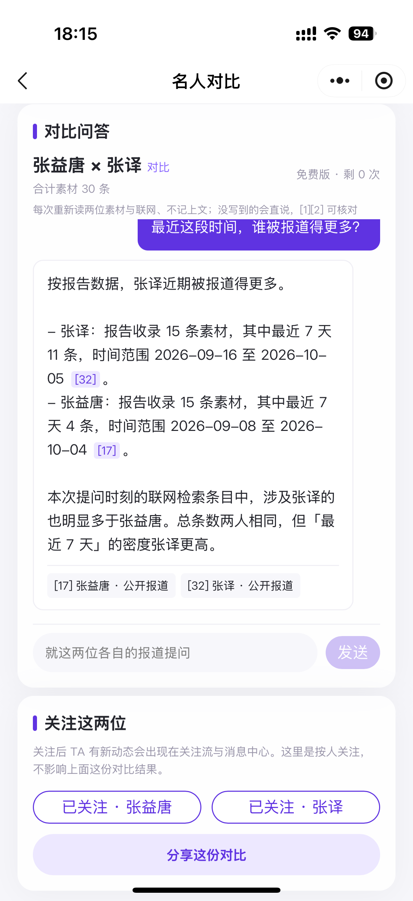<br><sub><b>对比页 3 / 3</b></sub></td>
  </tr>
</table>

#### 会员与配置

<table>
  <tr>
    <td align="center">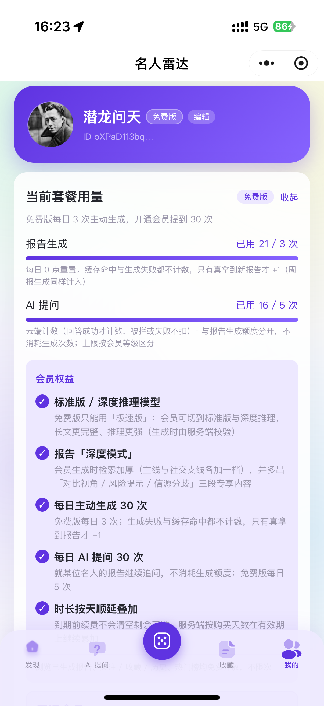<br><sub><b>我的</b> · 配额透明展示 / 会员权益</sub></td>
    <td align="center">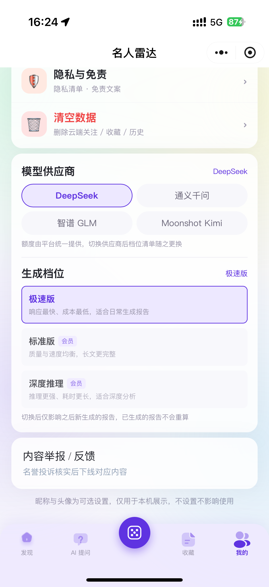<br><sub><b>模型供应商自选</b> · DeepSeek / 通义千问 / 智谱 GLM / Moonshot 任选</sub></td>
  </tr>
</table>

---

## 技术栈

- **框架** —— Taro 3.6（React 18）+ TypeScript：webpack5 编译
- **UI** —— Taro UI 3.x + SCSS（750 设计稿）：全局主题变量位于 `src/styles/`
- **状态** —— zustand：`src/stores/auth.ts` 等
- **校验** —— zod：报告 Schema 全字段校验
- **时间** —— dayjs：相对时间、ISO 周、配额日期键
- **云后端** —— 腾讯云 CloudBase（微信云开发）：数据库 + 云函数；环境 ID 由本地配置提供
- **检索源** —— 博查 `api.bochaai.com`：经云函数 `aiProxy` 代发
- **大模型** —— **四家 OpenAI 兼容端点任选**：DeepSeek / 通义千问（DashScope 兼容模式）/ 智谱 GLM / Moonshot Kimi，默认 DeepSeek（`https://api.deepseek.com/v1`）；端上可选项与三档位见 `src/config/public.ts`，四家端点、Key 变量名与会员档位见 `cloudfunctions/aiProxy/llm.config.js`（配置步骤见「[配置说明](#配置说明)」第 3 节）

依赖安装使用 `.npmrc` 中的 `legacy-peer-deps=true`；`@tarojs/plugin-platform-*` 钉在 `^3.6.25`（勿升级），webpack 钉 `~5.91.0`。

---

## 架构与核心链路

```
用户输入名人名
  → 本地敏感名单拦截（命中即拒答）
  → LLM 消歧 → 候选选人 → personKey
  → 命中 report_cache？──是→ 直接渲染（不触发生成）
       │否
       └→ 博查联网检索（api.bochaai.com）→ 素材
          → 大模型生成结构化 JSON（四家任选，经云函数 aiProxy 代发）→ zod 校验 + URL 白名单清洗
          → 写入 report_cache → 渲染报告
```

分层调用关系：

```
pages / components        页面与展示
     ↓
src/utils/**              业务逻辑与云访问层（页面唯一的调用出口）
     ↓
utils/db.ts               自建数据访问适配层（id ↔ _id 映射、分页续取、写兜底）
utils/cloud.ts            CloudBase 初始化与诊断
     ↓
cloudfunctions/**         10 个云函数（密钥、配额、机审、定时任务、支付）
     ↓
上游：博查检索 / 大模型（四家任选）/ 微信支付 / security.msgSecCheck
```

两个关键机制：

- **`report_cache.state = building` 作为跨设备生成互斥锁**：并发查同一人时仅一方代表生成，另一方等待读取结果。
- **缓存命中优先于冷却与配额**：命中即渲染，不消耗额度、不受冷却限制。

---

## 快速开始

### 你需要自备什么

环境：Node 16 / 18（建议 LTS）、微信开发者工具、已开通云开发的小程序 appid。

- **小程序 appid + 主体资质** —— 微信平台要求；不配则无法真机预览，无法上线
- **云开发环境（腾讯云 CloudBase）** —— 数据库与 10 个云函数都跑在这里；不配则登录与**全部** DB 调用不会发起，「我的」页显示「云服务未配置」
- **大模型 API Key（至少 `DEEPSEEK_API_KEY`）** —— 生成报告（经云函数 `aiProxy` 代打）。用户在「我的」页可以切到别家，**列出哪几家就要配哪几家的 key**（`QWEN_API_KEY` / `ZHIPU_API_KEY` / `MOONSHOT_API_KEY`）；没配的家用户一切过去就是「未配置额度」。不配则生成报错；已缓存报告的浏览、收藏仍可用
- **博查（Bocha）API Key** —— 联网检索素材；不配则检索为空，报告缺素材、时间线不完整
- **ICP 备案 / 服务类目** —— 上线审核；不配则只影响发布，不影响本地调试

### 安装与运行

```bash
git clone https://gitee.com/qianlonglove_admin/celebrity-radar.git
cd celebrity-radar/celebrity-radar

cp src/config/local.example.ts          src/config/local.ts                  # ① 端上本地配置（必做）
cp project.private.config.example.json  project.private.config.json          # ② 开发者工具私有配置
cp .env.example                         .env                                 # ③ 云函数部署密钥
npm install                                                                  # .npmrc 已开 legacy-peer-deps

npm run dev:weapp      # 开发模式（watch，产物 dist/）
npm run build:weapp    # 生产构建，产物 dist/
npm run build:h5       # H5 端构建（调试用）
```

用微信开发者工具导入 `celebrity-radar/` 目录（`miniprogramRoot: dist/`、`cloudfunctionRoot: cloudfunctions/`）；
开发期可勾选「不校验合法域名」先行联调。

### 三份本地配置

三份文件都**不进版本库**（已在 `.gitignore` 内），所以改动不会污染工作区、也不会随 PR 提交。

- **`src/config/local.ts`** —— 你自己小程序的真实值：云开发环境 ID、订阅模板 ID、业务域名白名单（`webviewDomains`）、本地调试开关。**必做**：`src/config/public.ts` 直接 import 它，没复制会编译报 `Cannot find module './local'`
- **`project.private.config.json`** —— 微信开发者工具的私有工程配置（你自己的 appid 与工具设置）。不配则开发者工具里每次都要重设 appid 等参数
- **`.env`** —— 云函数部署密钥（`DEEPSEEK_API_KEY` / `BOCHA_API_KEY` …），由 `cloudbaserc.json` 以 `${env.XXX}` 引用。不配则云函数部署后上游 key 为空，检索与生成都失败

---

## 配置说明

### 1. 端上配置：`public.ts`（进包）+ `local.ts`（不进包）

- **`src/config/public.ts`**（进版本库）—— 与部署无关的公共配置：可选**供应商**清单与各家的三档位、`memberOnly` 分档。**严禁写入任何 key**（key 在云函数环境变量里，用户切换供应商只是换一次请求参数）
- **`src/config/local.example.ts`**（进版本库）—— 本地配置**模板**，值全为占位串
- **`src/config/local.ts`**（不进版本库，已被 `.gitignore`）—— 你自己小程序的真实值：环境 ID、订阅模板 ID、业务域名白名单、本地调试开关

`local.ts`（首次 clone 后由 `local.example.ts` 复制而来）：

- **`cloudbaseEnvId`** —— CloudBase 环境 ID。保持占位串 `REPLACE_ME` 时云服务视为未配置，登录与 DB 调用不会发起
- **`subscribeTemplateId`** —— 关注更新订阅消息模板 ID，与云函数环境变量 `SUBSCRIBE_TEMPLATE_ID` 指向同一模板
- **`alertTemplateId`** —— 关键词预警的模板 ID，**必须与上一个不同**：微信一次性订阅授权**按模板**消耗，两个定时任务共用一个模板会互相吃掉授权位（先跑的用掉，后跑的必得 43101）
- **`riskTemplateId`** —— 名人风险监控的模板 ID，**同样必须与上面两个都不同**（同一个「按模板消耗」的道理）。留空则功能照常可用、只是不推送，风险信号仍在预警页展示
- **`webviewDomains`** —— 「原文预览」页可内嵌的业务域名白名单；留空则一律走「素材预览卡 + 复制链接」降级路径
- **`debug`** —— 本地调试开关（放开额度闸门与上游冷却）。**仓库默认全为安全值**（五项 `false` + `memberOverride: 'off'`），只在本地联调时改
- **`debug.memberOverride`** —— 强制会员身份，用于**自测付费功能**：`'off'`（默认）按云端真实发货结果判定；`'free'` 强制免费；`'monthly'` / `'quarterly'` / `'annual'` 强制对应档位会员。
  ⚠ 它只覆写**端上**判定（`utils/member.ts#readMemberState` 的最外层），**云端一概不认**：强制会员时检索条数仍被 `aiProxy` 按真实身份钳制、`quotaGuard` 的免计费复核也照旧 —— 所以「加厚检索」与「会员档位模型」这两件事测不出来，要看真实产物只能改云端的 `memberships` 集合（会员权威数据；`users.membership` 只是端上读的镜像，云函数不认它）。另：调试为会员时**不要测支付**（`utils/pay.ts` 靠 `expires_at` 是否变晚确认发货，覆写后它恒定不变）

`public.ts`：

- **`llm.providers`** —— 可选**供应商**清单：每家有 `id`（须与云函数 `llm.config.js` 的 `PROVIDERS` 键一致）、展示名，与 `models`（统一的三档：`fast` / `standard` / `reason` = 极速版 / 标准版 / 深度推理）。**只列你云端配了 key 的家** —— 用户切到哪家，云函数就用哪家的 key 代打，端上不持有任何凭据
- **`llm.provider` / `llm.model` / `llm.models`** —— 默认供应商、它的默认模型名、以及它的档位清单（后两者分别 = `providers[0]` 的 fast 档与 `providers[0].models`）。四家的档位标签完全一致（极速版 / 标准版 / 深度推理），所以会员文案（会员中心对比表、权益表）按它推导即可，加一家供应商不用改文案
- **`models[].memberOnly`** —— `true` = 会员专属：免费用户即使本机选了该档，生成时也会回落该家的极速版。**改这一列必须同步云函数 `aiProxy` 的 `llm.config.js` 里对应供应商的 `memberOnlyModels`**，那份才是计费闸门（端上这份改包即可绕过）

> 用户的供应商 / 档位偏好只存本机 storage（`settings:llm_provider` + `settings:llm_tier`）。
> 存的是**档位标识**而不是模型名，所以换供应商时「我选的那一档」跟着走（DeepSeek 标准版 → 通义千问标准版），
> 不需要用户重选一次；而档位清单整组换成那家的三档，这正是「换家 = 换档位参数」。

> 拆成两个文件的目的：仓库里留真实环境 ID，避免 fork 者直接连上原作者的云环境；
> 而作者本地为放开额度把 `debug` 置 true 的改动，混在 `public.ts` 里也总有误提交的风险。

### 2. 密钥归属：只在服务端，端上零密钥

- **`BOCHA_API_KEY` + 各家大模型的 key（`DEEPSEEK_API_KEY` / `QWEN_API_KEY` / `ZHIPU_API_KEY` / `MOONSHOT_API_KEY`）** —— 云函数 `aiProxy` / `hotBoardRefresh` 的环境变量（部署时从 `.env` 读）。**端上清单里列了哪几家，这里就要配齐哪几家**。❌ 不进包
- **`SUBSCRIBE_TEMPLATE_ID` / `ALERT_TEMPLATE_ID` / `RISK_TEMPLATE_ID`** —— 三个定时云函数各自的环境变量（**三者必须是不同模板**，否则互相吃掉一次性订阅授权）。❌ 不进包
- **`WX_APPSECRET`** —— 仅 `dbInit` 的环境变量（换 access_token 建索引时用）。❌ 不进包
- **`DB_ADMIN_TOKEN`** —— 仅 `dbInit` 的环境变量（自定义口令，写操作的闸门）。❌ 不进包
- **`AI_PROXY_TEST_TOKEN`** —— 仅 `aiProxy` 的环境变量（`test` 付费探针的口令；**不配则该动作一律拒绝**，这是期望的默认状态）。为运维口令而非部署项，通常只在控制台排障时临时加。❌ 不进包
- **`WX_PAY_SUB_MCH_ID` / `PAY_CALLBACK_ENV_ID`** —— `payCreate` 的环境变量。❌ 不进包
- **`PAY_ADMIN_TOKEN`** —— 仅 `payCallback` 的环境变量（退款 / 手动对账运营写口的口令；**不配则写口一律拒绝**）。❌ 不进包
- **`PAY_CALLBACK_GUARD`** —— 仅 `payCallback` 的**可选**环境变量，灰度开关：`log`（默认，端上调用只记日志）/ `strict`（拒绝端上调用）/ `off`（不判）。真机日志确认过回调形态后再切 `strict`。❌ 不进包
- **部署期的密钥来源（`.env` 本身）** —— `celebrity-radar/.env`（由 `.env.example` 复制，**不进版本库**），由 `cloudbaserc.json` 以 `${env.XXX}` 引用。❌ 不进包
- **环境 ID / 订阅模板 ID** —— `src/config/local.ts`。✅ 进包（**它们不是密钥**）

全部请求经云函数代发，客户端不持有任何 Key，用户零配置。历史版本曾支持「用户填自己的 Key」的本机直连（BYOK），**已整体移除**。

`src/config/local.ts` 会打进包，所以只该放「不是密钥、但跟机器走」的值。

### 3. 模型供应商与 Key（四家任选）

端上「我的 → 模型供应商」让用户自己挑用哪家，**Key 全部由你（平台）在云函数里出**，用户零配置。当前端上开放的是**四家**（顺序即「我的」页里的顺序）：

- **DeepSeek**（id `deepseek`）—— 变量名 `DEEPSEEK_API_KEY`；端点 `https://api.deepseek.com/v1`；三档 = `deepseek-v4-flash`（免费档）/ `deepseek-v4`、`deepseek-reasoner`（会员档）
- **通义千问**（id `qwen`）—— 变量名 `QWEN_API_KEY`；端点 `https://dashscope.aliyuncs.com/compatible-mode/v1`（DashScope 兼容模式）；三档 = `qwen-turbo` / `qwen-plus` / `qwen-max`
- **智谱 GLM**（id `zhipu`）—— 变量名 `ZHIPU_API_KEY`；端点 `https://open.bigmodel.cn/api/paas/v4`；三档 = `glm-4-flash` / `glm-4-air` / `glm-4-plus`
- **Moonshot Kimi**（id `moonshot`）—— 变量名 `MOONSHOT_API_KEY`；端点 `https://api.moonshot.cn/v1`；三档 = `moonshot-v1-8k` / `moonshot-v1-32k` / `moonshot-v1-128k`

配置步骤：

1. 把四家的 Key 逐个填进 `celebrity-radar/.env`（由 `.env.example` 复制而来），**变量名必须与上表一致**。
2. 确认 `cloudbaserc.json` 里 `aiProxy` 与 `hotBoardRefresh` 两个函数的 `envVariables` 含这四个变量名 —— 仓库里已经写好；若你不走 `tcb fn deploy` 而是用开发者工具右键上传，则要去云开发控制台逐项手工补。
3. 部署 `aiProxy` 与 `hotBoardRefresh`（`tcb fn deploy aiProxy && tcb fn deploy hotBoardRefresh`）。
4. 真机验证：在「我的 → 模型供应商」逐家切过去各生成一次，能出报告即为配通。

几条规则：

- **清单列了几家，就要配几家的 Key**。列了四家却只填一家的 Key，等于给用户三个必然报错的选项（切过去报「平台未配置大模型额度（云函数环境变量 `QWEN_API_KEY`）」）。
- **不想提供某一家**：从 `src/config/public.ts` 的 `llm.providers` 里删掉那一项（会员中心文案会跟着变），而**不是**"留着入口但不填 Key"。
- **`LLM_PROVIDER` 只是云端兜底**，不是「选哪家」的总开关。它只在两种情况下生效：端上没带供应商、或带了个供应商表里没有的 id（老版本包 / 改包）。定时任务 `hotBoardRefresh` 没有端上偏好，走的正是这条，默认 `deepseek`。
- **改会员档位要同时改两处**：端上 `public.ts` 各家的 `memberOnly`（管 UI 与请求值）与云函数 `llm.config.js` 的 `memberOnlyModels`（**管计费闸门**）。只改端上，改包即可白拿会员档。
- **`OPENAI_API_KEY` 默认用不上**：`llm.config.js` 里有 OpenAI 这一项，但境内云函数连不上官方端点，端上清单里也**故意没有列它**（列了只会多一个必然失败的选项）。要接自建中转，见下一条。
- **自建网关 / 中转站**：给 `aiProxy` 加 `LLM_BASE_URL` + `LLM_MODEL` + `LLM_API_KEY` 三个环境变量即可覆盖整张供应商表，`LLM_PROVIDER` 都不用改。⚠ 但 `LLM_MODEL` 是**全局覆盖**，会把所有用户锁到同一个模型上（端上仍显示各自选的档位），只当排障 / 中转开关，别当常态配置。
- **想长期多加一家**：① 端上 `public.ts` 的 `llm.providers` 补一项；② 云函数 `aiProxy` 与 `hotBoardRefresh` 下的**两份** `llm.config.js` 各补一份配置（两份必须逐字一致 —— 微信云函数各自独立打包，跨目录 require 在部署后必然失效）；③ `.env` 与 `cloudbaserc.json` 补该家的 Key 变量名；④ 会员档位两处口径对齐。

---

## 部署

顺序有依赖：先建好集合与权限，函数里的读写才不会静默失败。会员支付、订阅推送与三个定时任务都是**可选**的 —— 先把「搜人名 → 生成报告」这条主链路跑通，再回来配。

### 1. 开通云开发，填环境 ID

1. 用微信开发者工具导入 `celebrity-radar/` 目录（`miniprogramRoot: dist/`、`cloudfunctionRoot: cloudfunctions/`），
   此时会要求填 appid —— 填你自己的（或直接改 `project.config.json`）。
2. 工具栏「云开发」→ 开通环境，记下**环境 ID**（形如 `celebrity-radar-1a2b3c4d`）。
3. 把环境 ID 填到两个地方：

| 位置 | 字段 | 谁读它 |
|---|---|---|
| `src/config/local.ts` | `cloudbaseEnvId` | 小程序端 `wx.cloud.init` |
| `.env` | `TCB_ENV_ID` | `cloudbaserc.json` 的 `envId`，即 CloudBase CLI 部署时 |

若你的 CloudBase CLI 版本不解析该变量，直接把 `cloudbaserc.json` 顶部的 `envId` 写成环境 ID 字面值即可。

### 2. 部署云函数（10 个）

`.env` 里要填的是**博查 Key + 四家大模型的 Key**，缺哪家，用户在「模型供应商」切到那家就会报「未配置额度」：

```
BOCHA_API_KEY=...
DEEPSEEK_API_KEY=...
QWEN_API_KEY=...
ZHIPU_API_KEY=...
MOONSHOT_API_KEY=...
```

**哪几家对用户可见，由端上 `src/config/public.ts` 的 `llm.providers` 决定**（当前四家）；只想开其中几家时，删端上清单里的项，而不是不填 Key —— 详见「配置说明 → 3. 模型供应商与 Key」。

```bash
npm i -g @cloudbase/cli     # 只需一次
tcb login                   # 只需一次
cd celebrity-radar/celebrity-radar
tcb fn deploy aiProxy       -e <your-env-id>
```

`cloudbaserc.json` 已声明函数、环境变量与定时器，逐个 `tcb fn deploy <函数名>` 即可。

- **`aiProxy`** —— 平台代付上游密钥（`search` / `chat`）+ **云端闸门**（会员身份读 `memberships`、每日上限按 `quota.config.js`、防滥用就地自增 `ai_calls`、素材加厚按 `count` 分档）+ 对话输出上限（所有请求都下发，见 `chatMaxTokens`）+ **共享缓存写口**（`action:'report'`：`acquire` / `release` / `save` / `saveFeed`）；**供应商由端上请求指定**（用户自选），云端只兜底。触发：端上调用；环境变量：`BOCHA_API_KEY` `LLM_PROVIDER` + 四家的 Key（`DEEPSEEK_API_KEY` `QWEN_API_KEY` `ZHIPU_API_KEY` `MOONSHOT_API_KEY`）+ `OPENAI_API_KEY`（默认用不上）+ `AI_PROXY_TEST_TOKEN`（可选：`test` 探针口令，**不配则该动作一律拒绝**）
- **`quotaGuard`** —— 配额计数权威（原子自增 + 服务端日期），`refresh` / `generate` / `ask` 三类。触发：端上调用；环境变量：—
- **`contentCheck`** —— 内容安全机审（云调用 `security.msgSecCheck`），送检源 = AI 提问。触发：端上调用；环境变量：—
- **`hotBoardRefresh`** —— 热门名人榜每日生产（写 `hot_board`）。触发：定时 06:30；环境变量：`BOCHA_API_KEY` `LLM_PROVIDER` + 四家的 Key（定时任务没有端上偏好，取 `LLM_PROVIDER`，默认 DeepSeek，因此**这家必须配 Key**）
- **`notifyFollowUpdates`** —— 关注更新订阅消息推送。触发：定时 09:00（**拒绝端上调用**）；环境变量：`BOCHA_API_KEY` `SUBSCRIBE_TEMPLATE_ID`
- **`keywordAlert`** —— 关键词舆情预警（按订阅词检索并写 `keywords`）。触发：定时 09:20（**拒绝端上调用**）；环境变量：`BOCHA_API_KEY` `ALERT_TEMPLATE_ID`
- **`riskWatch`** —— 名人风险监控（按被监控的人检索、写 `risk_signals` 并推送）。触发：定时 09:40（**拒绝端上调用**）；环境变量：`BOCHA_API_KEY` `RISK_TEMPLATE_ID`
- **`payCreate`** —— 会员下单（服务端定价 + 云支付统一下单）。触发：端上调用；环境变量：`WX_PAY_SUB_MCH_ID` `PAY_CALLBACK_ENV_ID`
- **`payCallback`** —— 支付链路的**唯一后端**：支付结果通知（金额校验 + 幂等续期会员）+ **售后**（退款运营写口 `adminOp:'refund'` / 手动对账 `adminOp:'reconcile'`）。触发：微信支付回调（**端上调用受闸门约束**，见下）+ 定时对账 `payReconcile`（每小时第 15 分）；环境变量：`PAY_ADMIN_TOKEN`（运营写口口令，不配则写口一律拒绝）+ `PAY_CALLBACK_GUARD`（可选灰度开关）
- **`dbInit`** —— 运维工具：建集合 / 比对字段 / 建·改索引（端上不调用）。触发：手动；环境变量：`DB_ADMIN_TOKEN` `WX_APPID` `WX_APPSECRET`

几条容易踩的：

- **「配置是否随部署生效」取决于部署方式**：`tcb fn deploy`（CloudBase CLI）会读仓库根 `cloudbaserc.json`，把环境变量、超时、触发器一并下发；微信开发者工具右键「上传并部署」**只上传代码**，不读 `cloudbaserc.json` ⇒ 环境变量 / 超时 / 触发器都得去控制台补。
- `aiProxy`、`hotBoardRefresh`、`notifyFollowUpdates` 的执行超时必须是 **60 秒**（`aiProxy` 内还要满足 `LLM_CHAT_TIMEOUT_MS = 50000` 更小），否则长报告、热门榜一轮「6 检索 + 1 生成」、推送一轮最多 20 次检索都会被平台提前掐断（端上 `-504003`）。
- `dbInit` 是**运维工具、不是运行时依赖**：只在建集合 / 建索引时部署，用完 `tcb fn delete dbInit` 即可（用法见第 3 节）。
- `contentCheck` 无环境变量（走云调用，凭证由平台托管），唯一前提是 `cloudfunctions/contentCheck/config.json` 里的 `permissions.openapi` **随上传生效**；缺这条声明时端上按 **fail-open** 静默放过。⚠ 它没法用控制台「云端测试」验（需要真实 `openid`），只能在真机问答页验。
- **端上不能触发定时任务与支付回调（调用方闸门）**：云函数部署后端上 `wx.cloud.callFunction` 就能调到它，而 4 个定时推送函数（`notifyFollowUpdates` / `keywordAlert` / `riskWatch`）与 `payCallback` 本就不该由端上调用 —— 端点判据是 `getWXContext().OPENID`（端上调用必带，定时器 / 微信回调 / 控制台「云端测试」都不带）。前三个**一律拒绝**端上调用；`hotBoardRefresh` 保留端上 `action:'ensure'` 补跑链路，**只拦端上 `force`**；`payCallback` 用 `PAY_CALLBACK_GUARD` **灰度**：默认 `log` 只记日志，在真机日志里确认过支付回调不带 `openid` 后再切 `strict`（即便判错，定时对账也会把滞留的 `granting` 补上，不会永久丢单）。

**没有必装清单，按需部署即可**（不用的功能不部署，也不影响其他部分）：

- **必装**：`aiProxy` —— 生成报告 / 检索 / AI 问答都走它。
- **建议（现在实际算必装）**：`quotaGuard` —— 云端闸门读的就是它写的计数；不部署 = 三张配额表恒空 ⇒ 每日上限在云端形同不存在（端上仍会自己拦，但那正是「改包即可绕过」的那半边）。部署顺序见第 3 节。
- **可选**：`contentCheck`（机审，fail-open，不部署只是少一道合规兜底）、`hotBoardRefresh`（首页热门榜，需定时触发器 06:30）、`notifyFollowUpdates` / `keywordAlert` / `riskWatch`（三路订阅推送，各需一枚独立模板 + 定时触发器）、`payCreate` / `payCallback`（会员支付，需自己的商户号）。
- **运维工具**：`dbInit`，用完即删。

### 3. 建集合与权限（18 张集合）

CloudBase 文档型数据库。端上写业务字段 `id`，由 `utils/db.ts` 映射到系统主键 `_id`。

| 集合 | 用途 | 权限 |
|---|---|---|
| `users` | 账号与设置（首登自动写入）；`membership` 是端上读口的**镜像**，权威在下方 `memberships` | 仅创建者可读写 |
| `memberships` | **会员权益权威**（`_id` = openid）：只由 `payCallback` 发货与**退款撤销**时写；云端判档位与免计费都读它 | **客户端不可读写**（仅云函数） |
| `ai_calls` | 防滥用限速计数（`_id` = openid#yyyy-MM-dd）：`aiProxy` 放行上游前就地自增，是成本侧的硬边界 | **客户端不可读写**（仅云函数） |
| `report_cache` | 报告缓存 + `building` 生成互斥锁（全局共享、长期复用） | 所有人可读、**客户端不可写**（写入只能走 `aiProxy` 的 `action:'report'`） |
| `feed_cache` | 检索结果结构化映射（不存 LLM 产物） | 所有人可读、**客户端不可写**（同上，`op:'saveFeed'`） |
| `hot_board` | 热门名人榜（AI 每日写，`_id` 固定 `latest` 覆盖写） | 所有人可读、客户端不可写 |
| `keywords` | 关键词检索缓存（全局共享） | 所有人可读、客户端不可写 |
| `refresh_quota` | 关注流每日刷新 ≤ 10 次（`openid#yyyy-MM-dd`） | 本人可读、不可写（写仅限云函数） |
| `generate_quota` | 报告每日生成配额（免费 3 / 会员 30） | 本人可读、不可写（同上） |
| `ask_quota` | AI 提问每日配额（免费 5 / 会员 30，成功才计数） | 本人可读、不可写（同上） |
| `orders` | 会员订单状态机（`pending → granting → paid` / `failed` / `refunded`；`refunded` 由运营写口置入、对账任务据此撤销会员） | 本人可读、不可写（写仅限支付云函数） |
| `follows` | 关注列表（`openid#personKey`） | 仅创建者可读写 |
| `favorites` | 收藏（四类，`openid#type#hash` 防重） | 仅创建者可读写 |
| `history` | 浏览历史（保留 50 条） | 仅创建者可读写 |
| `events` | 埋点 | 仅创建者可读写 |
| `keyword_watches` | 关键词订阅（`openid#关键词哈希`，与 `follows` 同构）；兼存名人监控行（`type='person'`，`openid#person#personKey`） | 仅创建者可读写 |
| `risk_scans` | 名人风险扫描快照（`_id = personKey`）：记「上次扫到哪」，判断哪些条目是新的 | 所有人可读、客户端不可写 |
| `risk_signals` | 风险信号流水（`_id = personKey#url 哈希`） | 所有人可读、客户端不可写 |

建库与权限的现状（fork 者必读）：

- **集合**可由运维函数 `dbInit` 一键建齐（`cloudfunctions/dbInit/schema.js` 是库结构的**单一事实源**）。
- **权限必须在控制台手工设置** —— 没有任何接口能改集合权限，需在上表逐张集合手工配置。
- **索引可以程序化**：由 `dbInit` 走微信 HTTP API「更新索引」建 / 改（需 `WX_APPID` / `WX_APPSECRET`），或在控制台手工建。
- **哪些还没设**？用 `dbInit` 的 `{"action":"report"}` 一查即知，返回里的 `permissions_manual` 就是要手工点的那份清单。

控制台**没有**「所有人可读、登录可写」这类预设，改权限时要选「自定义安全规则」，按下表四档填（取值与 `cloudfunctions/dbInit/schema.js` 的 `ACL` 一一对应）：

| 档位 | 安全规则（JSON） | 用在哪几张集合 |
|---|---|---|
| 仅创建者可读写 | 控制台预设，直接选 | `users` / `follows` / `favorites` / `history` / `events` / `keyword_watches` |
| 本人可读、不可写 | `{"read": "doc._openid == auth.openid", "write": false}` | `refresh_quota` / `generate_quota` / `ask_quota` / `orders` |
| 所有人可读、客户端不可写 | `{"read": true, "write": false}` | `hot_board` / `keywords` / `risk_scans` / `risk_signals` / `report_cache` / `feed_cache` |
| 客户端不可读写 | `{"read": false, "write": false}` | `memberships` / `ai_calls` |

```bash
tcb fn deploy dbInit -e <your-env-id>
tcb fn invoke dbInit -e <your-env-id> --params '{"action":"report"}'                  # 只读巡检：先看缺什么
tcb fn invoke dbInit -e <your-env-id> --params '{"action":"init","token":"<口令>"}'   # 建缺失的集合
```

⚠ **写操作需要口令**：先给 `dbInit` 配环境变量 `DB_ADMIN_TOKEN`（自定义随机串），调用时带 `"token":"<同一个串>"`；
未配置该变量时写操作**一律拒绝**（只读巡检不受限）—— 这是防止「云函数被端上任意调用」的闸门，别省。
`action` 另有 `fields`（字段比对）/ `indexes`（索引计划）/ `sync`（一步到位），带 `apply: true` 才真正落库。

**权限最容易出事的三条**：

- 三张配额表（`generate_quota` / `refresh_quota` / `ask_quota`）必须设成「本人可读、**不可写**」，否则用户能自己改额度 ⇒ 免费层失效。
  ⚠ 必须先部署 `quotaGuard` 再收紧权限，顺序颠倒会让端上回退写入被拒、计数恒为 0。
- `memberships` / `ai_calls` 必须设成「**客户端不可读写**」：它们是服务端权威（会员身份、防滥用计数），端上碰得到就等于自己发会员、自己清计数。端上要显示的会员信息读的是 `users.membership` 那份镜像。
- `report_cache` / `feed_cache` 是「所有人可读、**客户端不可写**」的共享缓存：**写入只能走 `aiProxy` 的 `action:'report'`**。
  它们原先「登录可写」，而这等于把全站共享内容（含会员段）的写权交给任意登录用户 —— 可覆盖任意人物的报告正文、伪造或抹掉会员段、写 `state=building` 让全站对该人物的查询排队。收紧后由服务端把关：只能写自己持锁的那一行、非会员写不进会员段、体积与形状受检、调用留痕。
  ⚠ **顺序同样不可颠倒**：先部署带写口的 `aiProxy` 并发布端上（端上写口不可用时回退直写；直写失败降级为「不写缓存但照常出报告」，不抛错），**待旧版本覆盖率达标后**，才把这两张表改成 `{"read": true, "write": false}`。先收紧 = 未更新的客户端一进报告页就写锁失败、直接拿不到报告。

### 4. 域名与后台配置

端上代码 `npm run build:weapp` 产出到 `dist/` 后，微信开发者工具直接刷新即可；浏览器调试用 `npm run build:h5`，云开发相关功能不可用。

真机预览与上线前，还要在「微信公众平台 → 开发管理」与小程序后台配好：

- **request 合法域名**：**不需要配**。端上没有任何直连上游的请求 —— 博查检索与四家大模型全部由云函数代发，而云函数出网不受小程序域名白名单约束（云数据库 / 云函数走 `wx.cloud`，也不占域名）
- **业务域名**（可选）：只有想让「原文预览」页内嵌外站时才需要，填进 `src/config/local.ts` 的 `webviewDomains`（只写主域名，不带协议与路径）；不填则一律走「素材预览卡 + 复制链接」的降级路径
- **隐私协议**：收集项为「匿名标识 openid、本地存储」，须与代码实际收集项一致
- **客服功能**：开通并绑定客服人员（「内容举报 / 反馈」依赖 `open-type="contact"`）

### 5. 会员支付（可选）

代码已完整落地（`payCreate` / `payCallback` + `utils/pay.ts` + 「我的」页入口），但要人工配置才能用：

1. 云开发控制台开通微信支付并绑定商户号；
2. 给 `payCreate` 配环境变量 `WX_PAY_SUB_MCH_ID` 与 `PAY_CALLBACK_ENV_ID`；
3. 部署 `payCallback`（`cloudbaserc.json` 已带 `PAY_ADMIN_TOKEN` 与定时触发器 `payReconcile`）；
4. 给 `payCallback` 配环境变量 `PAY_ADMIN_TOKEN`（运营写口口令）。

支付回调函数名由 `payCreate` 内的 `functionName: 'payCallback'` 指定，**改名会收不到通知**。
未配置时端上明确提示「微信支付未配置 / 支付服务未部署」，且不影响免费功能（仍按免费版 3 次/日）。

**调用方闸门（灰度）**：`payCallback` 部署后端上可被直接调用，任何人都能用「自下单 + 伪造回调」给自己发货。闸门按 `getWXContext().OPENID` 判端上调用，由环境变量 `PAY_CALLBACK_GUARD` 控制（默认 `log` 只记日志）。**先用默认值跑一段时间**，在云函数日志里确认真机支付回调**不带** `openid` 后，再改成 `strict`（拒绝端上调用）。

**退款与对账（售后闭环）**：退款发生在微信商户平台，业务侧感知不到，故由运营写口把订单置 `refunded` —— 在云开发控制台「云端测试」里调：

```json
{ "adminOp": "refund", "token": "<PAY_ADMIN_TOKEN>", "outTradeNo": "MR...", "reason": "用户申请退款" }
```

置位后**只改订单状态、不碰会员**；会员撤销交给定时对账 `payReconcile`（每小时第 15 分，也可用 `{ "adminOp": "reconcile", "token": "..." }` 手动触发）。撤销按「这一单确实发过货」扣减 `max(now, 原有效期 − 该单天数)` 天，并靠权威行 `memberships.refunded_orders` 名单保证**只扣一次**。对账还兼补两类残留：`granting` 超时补发货、权威与镜像不一致时**以权威覆盖镜像**（端上伪造的会员会被抹掉）。

### 常见卡点

| 现象 | 原因 | 处理 |
|---|---|---|
| 编译报 `Cannot find module './local'` | 没复制 `src/config/local.ts`（快速开始的 ①） | 见「[快速开始](#快速开始)」→ 安装与运行 |
| 「我的」页显示「云服务未配置」 | `local.ts` 的 `cloudbaseEnvId` 还是 `REPLACE_ME` | 填自己的环境 ID（第 1 节） |
| 生成报错、端上 `-504003` | 云函数超时仍是默认 20 秒（用开发者工具上传的） | 控制台把超时改成 60 秒（第 2 节） |
| 检索有结果但报告内容空 | 模型返回超时或 JSON 校验不过 | 看 `aiProxy` 日志；默认模型名必须是上游真实存在的 |
| 免费额度怎么点都不减 | 配额表权限没收紧，或 `quotaGuard` 部署顺序颠倒 | 见第 3 节 |
| 订阅推送收不到（43101） | 三个定时任务共用了同一枚模板 | `subscribeTemplateId` / `alertTemplateId` / `riskTemplateId` 必须是三个不同模板 |
| 会员开通点击无反应 | 未配商户号 / 未部署 `payCallback` | 见第 5 节，不影响免费功能 |
| 改包后额度形同不存在 | `ai_calls` / 三张配额表的权限没收紧 | 见第 3 节：`ai_calls` 与 `memberships` 必须是「客户端不可读写」 |
| 端上显示会员、云端却按免费档 | `memberships` 里没有这一行（发货只写了镜像） | 让用户重进一次支付回调所在的订单页触发重试；或核对 `payCallback` 日志 |
| 端上能给自己发货 | `payCallback` 的 `PAY_CALLBACK_GUARD` 仍是默认 `log`（只记不拦） | 在日志里确认真机回调不带 `openid` 后改成 `strict`（第 5 节） |
| 已退款的用户还是会员 | 订单未置 `refunded`，或对账任务还没跑到 | 用 `adminOp:'refund'` 置位；对账每小时跑一次，可手动 `adminOp:'reconcile'`（第 5 节） |

### 上线前检查清单

- [ ] 小程序类目与主体资质符合「资讯 / AI 生成内容」相关要求
- [ ] 隐私协议已配置，且与实际收集项（openid、本地存储）一致
- [ ] 保留 AI 生成内容标识（项目内置：「AI 生成，仅供参考」角标与报告页声明）
- [ ] `src/utils/sensitive.ts` 的 `SENSITIVE_NAMES` 已按最新要求补充（⚠ 这是**留给运营人工填**的，仓库里是空数组）
- [ ] `src/config/local.ts` 的 `debug` 五项全为 `false`、`memberOverride` 为 `'off'`（仓库默认即为安全值；否则免费层限流与 429 冷却保护失效，且会把自己伪装成会员去自测付费功能）
- [ ] `memberships` / `ai_calls` 已在控制台设为「**客户端不可读写**」（会员与成本两道权威都在这里；没设 = 端上能自己发会员、自己清计数）
- [ ] `aiProxy` **未**配置 `AI_PROXY_TEST_TOKEN`（或已配置但不外泄）：`test` 探针每次调用都真花钱，未配置时它会一律拒绝
- [ ] 已部署会员支付时，`payCallback` 的 `PAY_CALLBACK_GUARD` 已确认真机回调形态并切为 `strict`（默认 `log` 只观察不拦，等于端上仍能伪造回调发货）
- [ ] 已部署会员支付时，`payCallback` 已配 `PAY_ADMIN_TOKEN` 且不外泄（退款 / 对账运营写口的口令，不配则写口一律拒绝）
- [ ] 已在真机跑过主要验收路径（搜索 → 消歧 → 生成 → 收藏 / 分享 / 问答）

---

## 项目结构

下列路径相对 `celebrity-radar/` 子目录；仓库根另有 `README.md` / `README.en.md` / `LICENSE` / `NOTICE` / `CHANGELOG.md` / `CONTRIBUTING.md` / `SECURITY.md` / `CODE_OF_CONDUCT.md` / `assets/screenshots/`。

另有 `doc/` 为作者本地的设计与联调文档，已在 `.gitignore` 中排除（`/doc/`），**不随仓库分发**。

```
celebrity-radar/
├── src/
│   ├── pages/                  # 19 个页面
│   │   ├── index/              # 发现（tabBar）
│   │   ├── ask/                # AI 提问（tabBar）
│   │   ├── collection/         # 收藏（tabBar）
│   │   ├── mine/               # 我的（tabBar）
│   │   ├── report/             # 报告页（核心）
│   │   ├── profile/            # 名人主页
│   │   ├── feed/               # 关注流
│   │   ├── following/          # 关注列表
│   │   ├── weekly/             # 本周周报
│   │   ├── compare/            # 两位名人横向对比
│   │   ├── qa/                 # AI 问答（报告页入口）
│   │   ├── topic/              # 主题知识库
│   │   ├── alerts/             # 关键词舆情预警
│   │   ├── messages/           # 消息中心
│   │   ├── history/            # 浏览历史
│   │   ├── records/            # 收藏 / 记录入口
│   │   ├── link-preview/       # 素材原文预览
│   │   ├── member/             # 会员中心
│   │   └── agreement/          # 隐私与免责
│   ├── components/             # person-card / favorites-view / report-loading / share-poster / qa-panel 等
│   ├── utils/                  # 业务与云访问层（48 个模块，见「核心模块」）
│   ├── config/                 # public.ts（公共配置）/ local.ts（本地配置，不进库）/ domains / hot / filters / notices
│   ├── stores/                 # zustand store
│   ├── styles/                 # 主题变量、底栏图标
│   └── custom-tab-bar/         # 自定义底部菜单
├── cloudfunctions/             # 10 个云函数
│   ├── aiProxy/                # 平台代付密钥闸门 + 会员 / 配额 / 限速闸门（test / search / chat / report 写口）
│   ├── quotaGuard/             # 配额计数权威（原子自增 + 服务端日期）
│   ├── contentCheck/           # 内容安全机审（云调用）
│   ├── payCreate/              # 会员下单（服务端定价 + 云支付统一下单）
│   ├── payCallback/            # 支付通知 + 售后（退款写口 / 定时对账，定时 每小时:15；after-sales.js）
│   ├── notifyFollowUpdates/    # 关注更新订阅消息（定时 09:00，拒绝端上调用）
│   ├── keywordAlert/           # 关键词舆情预警（定时 09:20，拒绝端上调用）
│   ├── riskWatch/              # 名人风险监控（定时 09:40，拒绝端上调用）
│   ├── hotBoardRefresh/        # 热门名人榜每日生产（定时 06:30；端上仅 ensure，force 限运维）
│   └── dbInit/                 # 运维工具（schema.js 是库结构单一事实源）
├── test/                       # 本地单测（11 个用例文件 / 572 条用例）
├── config/                     # Taro 构建配置（dev / index / prod）
├── cloudbaserc.json            # CloudBase 部署描述（函数 + 环境变量 + 定时器）
├── .env.example                # 云函数部署密钥模板
├── project.config.json         # 微信开发者工具工程（miniprogramRoot: dist/）
└── project.private.config.example.json
```

---

## 核心模块

`src/utils/` 是全部业务逻辑与云访问的唯一出口（页面只调这里，不直接碰 DB 与上游）。

- **`cloud.ts` / `db.ts`** —— CloudBase 初始化与诊断；自建数据访问适配层（`table('x').select/eq/or/upsert/maybeSingle`），`id ↔ _id` 双向映射、分页续取、写操作兜底
- **`auth.ts`** —— 微信登录 + `users` 首次初始化；并发登录去重、登录态落盘、脏缓存拒绝
- **`search.ts`** —— 博查适配器（无 Key 降级），素材归一为 `NewsItem`；提问用的 `searchForAsk`
- **`disambiguate.ts`** —— LLM 同名消歧 + 领域码枚举 + 兜底
- **`report.ts`** —— 报告生成、zod 校验、URL 白名单清洗、降级纯文本
- **`cache.ts`** —— `report_cache` 读写 + `building` 互斥、`feed_cache`、`refresh_quota`
- **`quota.ts` / `quota-guard.ts`** —— freemium 生成配额与它的服务端通道（未部署时静默回退端上计数）
- **`llm.ts`** —— LLM 调用：统一经 `aiProxy` 代付；**供应商 + 档位**由本机偏好 + `public.ts` 裁决（换供应商不换档），非会员请求会员档位一律回落该家极速版
- **`member.ts` / `member-sample.ts`** —— 会员权益表（唯一事实源）+ 会员判定 + 报告页会员价值条文案；会员中心「真实示例」（只节选不改写、挑不到就不出卡）
- **`pay.ts`** —— 会员支付：拉取服务端套餐（24h 本机缓存 + 离线兜底）+ 下单 + 拉起收银台 + 轮询确认（价格与时长**只认服务端**）
- **`qa.ts`** —— AI 问答：报告片段选片 + 提问时联网检索 + 每日额度闸门（回答成功才计数）+ 3 秒连点间隔
- **`weekly.ts`** —— 关注周报：材料只读 `feed_cache`，LLM 只写文字（人 / 条目以材料为准），按 ISO 周本机缓存
- **`hot-board.ts` / `explore.ts`** —— 热门榜三级回退读取；「今日名人」与随机探索（种子稳定，xorshift32 去取模偏置）
- **`keyword-alert.ts` / `keywords.ts`** —— 关键词订阅与预警条目；关键词云 + 高频观点（纯端上聚合，存量缓存立即生效）
- **`risk-watch.ts` / `risk.ts`** —— 名人风险监控的订阅读写与信号分组；报告页风险雷达的事实级清单（两端共用同一份词典，测试钉住一致）
- **`topic-digest.ts` / `compare.ts` / `stats.ts` / `trend.ts`** —— 主题编目 / 两人对比 / 主页数据 Tab / 热度趋势折线 —— 全部纯端上聚合，不新增 Schema 字段与云函数
- **`quote-check.ts` / `source-link.ts`** —— 名言出处核对（只核对可核对的事实）；原文预览页的唯一跳转出口
- **`messages.ts` / `notify.ts`** —— 消息中心时间流与已读口径；微信订阅消息授权与推送落位
- **`share-card.ts` / `share.ts`** —— Canvas 2D 名言卡（零网络图依赖、不落云存储）；全项目唯一分享文案出口
- **`sensitive.ts` / `sec-check.ts`** —— 本地敏感名单一级拦截（发版前人工维护）；内容机审（fail-open）
- **`follows.ts` / `favorites.ts` / `history.ts` / `watch.ts`** —— 关注列表（主键 `openid#personKey`）/ 四类收藏（主键 `openid#type#hash`，天然防重）/ 查询历史（每账号仅留最近 50 条）/ 关注对象的「变化概览」（材料只读 `report_cache` 与 `feed_cache` 两张表）
- **基础件** —— `time.ts`（相对时间 / 报告过期天数唯一阈值）、`date.ts`（报告日期归一，热度趋势与时间分布共用的唯一解析口径）、`cooldown.ts`（429 冷却 10 分钟）、`debug.ts`（调试开关集中出口）、`cloud-diagnostics.ts`（结构化诊断日志）、`settings.ts`、`events.ts`、`tabbar.ts`、`data-deletion.ts`

---

## 安全与合规

- **密钥永不进包**：端上只存本地 storage，服务端只存云函数环境变量
- **输入侧**：本地敏感名单一级拦截，命中即拒答，**不发任何网络请求**
- **输出侧**：报告 `sources` / `dynamics` 链接强制 URL 白名单清洗，只保留检索素材中出现过的链接
- **内容口径**：全链路标注「AI 生成，仅供参考」；隐私声明页 + 举报入口 + 「清空我的数据」二次确认
- **运行成本**：报告缓存共享复用、每账号每日刷新 ≤ 10 次、主动生成 ≤ 3 次（会员 30）、`building` 互斥避免并发重复生成、关注周报按自然周本机缓存
- **档位决定检索厚度**：免费档只发主线检索（10 条素材），会员档主线 24 + 社交支线 16（共 40 条）—— 检索调用与素材量都随档位走
- **免费档刷新冷却**：同一人物的「刷新最新」在报告生成后 12 小时内不重复生成（内容本就不会变，直接交回现有的一版并说明），会员不受此限。**注意它与上一条「上游失败冷却」不是一回事**，两者判据、时长、目的都不同
- **冷却只拦「值得等待」的失败**：仅上游限流 429 / 网络 / 5xx 进入 10 分钟冷却；密钥无效、额度不足即时报错且不冷却；缓存命中永远优先于冷却与配额
- **云函数调用方闸门**：端上调用必带 `getWXContext().OPENID`，定时器 / 微信回调 / 控制台「云端测试」都不带 —— 4 个定时任务与支付回调据此**拒绝端上调用**（`payCallback` 走 `PAY_CALLBACK_GUARD` 灰度，默认先观察后切 `strict`）。挡的是「改包后循环触发推送 / 伪造支付回调给自己发货」
- **售后闭环**：退款由运营写口置 `refunded`，对账任务据此**按订单天数**撤销会员（只扣这一单买的天数、靠权威行名单幂等）；对账同时补发货、并以权威覆盖被端上改写的镜像会员
- **漏洞报告**：请**不要**开公开 Issue，按 [`SECURITY.md`](./SECURITY.md) 的渠道私下联系。
  判据提醒：改包让端上显示会员档**不算**漏洞（闸门在云端），云端闸门可被绕过才算

---

## 开发与测试

```bash
npm test          # tsc 编译测试产物 + 跑全部用例（572 条，纯本地、不连云）
npm run test:only # 跳过 tsc，直接跑
```

测试特点：**零新增依赖**（自建内存版 CloudBase + Taro / `wx` 替身 + 极简断言库），断言对象是**编译后的产品代码本身**，
运行不需要云环境、开发者工具或上游网络。不覆盖页面渲染、真机交互、云端函数执行、支付与推送。

提交前请确认（5 条）：

1. `npm test` 全绿（当前 572 / 572）
2. `npx tsc --noEmit` 无新增告警
3. 检查小程序**主包体积**（硬上限 2MB，当前构建产物约 1.3MB）；新增依赖前先核对构建产物
4. `src/config/local.ts` 与 `debug` 开关**不要**提交（已在 `.gitignore` 内）
5. 改动涉及数据模型时，同步更新 `cloudfunctions/dbInit/schema.js`（库结构的单一事实源）

---

## 常见问题

| 问题 | 结论 |
|---|---|
| 能直接跑起来吗？ | 能编译。要跑通生成链路，需自备**云开发环境 + 博查 Key + 大模型 Key**（端上开放四家，至少配 `DEEPSEEK_API_KEY` 一家即可用；列在清单里的每一家都要配 Key，见「[配置说明](#配置说明)」第 3 节） |
| 会烧钱吗？ | 会。检索与大模型都按量计费 —— 项目里的配额、缓存、冷却三套机制正是为此而生 |
| 能商用吗？ | 协议允许。但**上线另需你自己的主体资质、类目备案与 AI 生成内容合规措施** |
| 会员支付能用吗？ | 代码完整（`payCreate` / `payCallback` / 定价表 `PLANS`），但需要你自己的微信支付商户号；未配置时端上明确提示，不影响免费功能 |
| 品牌能沿用吗？ | 「名人雷达」属原作者，fork 后建议改成自己的名字再发布，以免混淆 |
| 为什么保留商业化代码？ | 它是一份完整参考实现：定价源唯一、端上只读、云函数强校验，取舍都写在注释里 |
| 支持几家大模型？用户能自选吗？ | 端上开放**四家**：DeepSeek / 通义千问 / 智谱 GLM / Moonshot Kimi，用户在「我的 → 模型供应商」自己挑，Key 由平台在云函数里出（`llm.config.js` 里另备 OpenAI 一项，但未对用户开放）。四家的变量名、配置步骤与漏配后果见「[配置说明](#配置说明)」第 3 节 |
| 换上游供应商难吗？ | 用户能自选的清单在 `src/config/public.ts` 的 `llm.providers`；云端注册表（端点 / Key 变量名 / 会员档位）在 `cloudfunctions/aiProxy/llm.config.js`（`hotBoardRefresh` 里有一份逐字相同的副本，两份都要改）。加一家 = 端上清单加一项 + 两份云端表各加一项 + 补一个环境变量 |

**上游依赖风险**：检索源（博查）与大模型（DeepSeek / 通义千问 / 智谱 GLM / Moonshot，均为 OpenAI 兼容端点）都是第三方付费服务，
接口、价格与可用性不受本项目控制 —— 某一家涨价或下线时，换用清单里的另一家即可（见「[配置说明](#配置说明)」第 3 节）。

---

## 已知限制

- 敏感名单 `src/utils/sensitive.ts` 需按最新合规要求在发版前**人工补充**，代码不做远程更新
- 内容机审 `contentCheck` 走云调用，未部署或权限未生效时按 **fail-open** 放过（可用性优先于拦截）
- 关键词预警依赖微信**一次性订阅**授权，模板 ID 与推送时机受平台规则约束
- 「原文预览」页能否 `webview` 内嵌取决于域名白名单与微信平台校验，未命中一律降级为预览卡
- 报告的**会员段落取决于缓存里那一版是谁生成的**：同一个人只有一行全局缓存，若免费档先生成过，
  会员打开时看到的是不含三段专享内容的版本，需点「查看最新」用会员档补齐（**这次补齐不消耗每日次数**）；
  反过来，已含会员段落的版本不会被免费档刷新覆盖，而那三段对非会员**在数据层就不下发**
  （所有读取口统一剥离，见 `utils/cache.ts` 与 `utils/member.ts#stripMemberSections`），
  不依赖每个页面各自判身份 —— 端上直连云数据库，改包 / 抓包本就能拿到原文，
  这条保证的是「非会员拿到的对象里没有会员段」这个不变式，不是安全边界
- 报告内容由大模型生成，**可能存在事实偏差**，务必以来源链接为准
- 测试覆盖的是逻辑与数据层，不含 UI 渲染、真机交互、云函数运行时与支付全链路

---

## 贡献指南

欢迎 Issue 与 Pull Request。**完整流程、评审标准与 Issue 模板见 [`CONTRIBUTING.md`](./CONTRIBUTING.md)**，这里是速览：

1. 默认分支是 `master`，从它拉出特性分支（`feat/xxx`、`fix/xxx`、`docs/xxx`、`chore/xxx`）
2. 提交信息遵循 [Conventional Commits](https://www.conventionalcommits.org/zh-hans/)（`feat:` / `fix:` / `docs:` / `chore:` …），一个提交只做一件事
3. 提交前跑完上面的「提交前请确认（5 条）」，并在 PR 描述里说明**改动动机**与**验证方式**
4. 涉及界面或交互的改动，请附真机截图
5. 改到「手工同步的两处」（供应商 / 档位表、会员档位闸门）时，两份必须一起改
6. 行为或配置变更请同步更新 `README`（中英两份）与 [`CHANGELOG.md`](./CHANGELOG.md)

参与本项目即表示你同意遵守 [`CODE_OF_CONDUCT.md`](./CODE_OF_CONDUCT.md)。

我们不接受：提交真实密钥 / 环境 ID、绕过配额与会员闸门的「破解」改动、来源不明的素材与字体、
与项目定位无关的大规模重写（换框架 / 整仓格式化）。

---

## 反馈与支持

| 你想做的事 | 去哪 |
|---|---|
| 报告 Bug | [Gitee Issues](https://gitee.com/qianlonglove_admin/celebrity-radar/issues) —— 请按 [`CONTRIBUTING.md`](./CONTRIBUTING.md) 末尾的模板填写，**务必先删掉日志里的 key 与 openid** |
| 提功能建议 | 先开 Issue 讨论动机与范围。本仓库的设计取舍都写在代码注释里，先对齐能省掉一次返工 |
| 报告安全漏洞 | **不要开公开 Issue**，走 [`SECURITY.md`](./SECURITY.md) 的私下渠道 |
| 使用求助 | 先查上方「[常见问题](#常见问题)」与「[已知限制](#已知限制)」，多数「不生效」都在那几条里；仍无解再开 Issue |
| 想知道改了什么 | [`CHANGELOG.md`](./CHANGELOG.md) |

本项目由个人维护，回复尽力而为（安全报告通常 7 个工作日内首次回复）。

如果这个项目对你有帮助，欢迎在 Gitee 上给个 Star，或把你踩到的坑补进「[常见问题](#常见问题)」。

### 赞赏支持

完全自愿，也与功能取舍无关 —— 赞赏不附带「指定开发 / 加急回复 / 解锁会员」等任何承诺。

<table>
  <tr>
    <td align="center"><br><sub><b>微信</b></sub></td>
    <td align="center"><br><sub><b>支付宝</b></sub></td>
  </tr>
</table>

---

## 版本与更新日志

当前版本 **0.1.0**（见 `celebrity-radar/package.json`），全部变更记录在 [`CHANGELOG.md`](./CHANGELOG.md)。

版本号遵循[语义化版本](https://semver.org/lang/zh-CN/)：**MAJOR** = 需要部署者动手的迁移
（数据库结构、云函数契约、配置项改名，日志里会以「**部署者注意**」标出）；**MINOR** = 向后兼容的新能力；
**PATCH** = 修复与文案。

---

## 许可与致谢

本项目以 [Apache License 2.0](./LICENSE) 发布，版权与第三方组件声明见 [`NOTICE`](./NOTICE)。

- 上游服务：腾讯云 CloudBase（微信云开发）、博查检索、大模型（DeepSeek / 通义千问 / 智谱 GLM / Moonshot Kimi 四家任选，均为 OpenAI 兼容端点）、微信支付
- 开源依赖：Taro、Taro UI、React、zustand、zod、dayjs 等，版权归各自作者

**免责声明**：本项目仅用于技术学习与交流。使用者需自行承担因使用本项目产生的一切后果，
包括但不限于上游 API 费用、内容合规责任与数据安全责任。「名人雷达」名称与品牌归原作者所有。

