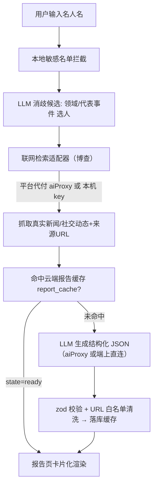
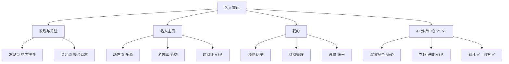

# 名人雷达 · 微信小程序设计与研发方案（增强版）

> 版本：v1.4 ｜ 日期：2026-10-07 ｜ 形态：Taro（React）+ Taro UI 小程序 + **腾讯云 CloudBase（微信云开发）**
> 状态：**已进入开发**。代码侧 MVP 已落地（17 页 / 37 utils / 8 组件 / 运行时 7 云函数 + 运维工具 `dbInit`），运行时验收待云配置后执行（见《开发计划.md》《联调手册.md》）。
> v1.1 变更：新增 §六 合规与内容安全；重划 MVP 范围；报告 Schema v2（消歧 / 缓存 / 热度口径 / 模式标注）；修正图表与 RAG 选型错误；新增缓存与成本模型；补充重名消歧机制。
> v1.2 变更：组件库由 NutUI-React-Taro 改回 **Taro UI**（用户决策，2026-10-04）。
> v1.3 变更（评审收口）：新增 §3.8 数据模型与工程收口（collection 结构 / 主包预算 / zod / 埋点）；§1.6 补领域码枚举与 heat 归一公式；§2.4 补冷启动、缓存击穿、敏感输入三条边界；§3.3 补 Taro UI 版本矩阵；§4.1 补 TabBar 与路由规划；§5.3 补三条风险；§5.4 扩为可执行验收用例；§六 新增输入侧过滤；§5.2 补埋点任务。
> v1.4 变更（技术底盘同步）：**云后端由 WorkBuddy 改为腾讯云 CloudBase（微信云开发）** —— 数据库为**文档型**（无 SQL / 无 RLS / 无建列）、云函数通道具备（`aiProxy` / `notifyFollowUpdates` / `quotaGuard` / `payCreate` / `payCallback`）；**检索源由 Tavily 校正为博查**（`api.bochaai.com`）；`users` 增 `membership`、新增集合 `orders`、知识模式（`mode=knowledge`）废弃。§0 / §1.4 / §1.6 / §2 / §3.3～§3.8 / §5 / §六 / §七 / 附录 A～C 按实现口径重写。
> v1.4 补记（2026-10-06）：**P1 关注周报（M5-2）落地** —— 新增页面 `pages/weekly`（入口在关注流顶部）与 `utils/weekly.ts`；素材只读 `feed_cache`（不新增采集、不新增集合与云函数），人与其动态条目**以材料为准**、模型只写综述 / 逐人摘要 / 话题词；按 ISO 周存本机 storage。§2.1 M5 / §2.2 / §3.7 / §3.8 / §4.1 / §5.4 / §七 与埋点枚举同步（验收用例 12 → **13 条**）。
> v1.4 补记（2026-10-06 · 二）：**P1 分享卡片（M6-1 / M3-3）落地** —— 新增 `utils/share-card.ts`（Canvas 2D 绘制与导出）与 `components/share-poster`（离屏画布 + 预览弹层），入口两处（报告页语录「卡片」/ 收藏页「名言卡」；**报告页该入口已于同日「补记 · 九」删除，现只余收藏页一处**）。
> **实现口径对 §4.2 的一处修正**：原设计「canvas 生成卡片 → 存云 Storage → 分享 / 保存」中的**云 Storage 环节取消** —— 保存相册（`saveImageToPhotosAlbum`）与图片转发（`showShareImageMenu`）都只接受**本地临时路径**，朋友圈分享传的是 query 而非图片，落库只会给云存储留下用户私人收藏的副本（成本与隐私面积都变大）。
> 另两处落地取舍：① 卡片**零网络图片依赖**（头像沿用 §六 的「不抓头像」原则，用领域色圆 + 姓名首字），断网可出图、不占 request 合法域名；② 卡片高度**固定**（名言卡 3:4），不做自适应高度（真机 Canvas 2D 尺寸一经设定再改即又一轮重绘）。§2.1 M6 / §2.2 / §4.2 / §5.4 / §六 同步（验收用例 13 → **14 条**）。
> v1.4 补记（2026-10-06 · 三）：**删除「分享长图」（报告长图）** —— 原 §4.2 的「报告底部点出卡片入口 → 出长图」整条下线，只保留单条名言出图：报告长图要么把报告搬进图里（画布尺寸超限），要么截成精华版（信息量不足以替代报告），而转发场景真正需要的是**一句话**。同步删除 `ReportCardInput` / `paintReportCard` / `renderReportPoster`、`SharePoster` 的 `kind` 分支与 `REPORT_POSTER_HEIGHT`，报告页底部动作由两行收敛为一行。§2.1 M6 / §2.2 / §4.2 已同步。
> v1.4 补记（2026-10-06 · 四）：**删除「相似名人推荐」（原 M1-6）** —— 按产品决策从范围中移除，不再排期（原档位 V2）；同类名人的发现改由「发现」页热门位（`config/hot.ts` 24 位）与搜索消歧承担。§2.1 M1 与《开发计划.md》功能总表 / §八 明确不做表已同步。
> v1.4 补记（2026-10-06 · 五）：**V1.5 三项收口** —— ① 热门 / 分类数据化：`utils/hot-board.ts` 从 `report_cache` 聚合真实 `heat` 重排榜单，静态 24 位退化为兜底种子（无新增云资源）；② 话题态度结构化：报告 Schema 增 `stance` 段（可选，老缓存无该字段时只显示情绪条）；③ 动态多域名源过滤：`utils/search.ts` 主线 + 社交支线两路并发、按 url 去重合并，云函数 `aiProxy` 的 `search` 动作增 `include` 站点限定。§1.4 / §2.1 M1·M3·M4 / §2.3 / 附录 A 已同步；检索成本影响（每次生成由 1 次博查调用变为 2 次）记于《开发计划.md》§九 风险表。
> v1.4 补记（2026-10-06 · 六）：**V1.5 最后一项「内容安全机审」落地** —— 新增云函数 `contentCheck`（**云调用** `security.msgSecCheck`：凭证由平台托管，函数**零环境变量、无需 access_token**，权限只在 `config.json` 的 `permissions.openapi` 声明）+ 端上 `utils/sec-check.ts`；接入点 = **收藏备注保存前送检**（`components/favorites-view`）。口径 **fail-open**：未部署 / 上游抖动一律放过（仅留一行诊断日志），**命中违规才拦**并提示改写。§1.4 / §六 3 / §七 与《开发计划.md》§四·§五·§七·§十 同步（验收用例 15 → **16 条**）。
> v1.4 补记（2026-10-06 · 七）：**V2 首批「两名人横向对比」落地** —— 新增 `utils/compare.ts`（**纯函数聚合**，便于离线验证）+ 页面 `pages/compare`（入口在报告页底部，主视角 = 当前报告）。**核心取舍：对比不生成任何新内容** —— 报告是一次生成、长期复用的资产，对比只是把两份**已生成**报告并排摆放，故只读缓存（`getCachedReport`）、进页面**零额度消耗**；只有当对手方确实没有报告时，才把「约 30 秒 + 1 次今日额度」这个重操作交给用户自己决定（不替 TA 花掉）。口径上刻意克制：**只对「曝光度」给方向**（热度 / 近 30 天 / 近 7 天报道量标出更高的一方），动态 · 言论 · 履历条数**只并列不给箭头** —— 条数取决于素材多寡，多不代表更好，不做优劣断言。§1.4 / §2.1 M4 / §2.2 / §5.1 与《开发计划.md》功能总表 · §三 页面清单 · §七 · §八 · §九 同步（验收用例 17 → **18 条**，见《联调手册》§四）；**无新增集合 / 云函数 / 依赖**（不引图表库，主包 1019KB / 硬限 2MB）。
> v1.4 补记（2026-10-06 · 八）：**收藏列表页改版** —— ① **卡片以「人」为主**：左侧的类型 emoji 图标换成**名人头像**（姓名首字 + 领域色，与 person-card / 报告页 / 对比页同一套色；取不到首字时用「?」占位），类型退到姓名右端的**小胶囊**补回可辨识度；② **四类卡片收敛成一条渲染路径**（头 / 正文 / 底线），此前是三条各自拼装的路径、连「整卡可点」都不一致；报告卡原本**没有正文**、比其它三类矮半截，改为一条**热度刻度**补上视觉重量；动态卡补上两行摘要（收藏动机多是「这条要跟进」，只有标题不足以回想当时为什么存它）；底线加分隔线，把「内容」与「操作」分开；③ **删除用户备注** —— 本项目唯一入库的用户自由文本，列表上却只是一行小字，收益远小于表达 / 审核成本（连带见 §六 3 机审接入点暂缓）；④ **取消收藏由文字改星标图标**（与报告页语录的 ★/☆ 同一套符号），二次确认保留；⑤ **补下拉刷新**：收藏列表是「别处一动它就过期」的数据（在报告页取消收藏、报告重生成后快照都变了），此前只能退出页面再进。**无新增集合 / 云函数 / 依赖**，主包 1019KB。§4.2 页面与组件 · §5.4 验收 · §六 3 与《开发计划.md》功能总表 · §三 页面清单 · §五 · §七 · 《联调手册》§一 · §三 · §四 同步（验收用例 18 → **19 条**，其中用例 16 内容机审**暂缓**；见《联调手册》用例 19 与文末校正）。
> v1.4 补记（2026-10-06 · 九）：**删除报告页「语录」旁的「卡片」按钮** —— 分享卡片此前在报告页语录与收藏页名言卡**各摆一个入口**，结果是报告页每条语录底部都并排着「卡片 + 星标」两个动作，把一个「要不要收藏这句话」的小决定扩成二选一，且与页面右上角承担整份分享的原生转发重复。故单条名言出图的入口**收敛到收藏页「名言卡」一处**：动线变成「读到 → 收藏 → 在收藏页出图」，语义也更顺（收藏页本就是「先把话存下来、之后想转发」的地方）。报告页连带移除 `quotePoster` 状态、`SharePoster` 渲染与 `QuoteCardInput` 引用；`utils/share-card.ts` 与 `components/share-poster` **保留**（收藏页在使用）。§4.2 / §5.4 与《开发计划.md》功能总表 · §三 页面清单 · §五 · §七 · 《联调手册》§三 用例 14 / 汇总表 同步（用例总数仍 **19 条**，用例 14 就地收窄为单入口）。
>
> v1.4 补记（2026-10-06 · 十）：**V2 两项落地 —— 热度趋势折线（M4-6）与消息中心**。① **热度趋势**：新增 `utils/trend.ts`（**纯端上聚合**报告里带日期的条目 —— `dynamics.date` + `timeline.date`，30 天窗口 / 6 桶 = 5 天一格，同一天同一说法去重，条目 < 3 时整卡不渲染）+ 报告页「热度趋势」卡；**不引图表库**（View + transform 自绘：绘图区固定 630×220rpx，rpx 等比缩放所以线段旋转角度在任意机型都成立）。**存量缓存立即生效、零生成成本、不改报告 Schema**；口径是「本报告收录的带日期条目」，**不等于全网报道量**（卡内脚注写明，避免被读成权威统计）。② **消息中心**：新增 `utils/messages.ts` + 页面 `pages/messages` + 发现页铃铛（未读为 0 时不显示红点），把三类提醒合成一条时间流 —— 关注更新（复用 `utils/watch.ts` 的缓存判定，与关注流页共享 60s 内存缓存）/ 周报提醒（按 ISO 周给一条，待生成条目以周一 00:00 为事件时间）/ 平台公告（静态清单 `config/notices.ts`，发布不需要后台操作）；已读基线存本机 `messages:read_at`，随「清空我的数据」清除。**两项均无新增集合 / 云函数 / 依赖、无需任何人工配置、不消耗生成额度**（主包 1019KB → **1034KB**）。§2.1 M4·M5 / §3.3 / §4.1 / §4.2 / §5.4 / §六 / §七 与《开发计划.md》《联调手册.md》同步（验收用例 19 → **21 条**，主包 ≤ 2MB 未变）。
>
> v1.4 补记（2026-10-07 · 十一）：**订阅推送链路补全 + V2「主页数据 Tab」落地**。
> ① **订阅推送（M5-3）**：复查发现两处工程缺口 —— 云函数 `notifyFollowUpdates` **缺云调用权限声明**（目录下没有 `config.json` 的 `permissions.openapi: ["subscribeMessage.send"]`，会被平台直接拒绝，一条提醒都发不出去，且**不是** 43101）；以及它写回 `feed_cache` 的条目**与端上 `NewsItem` 不同构**（`summary: false`，只有标题 + 链接），会让同一个人出现「端上刷过就有摘要、云端刷过就变空白」，并让 `utils/weekly.ts` 读 `e.content` 抛 `TypeError` **打断整份周报**。现均已修复（`summary: true` 取回正文、`source` 补 host 兜底、`publishedDate` 归一 ISO，端上周报对空正文加兜底），部署与触发器步骤补为《联调手册》§一 **步骤 10**；模板 ID 待申请后填入 `config/local.ts#subscribeTemplateId` 与云函数环境变量 `SUBSCRIBE_TEMPLATE_ID`。
> ② **数据 Tab（M2-4，V2 最后一项端上功能）**：主页第 4 个 Tab，新增 `utils/stats.ts`（**纯端上聚合**）—— 四张卡：**曝光度**（热度 / 近 30 天报道 / 近 7 天报道，脚注把热度公式的两个输入摆出来，别让热度当玄学数字）、**报道来源分布**（Top 6 横向条形，互为子串的媒体名归并成一家，模型没给 `source` 时回落 url 主机名）、**情绪构成**（三色占比条，与报告页「立场与舆情」同一套配色与同一份数据源）、**时间分布**（近 12 个月月度柱，动态 + 时间线按「同月同一说法」去重）。**每张卡各有成立门槛，样本不足整卡不渲染**（与词云 < 4 词、折线 < 3 点同一取舍）；老报告缺 `coverage` 时报道量显示「—」而不是 0 —— 算不出来就说算不出来，给一张由一两条数据凑出来的「分布」比不给更糟。**只读已落库的报告字段，存量缓存立即生效、零生成成本、不改报告 Schema、不新增云函数、不引图表库**（条形与柱为 View + 宽度 / 高度百分比，主包 1034KB → **1047KB**）。§2.1 M2 / §2.2 / §3.6 / §5.4 / §七 与《开发计划.md》《联调手册.md》同步（验收用例 21 → **22 条**）。
>
> ③ **消息中心交互改版（2026-10-07）**：① **已读逐条记** —— 新键 `messages:read_ids`（条目 id 列表，上限 300 条，超出裁掉最旧的），进页面**不再自动全标已读**，点开某条或点顶部「全部已读」才清除；旧版 `messages:read_at` 基线保留为迁移兜底（只读不写），老用户升级后不会凭空多出一堆未读。② **长内容折叠** —— 正文超过 42 字（约两行）默认折两行并显示「展开全文」，点卡片展开 / 收起、顺手标为已读；公告正文普遍 55 字以上，所以公告一律折叠。③ **展开与跳转分离** —— 长内容展开后底部才出现「查看详情 ›」，短内容仍是点卡片直接进详情：展开的是内容，离开页面得让用户明确点。④ 已读 / 未读不靠文字标签，靠**左侧紫条 + 卡片底色 + 文字灰度**三处区分（列表要能一眼扫过去）。**无新增集合 / 云函数 / 依赖 / 人工配置**，主包 1047KB → **1050KB**。
>
> ④ **名人主页 Tab 改自绘（2026-10-07）**：主页四格标签（动态 / 名言 / 时间线 / 数据）不再用 taro-ui 的 `AtTabs`，改为自绘胶囊分段器。原因：AtTabs 的样式是「整宽灰底条 + 每格一条满宽紫下划线」，下划线还绝对定位在 `__body` 里（页面内没有 positioned 祖先时它会挂到视口左上角）；四格等分下，带计数的标题会被 ellipsis 截成「时间线 (1…」。选中态改为紫色渐变胶囊 + 白字（下划线在小屏上太细，看不出选的是哪一格），计数从标题括号里取出、用小一号字跟在标题后。切页改为**条件渲染**（只渲染当前 Tab 的 DOM），不再需要 `__body` 那条横向轨道，`white-space: nowrap` 的复位补丁随之删除。**无新增集合 / 云函数 / 依赖 / 人工配置、不消耗生成额度**，主包 1050KB → **1051KB**。
>
> ⑤ **「我的」页改「套餐」视角 + 会员开通独立成页（2026-10-07）**：① **新增页面 `pages/member`（会员中心）** —— 把原先挤在「我的」页一张卡片里的档位 · 价格 · 支付按钮拆出来，四段式：**Hero**（身份徽章 + 有效期 / 免费版对比额度）→ **权益对比表**（免费版 vs 会员，六行：每日主动生成 / 浏览已生成报告 / AI 问答 / 关注收藏历史 / 热门榜对比 / 时长叠加）→ **档位选择**（价格 · 折算月价 · 角标由 `payCreate` 下发，默认选中带角标那档）→ **吸底支付条**（全页唯一支付按钮）。拆页的理由是**说服顺序**：先讲清「买了多得到什么」，再让用户选时长，最后才出现付钱按钮 —— 塞在一张卡里时权益只能写成两行小字，用户在信息不足的情况下就被要求付钱。② **「我的」页改套餐视角**：昵称右侧会员标识（金底「会员 · 剩 N 天」/ 白描边「免费版」）、配额卡由「今日报告生成 · 剩余 N 次」改为**当前套餐用量**（**报告生成** + **AI 提问** 两行，各带进度条与计费口径）。**两行刻意不合并**：报告生成是云端 `quotaGuard` 权威计数（跨设备一致），问答是端上本机计数（**同日稍晚已服务端化，见下方补记 ⑦**），合成一个数字会让「换了手机额度变了」变成莫名其妙的 bug。③ 权益文案**单一事实源**：对比表数值一律由 `utils/member.ts` 常量插值（页面不写死数字），额度耗尽提示同步改成「今日报告生成额度已用完」口径。**支付链路 / 云函数 / 集合 / 依赖一律未改**（复用现成 `payCreate` + `payCallback`），主包 1051KB → **1087KB**。
>
> ⑥ **底栏第二格「关注」换成「AI 提问」+ 关注流降级为二级页 + 提问额度纳入会员权益（2026-10-07）**：① **新增频道页 `pages/ask`（AI 提问，占据 TabBar 第二格）** —— 它**不是**报告页入口那个会话页（`pages/qa`）。TabBar 页只能 `switchTab` 打开且**不能带参数**，而问答必须先知道「问谁」；若硬把 `pages/qa` 挂底栏，报告页就只能改成「把 personKey 写进 storage → 切 tab」，这会毁掉「看完报告顺手追问」的返回路径（tab 页没有返回箭头）。故底栏那格做成**先选人再问**的频道页：进页并行读会员态 / 最近查看 / 我的关注，去重后走**一次批量读**探测出**缓存中已有报告**的名人（提问的前提是有报告；关注流是从 `report_cache` 共享读、**不写 history**，只靠最近查看会漏掉「关注了但没点进过报告页」的人），最近查看优先、名单上限 20 位，横滑 chips 选人后就地渲染共用会话；一个都探测不到时空态引导回发现页 —— **本页绝不代用户触发生成**（那是 30 秒的重操作，必须由用户自己点）。② **问答会话抽成共用组件 `components/qa-panel`** —— `pages/qa`（报告页入口）与 `pages/ask`（底栏频道页）共用同一套闸门 / 气泡流 / 提示，避免两处各写一份会话状态机；`pages/qa` 收敛为薄壳。③ **关注流（`pages/feed`）由 TabBar 页降为二级页** —— 去掉 `useTabBarSync()` 与 `safe-tab` 占位，标题改「关注动态」并补下拉刷新；入口落到**发现页顶部**「关注 N」胶囊（0 人时显示「关注流」）—— 关注是留存主线，撤掉独立 tab 后入口不能靠猜；`pages/weekly` 的「去关注流刷新」跳转同步由 `switchTab` 改 `navigateTo`。④ **提问额度纳入会员权益** —— 原先硬编码在 `utils/qa.ts` 的「每日 30 次」删除，改由 `utils/member.ts` 统一提供（`MEMBER_BENEFITS.askPerDay = { free: 5, member: 30 }`，配 `FREE_DAILY_ASK_LIMIT` / `MEMBER_DAILY_ASK_LIMIT` / `dailyAskLimit` / `askQuotaExhaustedMessage`）：**免费版每日 5 次 · 会员每日 30 次**，与报告生成**不同池**（提问不吃生成额度）；免费版给得比生成大方，但必须封顶 —— 每次提问都是一次真实的付费模型请求，同时这也是会员最有体感的一条权益。`MEMBER_BENEFIT_POINTS` 增「每日 AI 提问 N 次」权益点，`FREE_FEATURES_NOTE` 明确 **AI 问答不在「不限次」免费能力列**。**无新增集合 / 云函数 / 依赖 / 人工配置**，主包 1087KB → **1096KB**。
>
> ⑦ **AI 提问额度服务端化（2026-10-07）**：提问计数从「本机 storage 自我约束」搬到云端权威 —— 新增集合 `ask_quota`（**本集合成为第 12 张**），云函数 `quotaGuard` 增 `ask` 类（`TABLE_BY_KIND.ask = 'ask_quota'`，`dbInit/schema.js` 同步声明）。端上（`utils/qa.ts`）改为**先读 `ask_quota` 判额度、拿到回答后才**调云函数原子自增，口径仍是「**成功才计数**」—— 与报告生成 / 刷新两类的「发起即自增」**语义不同**（提问被额度拦下 / 机审命中 / 模型报错都不计数，与「我的」页脚注严格一致；该差异写在 `quotaGuard` 顶部注释里，改端上之前先读）。本机 storage 降级为**镜像**且同步方向定为**只抬高不覆盖**（`raiseMirror`）：云端读不到时回退本机计数、判定取两端较大值 —— 这样即便踩到「`ask_quota` 已建、权限也收紧了，但 `quotaGuard` 还是不含 `ask` 类的旧版本 ⇒ 自增一律失败 ⇒ 云端恒 0」这个**部署顺序坑**，额度也不会形同虚设（抬高取大值可能短暂高估，但错在安全侧：宁可少放行、不放超支）。顺带把闸门 `checkQaGate` 转 **`async`**（要读云端），调用方 `components/qa-panel` 改为**先占 `busy` 再判闸门**，堵住 await 那几十毫秒里连点发出两条真实付费请求。⚠ **需人工两步**：① 建 `ask_quota`（`dbInit` 可一键补建）；② **重新部署 `quotaGuard`**（控制台上那份旧版本不认 `ask`）—— 两步完成后再按《云开发配置手册.md》§四 收紧权限（**顺序不可颠倒**）。**不改报告 Schema、不新增云函数、不引依赖**，仅多一张集合；主包 1096KB → **1099KB**（含同日「候选探测改批量读」，见《联调手册》第二十三 / 二十四次校正）。§2.1 M4-8 / §3.8 / §5.4 / §七 与《开发计划.md》《联调手册.md》《云开发配置手册.md》《优化建议.md》同步（验收用例**仍为 23 条**，用例 23 就地扩写）。
>
> ⑧ **《优化建议.md》O-13 ~ O-19 一批「纯端上、零模型调用」优化（2026-10-07）**：七项合起来只 +26KB，**无新增集合 · 云函数 · 依赖 · 人工配置、不消耗生成额度**，验收用例**仍为 23 条**（复测点补入既有用例），主包 1099KB → **1125KB**。逐项设计取舍：
> - **O-13 分享覆盖**：新增 `utils/share.ts` 作**全项目唯一分享文案出口**（`personShareTitle` / `reportSharePath`），把「标题怎么写、落到哪一页」从四处各写一份收敛为一处。**落地页必须是 `pages/report/index`** —— tabBar 页不能作分享落地页，故 tabBar 页（发现页 / AI 提问页）分享时一律落到**具体某个人的报告页**（发现页落「横幅上的今日名人」、提问页落「当前选中的人」，未选出人时退回今日名人，保证链接一定能落地）。标题口径 = `姓名 · 领域` + 报告 `intro` 首句（页面上本来就在展示的那句话），**不带「深度报告」这类自夸后缀、不带未核实结论**。`pages/collection` / `pages/mine` / `pages/feed` / `pages/messages` / `pages/history` / `pages/member` 仍未注册分享 —— 这些页**没有「可分享的具体对象」**，分享出去只能是通用邀请，属记录在案的取舍。
> - **O-14 报告新鲜度**：报告缓存「一旦 ready 长期复用、不按时间过期」的策略，决定了必须有人告诉用户「这份旧了」。阈值收口到 `utils/time.ts` 的 `STALE_REPORT_DAYS = 14`（`reportAgeDays()` / `isStaleReport()`，**问答头部 / 报告页 / 收藏卡 / 历史页「继续看」四处同阈值**，原先 `components/qa-panel` 里手写的那份判断改为调用同一函数）。报告页在「查看最新」**之前**补一行「N 天前生成 · 建议刷新」—— 一个孤零零的「查看最新」不构成点击理由，把年龄写出来用户自己就会得出结论；收藏卡补「建议刷新」暖色胶囊，但**收藏存的是快照**，报告刷新不更新这条收藏。
> - **O-15 历史页「继续看」**：用户回历史页的真实意图是「接着看昨天那份」，而不是重读一遍时间线，故在列表之上加一条横滑区（`CONTINUE_MAX = 3`，顺序即 `listHistory()` 时间倒序）。**代价要说清**：`history` 表只存「谁、什么时候看过」、不存报告版本，要让历史页说出报告年龄只能读回缓存 → 只在 3 张卡上做一次 `getCachedReports` 批量读（`in` 一次往返），**完整列表仍只用本机浏览时间、不做额外读**。
> - **O-19 热门榜分档 → ❌ 已撤销（2026-10-08）**：曾按 O-10「模型分级」同一口径做成「量」权益（数据早已取回、`BOARD_LIMIT = 24`，纯展示闸门、**零上游成本**：免费 6 / 会员 24）。**同日撤销**：榜单恢复为**全员可见全部位数**。理由 —— 榜单是全项目唯一「不需要等待」的内容（静态种子 + 每日 AI 榜），也是「不买也能用」这句话的样板；放进付费墙换来的是几位数的展示差异，付出的是用户在最显眼的位置先撞一次墙的第一印象。实现上 `MEMBER_BENEFITS.hotBoardShown` 与两个派生常量、首页的会员态读取（`readMemberState`）与底部那一行全部删除，**页面从此不再截断** —— 渲染几位只由 `utils/hot-board.ts#BOARD_LIMIT` 决定，页面再截一次就是「两处各写一个数」。会员中心该行保留但两栏同值（「全部可见」），与「浏览已生成报告」「关注 / 收藏 / 历史」同性质：**留着是为了明写它免费**，不是权益差异。
> - **O-18 对比页动作（只做零成本的一半）**：先「留下」（`关注这两位`，`toggleFollow()` 的 `null`（未登录 / 写失败）必须与「取关成功」分开处理，否则失败会被误报成「已取消关注」）再「带走」（`分享这份对比`，原生 `Button open-type=share`，标题 `A vs B` —— 两个人名本身就是话题）。**对比问答未做**：它要动 `utils/qa.ts` 的语料组装与编号规则；原计划排在 O-11 之后以免把成本叠在同一批，**O-11 已于 2026-10-08 落地，该阻塞已解除**，仍待排期。
> - **O-16① 相关名人**：词云算出的关键词此前只被用了一次。报告页底部新增「也在聊这些话题的名人」，候选**只取「收藏过的报告」**（≤3 位，排除本人），共同话题**复用 `utils/compare.ts#buildComparison`** —— 两处各写一套交集算法迟早会打架。交集为空整卡不渲染（宁可没有，也不摆一段「暂无相关」），读不到缓存的人**不触发生成**。②③（`stats.ts` → 周报、趋势桶 → 收藏卡 sparkline）记录为**未做**。
> - **O-17 消息中心可点 + 关注流入口**：`system` 类公告无 url 时不再早退（否则点了没反应），兜底 `switchTab` 到发现页 —— 平台公告的下一步本就该是「平台现在有什么可看的」；头部补 `关注流 ›` 描边胶囊，与「全部已读」并排但**长得不一样**（一个跳走、一个就地改状态，长得一样会点错）。
>
> ⑨ **提问额度可开挂 + 提问同时联网检索（2026-10-08）**：两项都落在问答链路上。① **调试期解除提问额度** —— 调试开关的**值**集中在 `config/public.ts#debugFlags`（`utils/debug.ts` 只做转出），本次把「每日提问额度」也纳入统一闸门，新增 `disableAskQuota` → 导出 `ASK_QUOTA_DISABLED`。与生成 / 刷新同一取舍：**只放开闸门**，云端计数照读、本机镜像照抬（排查时仍能看到真实用量）；连点间隔（3 秒）**不受影响**（它防的是误触重复计费，与「每日次数」是两件事），「今日还可问」报满额（否则会出现「剩余 0 次却仍能一直问」的矛盾展示）。⚠ **上线前 `debug` 节五项必须全 false**。② **提问同时联网检索** —— 见 §2.1 M4 的 2026-10-08 追加：`askReport` 组料时额外调 `utils/search.ts#searchForAsk`（8 条 / 近 7 天），与报告片段**一起**按相关度竞争预算（而非无条件全塞），标注为「联网检索」并要求冲突时以更新一方为准；检索不通静默降级为「只依据报告作答」。**零新增集合 / 云函数 / 页面 / 组件 / 依赖**；单测与调试开关解耦（新增 `test/harness/env.js#setDebugFlags`，用例默认全关五项、不受本机开关影响），`npm test` 通过 **191 / 191**。
>
> ⑩ **会员「深度模式」（O-11）+ 报告质量升级（O-20，全员受益）（2026-10-08）**：
> - **O-11 深度模式**（会员「质」权益第二步，与 O-10「模型分级」同一口径 —— 只加在**报告生成路径**、只对会员）：① **素材加厚**：`utils/search.ts` 增 `DEEP_MAIN_COUNT(24)` / `DEEP_SOCIAL_COUNT(16)`（两条链路各自过云函数 count 钳制，合计正好吃满 `MEMBER_SEARCH_MAX(40)`）；`utils/cache.ts#generateReport` 用**生成配额检查顺带回传**的会员态决定是否加厚，**全文件仅此一处**（`refreshAllFeeds` / `refreshFeed` 是每日 10 次的常态动作，放大等于常态成本翻倍而用户几乎无感，故**刻意不动**）；配额检查失败按免费口径（宁可少给不可误给）。② **输出上限**：`utils/llm.ts` 仅会员的请求体带 `deep: true`（免费逐字节不变），云函数 `aiProxy#handleChat` 以 `deep = event.deep === true && (await isMember())` 为**闸门**，仅它为真才加 `max_tokens = MEMBER_CHAT_MAX_TOKENS(8192)`；**免费版不传 `max_tokens`**（不悄悄削免费用户一刀）。起因：报告是「多段摘要 + 逐条动态」的长 JSON，贴默认上限时尾部字段易被截断，表现为「解析失败 → 重试 → 再失败」。返回体带 `deep`，端上记进诊断 meta。③ **独家段落**：`MEMBER_HINT_REALTIME` 只在会员的 system 末尾追加（免费连这段 token 都不白付），产出 `memberNotes`（对比视角 / 风险提示）与 `conflicts`（信源分歧）。⚠ **`aiProxy` 须重部署**（旧版本收到 `deep` 只是忽略：会员报告仍可能被尾部截断，不报错）。
> - **O-20 报告质量（不限会员）**：① **素材「事件归组 + 分级保留」** —— `buildUserMessage` 由「顺序截断（装不下丢整条）」改「先按事件归组（`normalizeTitle` + 字符二元组 Dice ≥ `SAME_EVENT_RATIO(0.62)`），前 `FULL_ITEM_COUNT(10)` 个**事件**给全文、其余压缩为 160 字 brief 并标『正文从略』；仍超预算只丢**已压缩**的尾部条目，首条永远保留」。按事件计而非按条计：一件事被 5 家媒体报道，过去会一口气吃掉 5 个全文名额。② **AI 点评拆条** —— 契约增 `analysisPoints`（`basis` 见 §2.3 的硬约束；上限 4 条 / 80 字）；**`analysis` 仍在契约里且仍落库**（由各条拼接），它是**问答上下文**（`utils/qa.ts`）与降级简版路径（`SYSTEM_FALLBACK`）的共用出口 —— 拆条不牺牲下游。报告页有拆条就渲染列表（判断 + 「依据：媒体名」），否则回落整段（老缓存照常）。**权限口径**：`memberNotes` / `conflicts` 是会员专享而报告是**全局共享缓存**，故 UI **二次判会员态**且两字段**各自判空**（只带 `conflicts` 的报告不该整卡消失）；会员卡标题改「会员专享 · 深度解析」；`utils/member.ts` 深度模式 note 补「信源分歧」。**无新增集合 / 页面 / 组件 / 依赖**；验收用例**仍为 23 条**（用例 3 / 12 补复测点），`npm test` **197 / 197**，主包 1201KB。
>
> ⑪ **会员价值的「可见性」收口（O-21 报告页顶部价值条 + O-22 会员中心真实示例）（2026-10-08）**：
> - **起因**：O-11 / O-20 把「质」权益做齐后，价值的**可见性**仍是零 —— 深度模式只在会员中心对比表里的一行字、以及**会员**滑到报告页**最底部**的那张卡里出现。而报告是**全局共享缓存**（§2.1 M4 的会员段落口径），免费用户点开某位名人时读到的很可能**正是会员生成的那一份**，三段内容此刻就躺在页面里（被 `member &&` 挡着），页面上却**没有任何一行字**解释这件事：免费用户不知道会员能多得到什么，会员也不确定买的东西有没有生效。这两件事都不是「再加一个权益」，而是把已有权益**说清楚**。
> - **O-21**：`utils/member.ts` 增 `MEMBER_SECTIONS` / `presentSections()` / `reportMemberValue()`（四态 = 会员 / 免费 × 报告有 / 无专享段落，**判定与文案收口为纯函数**），报告页横幅正下方新增 `.page-report__vip`：免费态「开通会员 › / 了解会员 ›」→ 会员中心，会员态「查看 ›」页内滚动到专享卡（`#report-notes`），会员读到**老缓存**（未含专享段）时只说明、**不给动作**（不引导为运营需要再烧一次生成额度）。免费态**分两支说真话**：有内容时说「开通即可查看」（可兑现），没内容时只说「会员生成会多出什么」，**不承诺当前这一份**。
> - **O-22**：新增 `utils/member-sample.ts`，从 `report_cache` 取一份**确实带专享段落**的**就绪**报告，把**原文**当示例摆在会员中心对比表正下方（它回答的正是「深度模式」那一格留下的疑问，两张卡必须相邻才读得通）。三条硬口径：**不做假示例**（挑不到整卡不渲染）、**只读 `state='ready'`**（inbox 半成品从未被任何人看过）、**只节选不改写**（>80 字截断加省略号；信源分歧只取第一条）。来源行（取自谁、何时生成、原文未改写）让「真实」二字**可核对**；扫描窗口 20 份、`order('generated_at')` 失败退化无排序扫描、结果 10 分钟内存缓存（失败也缓存）。
> - **刻意不做**：报告正文里摆「灰掉的内容 + 开通会员解锁」。留白可以有，但不该以「把已有内容遮起来诱导付费」的方式出现（§2.1 M4「正文不设墙」）；本次留白只有一处，且**当场说明白**。口径回改：对比表「报告深度模式」会员列由「加厚素材 + 对比 / 风险两段」改为「加厚素材 + 专享内容」（原写法漏了早已存在的第三段，且名字与数量写死在窄格里必然随实现漂移）。
> - **无新增集合 / 云函数 / 页面 / 组件 / 依赖 / 人工配置、不消耗生成额度**；验收用例**仍为 23 条**（用例 12 补 ⑧⑨ 复测点），`npm test` **208 / 208**（新增 2 个套件 / 11 例），主包 1201KB → **1209KB**。
>
> ⑫ **收藏卡「补内容」+ AI 提问用量如实计数**（2026-10-08，等同日两次校正，见《[优化建议.md](./优化建议.md)》**O-23 / O-24**、《[联调手册.md](./联调手册.md)》第三十三次校正）：
> - **收藏卡从「一行信息」补到「看得出为什么值得存」**（`components/favorites-view` v3 + `utils/favorites.ts`）：报告卡在热度刻度与走势条之外，**回源 `report_cache`** 摘「最新报道 + 素材画像」两行（新增纯函数 `reportDigestOf()`：`coverage.latest` 博查原值优先 → 退回**日期最新**的动态 → 两行都取不到返回 null）；动态卡标出**偏离中性**的情绪（新增 `SENTIMENT_TAG`，措辞与 `SENTIMENT_META` 同一套）并给「原文」入口（复用 `utils/source-link` 这个唯一跳转出口）；名言卡 meta 补媒体名、payload 增 `background` / `note`（`favoriteQuote` 落库）。**新增内容一律「取不到就不渲染」**，不给占位文案。⚠ 报告摘要与走势条**共用同一次批量读库**（仍受 `SPARK_MAX = 12` 限制），**0 额外读请求、不消耗生成额度**。
> - **调试开关放开的只是闸门，不是计数**（`utils/qa.ts`）：原 `qaRemainingToday()` 在 `ASK_QUOTA_DISABLED` 时报满额（理由是「照实相减会显示『还可问 0 次』却仍能一直问」），代价是**开挂时界面数字永远停在 0**（「我的」页套餐用量与问答面板头都像坏了）。改为 `QaUsage { used, limit, remaining, unlimited }` + 纯函数 `qaUsageOf()` / `qaUsageToday()`：`used` **始终是镜像真值**（脏输入归零）、`remaining` 照实相减、要不要说「限制」由 `unlimited` 决定；两处界面按 `unlimited` 二选一措辞，**升级提示在开挂态不弹**（此时并没被拦）。
> - **无新增集合 / 云函数 / 页面 / 组件 / 依赖 / 人工配置、不消耗生成额度**；验收用例 23 → **24 条**（新增「收藏卡内容与提问用量展示」），`npm test` **213 / 213**（新增 5 例、改写 2 例），主包 1209KB → **1214KB**。
>
> ⑬ **报告页会员促销条：会员去噪 + 免费瘦身（O-25，2026-10-08）**：
> - **起因**：⑪ 那条价值条对**两种人都渲染**，两头都不对 —— 会员看到的是一句「本报告已含对比视角 / 风险提示 · 查看 ›」（老缓存那份更是**点不动的两行长条**，像坏了），免费用户那边它占掉首屏 **≈187rpx**（标题 + 两行说明 + padding），而紧接其下才是正文。
> - **口径：促销条只对还没买的人存在**。买过的人不需要再看一遍卖点；免费用户才需要在「这份报告里有什么你看不到」这件事上被说清楚。据此：**会员态整条不渲染**，权益确认**并入专享卡标题**（右侧「已生效」小标，是**内容的一部分**而非宣传）；**免费态压成一行**（「会员专享」胶囊 + 22rpx 单行文案 `nowrap` + 右侧动作，≈80rpx）。文案函数 `reportMemberValue(member, present)`（四态）随之收敛为 `reportMemberPromo(present)`（两态）—— **删参数而不是返回空串**，让「不存在会员文案」写在签名上；两个免费态仍守⑪的**说真话**口径（有专享段就点名那几段，没有就不承诺当前这一份）。
> - **代价（知情接受）**：会员读到**老缓存**（未含专享段）时不再有任何说明 —— 用「报告页更干净」换掉一句几乎没人读完的解释（新报告都会带三段，触发面很小）。会员态那条**页内滚动**路径（`Taro.pageScrollTo` + `#report-notes` 锚点 + `--on` 渐变底）一并删除，不留半截实现。
> - **无新增集合 / 云函数 / 页面 / 组件 / 依赖 / 人工配置、不消耗生成额度、无新增读请求**；验收用例**仍为 24 条**（用例 12 的 ⑧ 就地改写），`npm test` **214 / 214**（该套件 3 例改写为 4 例），主包 **1214KB**（持平）。
>
> ⚠ **口径说明**：本文档是**设计方案**（需求 / 架构 / 取舍依据）；**功能实现进度与逐条验收**以《开发计划.md》《联调手册.md》为唯一准绳（如「知识模式」已按产品决策删除，本文档已同步）；建表逐列字段口径见《云开发配置手册.md》。

---

## 0. 概述

「名人雷达」是一款面向微信生态的**名人动态情报台**小程序。用户输入任意名人名字（如雷军），小程序先**联网抓取**该名人近期的新闻、公开演讲、社交平台动态，再交由 **AI 提炼**成一份结构化报告——经典名言/语录、近期动态、AI 点评、时间线与信息来源。在此基础上，方案进一步扩展为「**关注—聚合—分析—沉淀—分享**」的产品级闭环，而非单一「查一人出报告」的最小功能。

> **产品定位口径（合规前提，见 §六）**：本产品定位为「AI 信息整理工具」，不是资讯平台。所有内容均为「用户主动查询时生成、附带来源链接、明确标注 AI 生成仅供参考」的个性化结果，不做公众可见的社区 / 评论 / 资讯分发。

核心链路：



---

## 一、需求规划

### 1.1 背景与目标
- **痛点**：名人的公开言论、动态分散在新闻、微博、发布会、访谈中，缺乏一个聚合 + 提炼的轻量入口。
- **目标**：输入任意名人名字 → 自动联网抓取近期公开信息 → AI 提炼成「名言/动态/点评/趋势」结构化报告；并支持关注多个名人、长期沉淀与分享。

### 1.2 用户画像（细分）
| 角色 | 诉求 |
|---|---|
| 内容创作者 | 找金句、做选题、写稿前快速掌握某人立场 |
| 投资人 / 分析师 | 跟踪创始人公开发言，辅助判断态度与风向 |
| 普通用户 | 碎片时间看「今天雷军说了啥」 |

### 1.3 核心场景（5 个）
1. 关注雷军，每天打开看聚合动态流。
2. 一键生成某人的「深度分析报告」。
3. 收藏雷军关于「创业 / 管理」的名言，生成分享卡片。
4. 对比「雷军 vs 马斯克」的公开立场与热度。**（V2）**
5. 订阅后收到「本周关注名人动态周报」。**（手动生成版 P1 已落地；定时推送 V2）**

### 1.4 范围界定（v1.1 重划）
- **MVP（本次落地，收敛为 3 条主线）**：
  - **主线 1 查报告**：搜索（含消歧）→ 深度报告（六段 + 缓存）→ 名人主页简版（动态/名言两 Tab）。
  - **主线 2 关注沉淀**：关注 / 取关 → 关注流（**云端缓存优先，节流刷新**）→ 收藏 / 历史。
  - **主线 3 账号设置**：微信登录、检索源 key 管理、隐私设置、**freemium 生成配额 + 会员开通**（会员开通过程独立成页 `pages/member`：权益对比 + 档位选择 + 吸底支付，入口 = 「我的」页会员卡）。
  - MVP **不含**：AI 问答、两人对比、词云、热度折线图（canvas 卡片仅做 P1 验证性实现，且只出名言卡）。
- **V1.5（2026-10-06 收口）**：~~手动周报~~（✅ P1 已落地）、~~分享卡片~~（✅ P1 已落地，见 §4.2）、~~动态多域名源过滤~~（✅ 见 §2.1 M3）、~~热门 / 分类数据化~~（✅ 见 §2.1 M1）、~~话题态度结构化~~（✅ 见 §2.1 M4）、~~`msgSecCheck` 内容安全检测~~（✅ 代码已落地，见 §六 3；⚠ 唯一的送检源「收藏备注」已于同日删除，故**部署暂缓**、能力保留，见《开发计划.md》§七 待办 13）。**V1.5 范围已全部完成。**
- **V2**：AI 问答（RAG 式）、对比看板、热度趋势、自动订阅推送（云函数）、多语言。（其中**词云 + 高频观点**、**两名人横向对比**、**热度趋势折线**与**站内消息中心**已于 2026-10-06 提前落地 ✅；**AI 问答已于 2026-10-07 落地 ✅** —— 端上轻量 RAG，见 §2.1 M4；消息中心见 §2.1 M5。仅剩**「持续性」服务端推送**与**检索源后端代理**）

> 收敛理由：原 MVP 含 7 大模块（问答 / 对比 / 可视化齐上），首版交付风险高且 LLM 成本不可控；问答与对比强依赖语料库规模，宜在语料沉淀后（V1.5+）再开。
>
> v1.4 补充：原「知识模式（无实时来源的降级生成）」已按产品决策**删除**（2026-10-05）——抓取为空一律走「暂无动态」引导态，不再产出无来源内容（见 §2.4）。

### 1.5 成功指标（v1.1 补基线）
| 指标 | MVP 目标（上线 4 周） |
|---|---|
| 次周留存率 | ≥ 15% |
| 人均关注数 | ≥ 2 |
| 报告生成次数 / 周活用户 | ≥ 3 |
| 报告缓存命中率 | ≥ 50%（成本核心指标） |
| 分享率（V1.5 起） | ≥ 8% |

### 1.6 关键名词口径（v1.1 新增，v1.3 补公式与枚举）
- **热度值 `heat`**：`heat = round(60 × norm(N30) + 40 × norm(N7))`，归一函数 `norm(N) = min(1, log10(1 + N) / 2)`（对数缩放，N ≥ 99 封顶 1，防单条爆款拉满分），N30 / N7 为**博查检索结果集**中近 30 天 / 近 7 天条数。取 0–100，MVP 不引入额外声量接口，公式写进报告页脚注。
- **消歧（disambiguation）**：同名名人通过「领域 + 国籍 + 一句代表事件」候选卡片区分；用户选定后生成稳定 `personKey`（`名字#领域码`），后续关注 / 缓存 / 报告均挂 `personKey` 而非裸名字。候选列表末位固定追加「都不是 TA → 补充领域关键词」兜底入口；LLM 生成的候选若与素材零印证（领域 / 事件在素材中无任何呼应），降级为「未识别到该名人」。
- **领域码枚举（v1.3）**：`tech`（科技）/ `business`（商业）/ `ent`（文娱）/ `sports`（体育）/ `academia`（学术）/ `other`（兜底）。消歧候选的领域字段仅允许从该枚举取值（`config/domains.ts` 用 zod 强校验），保证 `personKey` 稳定可重放。
- **`personKey` 解析（v1.4）**：形如 `名字#领域码`，名字本身可能含 `#`，**禁止 `split('#')` 反解析**，统一走 `parsePersonKey()`。

---

## 二、功能设计

### 2.1 功能模块（7 大模块，标注 MVP 取舍）

**M1 发现与关注**（MVP：搜索 + 关注 + 关注流）
- 搜索任意名人 → **消歧候选列表**（LLM 生成领域/代表事件，用户选定）→ 关注 / 取关
- 热门 / 分类（科技·商业·文娱·体育）发现页（**V1.5 已数据化**：`utils/hot-board.ts` 用 `report_cache` 的真实 `heat` 重排榜单，静态 24 位退化为冷启动兜底种子）
- 关注流：所有关注对象的动态按时间聚合（**读取云端缓存，用户手动下拉刷新触发抓取，单日每账号限 N 次**，见 §3.7）。**（2026-10-07 改版**：本页不再占 TabBar 第二格，降为二级页，标题「关注动态」+ 下拉刷新，入口在发现页顶部「关注 N」胶囊；TabBar 第二格改为「AI 提问」频道页 `pages/ask`，见 §4.1）

**M2 名人主页**（MVP 简版：动态 / 名言两 Tab）
- 信息卡（头像占位、简介、标签、热度值——口径见 §1.6）
- MVP Tab：**动态 / 名言**；时间线 Tab **（V1.5 ✅ 已落地）**、数据 Tab **（V2 ✅ 已落地 —— 曝光度 / 报道来源分布 / 情绪构成 / 时间分布 四张卡，纯端上聚合、零生成成本，口径与成立门槛见《开发计划.md》M2-4）**
- 一键生成深度报告

**M3 动态与语料**
- 动态流：多源（**博查检索** + 新闻 / 微博 / 知乎等域名过滤）抓取，带来源、时间（**V1.5 已补社交源定向**：主线 + 社交支线两路并发，支线用 `include` 限定微博 / 知乎 / B站 / 小红书，按 url 去重合并，支线失败即忽略）
- 名言库：按主题（创业 / 管理 / 人生 / 产品）分类、收藏、复制（MVP）；卡片生成 **（P1）**
- 事件时间线 **（V1.5 ✅ 已落地）**

**M4 AI 分析中心**
- 深度报告（简介 / 动态 / 名言 / 点评 / 时间线 / 来源）**（MVP）**
- 生成配额（freemium：免费 3 次/日、会员 30 次/日，仅成功生成计数；缓存命中不计次）**（上线前追加）**
- 立场与舆情（对热点话题态度、情绪走向）**（V1.5 ✅ 已落地）** —— 两层显式分开：情绪走向条聚合已落库的 `dynamics.sentiment`（纯本地统计，新老缓存一视同仁），话题态度为报告新增 `stance` 段（模型判定 2~4 个话题，每条带一句话依据）
- 关键词云 + 高频观点 **（V2 ✅ 已落地 2026-10-06）** —— **纯端上聚合**（`utils/keywords.ts`，不改 Schema、不动生成链路，故存量缓存立即生效、零生成成本）。词源两层：① 模型判定的话题 `stance[].topic`（质量最高，优先展示、且豁免重叠收敛）；② 动态标题/摘要与语录原文的汉字 n-gram 词频（**≥2 条不同素材命中**才采用）。过滤三层：停用词与报道套话 → 跨词碎片（从未贴近片段边界的候选一律丢弃）→ 重叠收敛（同一说法的长短两版只留一条，被丢弃者的 ≥2 字子串一并抑制）。呈现按 §3.3 的 CSS 标签墙（字号按词频分三档）；「高频观点」逐条附原文标题与出处，**不做模型二次总结**（避免引入不可核对的二手表述）；词条 < 4 个时整卡不渲染
- 热度趋势折线图 **（V2 ✅ 已落地 2026-10-06）** —— **纯端上聚合**（`utils/trend.ts`，不改 Schema、不动生成链路，故存量缓存立即生效、零生成成本）。数据源为报告里**带日期的条目**（`dynamics.date` + `timeline.date`），30 天窗口 / 6 桶（5 天一格），同一天同一说法去重；点数 < 3 时整卡不渲染。**不引图表库**：绘图区固定 630×220rpx，`trendGeometry` 把 x/ratio 换算成 rpx 圆心与线段角度（rpx 等比缩放，故旋转角在任意机型都成立），用 View + transform 自绘折线、网格、峰值点与刻度。口径是「本报告收录的带日期条目」，**不等于全网报道量**（卡内脚注写明，避免被读成权威统计）
- 两名人横向对比 **（V2 ✅ 已落地 2026-10-06）** —— **零模型调用的纯端上聚合**（`utils/compare.ts` + `pages/compare`）：对比不是新内容生产，只是把两份**已生成**报告并排摆放，因此复用既有报告缓存（`getCachedReport` 只读）、进页面**不消耗任何额度**；只在对手方确实没有报告时才提示「约 30 秒 + 1 次今日额度」，由用户自己决定是否现场生成。呈现分六块：两方头像 VS + 一句话摘要（热度差 < 5 视为「接近」，避免拿噪声宣布谁更火）→ 热度对照（**共用一个刻度**取二者最大值，差值才看得出来）→ 指标表 → 舆论情绪结构（各自 `dynamics.sentiment` 本地计数，看百分比结构而非总数）→ 共同关注点（复用词云关键词求交集）与「各自在讲什么」（双方独有词）→ 公开立场并排。**口径上的克制**：只给「曝光度」类指标标出更高的一方（热度 / 报道量，同一把尺子的读数），动态 · 言论 · 履历条数**只并列不给箭头**；两位名人的热点话题通常不重合，故话题态度并排呈现而非强行配对
- 基于该名人语料的 AI 问答 **（V2 ✅ 已落地 2026-10-07）** —— **端上轻量 RAG**（`utils/qa.ts` + `pages/qa`，入口在报告页**首屏**——人物横幅正下方的实心紫底条「向 AI 提问 · 不消耗生成次数」；底部动作区留给两人对比）：语料即该名人**已缓存报告**摊成的带编号片段（简介 / 报道 / 语录 / 时间线 / 素材统计在前，`analysis` 与 `stance` 等 AI 判定在后 —— 顺序即可信度顺序），按问题的「汉字二元组命中数」排序取片段，**整份语料放得下就全放**（避免检索把信息筛丢、导致模型对其实有答案的问题拒答）。三条口径：① **只读缓存、不消耗生成额度**（与报告不共用「今日生成次数」：免费版一天 3 次，被问答吃掉会让用户当天无法生成报告），故问答另有本机闸门（**免费版每日 5 次 / 会员每日 30 次**，随会员分档 + 3 秒连点间隔），服务端化见《开发计划》待办 19；② 资料显式标注「公开报道 / AI 判定」两类，并要求资料不足时直说「报告里没有相关信息」，不得引入资料外知识；③ 用户提问是**全项目唯一自由文本**，送检复用 `checkUserText`（`contentCheck` 由此重新有了接入点）。**不改报告 Schema、不新增集合与云函数、不引向量库与依赖**（主包 1051KB → 1063KB）。**（2026-10-07 追加**：会话抽成共用组件 `components/qa-panel`，新增底栏频道页 `pages/ask`（TabBar 第二格「AI 提问」，先选人再问，候选 = 缓存里已有报告的名人）；**提问额度纳入会员权益** —— 上限改由 `utils/member.ts` 统一提供，免费版每日 5 次 / 会员每日 30 次，与生成不同池）**；同日体验升级（O-12，见《优化建议.md》）**：引导问题改由该报告**实际具备的段落**生成（动态 / 观点 / 立场话题 / 时间线 / 素材画像 / 负面报道 / 热度，上限 8 条、前三条顺序固定），`QA_SYSTEM` 第 7 条要求模型标 `[n]`、端上 `splitCitations` 把编号解析成可点标签（越界编号不解析），回答下方给**「来源」行**（转录条目 + 报道原文链接），回答支持长按复制，语料 ≥14 天时提示「报告生成于 N 天前」（并可点报告名回报告页），提问频道页的选人条改**卡片**（首字头像 + 领域色 + 「N 天前 · N 条」）且候选 > 5 位时给过滤框。**零新增页面 / 组件 / 依赖，主包不变（1099KB）**）。**（2026-10-08 追加：提问同时联网检索** —— 只读报告缓存最答不上来的恰是「最近怎么样了」这类问题（报告可能已是两周前的快照），故 `askReport` 组料时**额外做一次联网检索**（`utils/search.ts#searchForAsk`：只走主线、8 条、近 7 天，与报告片段一起按相关度竞争预算，而非无条件全塞），结果按同一套编号接在报告语料之后、标签为「联网检索」，并要求模型在冲突时以更新的一方为准；检索不通（通道未就绪 / `search` 冷却中 / 上游失败）一律**静默降级**回「只依据报告作答」，不报错、不提示。**零新增集合 / 云函数 / 页面 / 组件 / 依赖**）

**M5 订阅与推送**
- 关注即订阅
- MVP：打开读缓存 + 手动「生成周报」**（P1）✅ 已落地（2026-10-06）** —— 窗口为**滚动最近 7 天**（不用「本周一至今」：自然周口径下每周一打开几乎必然没素材，用户会以为功能坏了），缓存键仍按自然周（`yyyy-Www`）；素材只读 `feed_cache`（故生成前需先刷新过关注流），人与其条目**以材料为准**、模型只写文字；生成消耗 1 次今日生成额度（与报告同池），**进页面不点生成不扣额度**
- V2：定时抓取 + 微信订阅消息推送（CloudBase 云函数**已具备**定时器能力；MVP 已以「一次性订阅」形态提前落地 `notifyFollowUpdates`）；**站内消息中心 ✅ 已落地（2026-10-06）** —— 在真正的服务端推送之前，先把「提醒」做成本机可见的一条时间流（`utils/messages.ts` + `pages/messages`，发现页铃铛入口，未读为 0 时不显示红点）：① 关注更新（复用 `utils/watch.ts` 的缓存判定，与关注流页共享 60s 内存缓存）；② 周报提醒（按 ISO 周给一条，待生成条目以周一 00:00 为事件时间）；③ 平台公告（静态清单 `config/notices.ts`，发公告不需要后台操作）。已读**逐条记**（本机 `messages:read_ids` —— 点开某条或点顶部「全部已读」才清除，旧 `messages:read_at` 作迁移兜底；2026-10-07 前是「进页面即全标」，已改），随「清空我的数据」一并清除；长内容超 42 字折两行、点卡片展开 / 收起，展开后「查看详情 ›」才跳转；**不做多设备同步**（无新增集合，故无服务端已读态）

**M6 分享与沉淀**
- 生成名言卡（canvas）**（P1）** —— ✅ 已落地：端上 Canvas 2D 出图，**不落云 Storage**（v1.4 补记修正，见 §4.2）；原「报告长图」已删除（补记三）
- 导出 / 复制全文（MVP）
- 我的收藏（名言 + 报告 + 动态 + 时间线）、历史归档（MVP）

**M7 设置与账号**（MVP）
- 微信登录（`wx.cloud` 隐式身份 + `users` 首登幂等初始化）
- 检索源 key 管理（本机 storage）
- 推送订阅、隐私设置、内容举报

### 2.2 优先级
- **P0** = M1（搜索/消歧/关注/关注流缓存版）+ M2 简版 + M3 动态/名言 + M4 深度报告 + M7 + 缓存与配额体系
- **P1** = M5 手动周报（✅ 已落地）+ M6 分享卡片（✅ 已落地）
- **P2** = M4 问答（**✅ 已落地 2026-10-07**）/ ~~对比~~ / ~~趋势~~（**词云 ✅、两人对比 ✅、热度趋势 ✅ 已落地 2026-10-06**）+ M5 自动推送（**站内消息中心 ✅ 已落地**；「持续性」服务端推送待订阅模板过审）

### 2.3 AI 报告 Schema v2（产品核心）
```json
{
  "personKey": "雷军#tech",
  "name": "雷军",
  "mode": "realtime",              // 恒为 realtime（知识模式已废弃，见 §1.4）
  "generatedAt": "2026-10-06T12:00:00+08:00",
  "heat": 78,                       // 口径见 §1.6，0-100
  "intro": "一句话简介",
  "dynamics": [
    { "date": "2026-09-20", "title": "...", "summary": "一句摘要",
      "source": "新浪科技", "url": "https://...", "sentiment": "positive" }
  ],
  "quotes": [ { "text": "名言", "context": "出处场合/时间", "source": "url 或 据公开资料" } ],
  "analysis": "AI 综合点评（由 analysisPoints 各条拼接 —— 问答上下文与降级路径仍读它）",
  "analysisPoints": [ { "point": "一句判断（40 字内）", "basis": "媒体名" } ],  // 2026-10-08 增：点评拆条；basis 是素材 url 的引用位，落库前按白名单换成媒体名、否则收敛为「据公开资料」；上限 4 条 / 每条 80 字；非空才落库
  "stance": [ { "topic": "新品定价", "attitude": "mixed", "note": "认可与质疑声量接近" } ],  // v1.5 增：话题态度；attitude 四值；可选项（老缓存无）
  "memberNotes": { "compare": "对比视角", "risk": "风险提示" },  // 会员专享；两段皆空则整个字段不落库（报告是全局共享缓存，UI 必须二次判会员态）
  "conflicts": [ { "topic": "争点", "a": "一方说法", "b": "另一方说法" } ],  // 2026-10-08 增：会员专享「信源分歧」；缺任一侧的条目剔除，上限 3 条（V2「质」权益第二步）
  "timeline": [ { "date": "2026-08-01", "event": "发布会宣布新车交付" } ],
  "sources": [ { "title": "...", "url": "https://..." } ],
  "disclaimer": "内容由 AI 基于公开网络信息生成，仅供参考，不代表本平台立场。",
  "degraded": true                  // 可选：LLM 两次非法 JSON 后落纯文本降级时的标记
}
```
**系统提示词硬约束（v1.1 加强）**：仅基于提供的真实素材作答；不编造日期与来源；`quotes` 必须逐条带 `source`（素材 URL 或显式「据公开资料」）；`dynamics`/`sources` 中的 URL 必须来自**博查返回结果原文**，禁止模型自行拼写域名；`sentiment` 仅允许 `positive | neutral | negative` 三值；`stance.attitude` 仅允许 `positive | neutral | negative | mixed` 四值，且 `stance` 的 `topic` / `note` 为自由文本、无 URL 那样可白名单的锚点，因此在 `sanitizeReport` 里只做「去空 + 限 4 条 + 依据截断 60 字」（v1.5 增）。**2026-10-08 追加**：`analysisPoints` 改由**拆条**输出（每条 40 字内、要具体、禁套话），`basis` 与 `quotes.source` 同类 —— 都是**素材 URL 的引用位**，落库前经 `sourceNameOf` 按白名单换成**媒体名**，编造 / 空的 URL 一律收敛为「据公开资料」，页面上不出现裸 URL；`analysis` 仍落库（由各条拼接），**不得**因拆条而下线（问答上下文与降级简版路径都依赖它）。`conflicts` 侧同样做字符串兜底：`topic` 截 24 字、两侧各截 100 字、缺任一侧的条目整条剔除。

### 2.4 异常与边界（v1.1 扩充；v1.4 按实现校正）
| 场景 | 处理 |
|---|---|
| 网络失败 / 超时 | 提示并允许重试（指数退避，最多 2 次） |
| 超配额 | 提示「今日已达上限」+ 引导明日再看（不做排队）；缓存命中不受限 |
| 内容被拦截 | 提示换措辞 |
| 抓取为空 | **一律「暂无动态」引导态**（`nonews`）—— 知识模式已废弃，不再产出无来源内容（见 §1.4） |
| 重名 | 消歧候选列表；无法消歧时要求用户补充领域关键词 |
| 未配通道 + 缓存为空（冷启动 / 长尾名人） | 不进入生成流程；展示 `coldstart` 引导态（说明需联网检索 + 跳「我的」页看额度 / 会员）；禁止空态死循环 |
| 同一 personKey 并发生成（缓存击穿） | 生成前先条件写入 `report_cache` 的 `state=building` 占位，**只有写入成功者执行检索 + LLM**；其余请求轮询等待 ≤30s，超时提示「稍后查看」；完成后置 `state=ready`（见 §3.8） |
| 输入命中敏感名单（政治 / 军事等敏感人物） | 前置拦截，**不发起任何网络请求**：返回「暂不支持查询该人物」；两级拦截见 §六.7 |
| LLM 输出非法 JSON | 丢弃流式方案，非流式重试一次 + `response_format: json_object`；仍失败则展示分段纯文本降级渲染并打 `degraded` 标记 |
| 命中缓存 | 报告页顶部显示「生成于 xx 前 · 查看最新」双入口 |

---

## 三、技术选型

### 3.1 为什么引入开源框架（快速开发导向）
原生小程序能跑，但列表、卡片、状态、请求都要手写，重复劳动多。引入成熟**开源框架 + 组件库 + 工具链**可把开发量砍掉一大半：UI 用现成组件，AI 与后端用**云开发（CloudBase）**，团队只需聚焦「联网抓取 + 报告编排 + 缓存成本控制」这一核心差异点。

### 3.2 框架候选对比（已选定 Taro）
| 方案 | 语言 / 构建 | 跨端能力 | 生态 | 与云能力契合度 | 选定 |
|---|---|---|---|---|---|
| 原生 + TDesign / Vant | WXML / JS | 仅微信 | 官方 + 社区组件库 | 最佳 | 备选 |
| uni-app（Vue3 + Vite） | Vue3 | 微信 + H5 + App | 插件市场极大（uni-ui / uView / uCharts） | 需验证 | 备选 |
| **Taro（React）+ Taro UI** | React / TypeScript | 微信 + H5 + RN | Taro UI（Taro 官方团队出品，与框架零缝隙集成，组件风格统一） | `wx.cloud` 直接可用（见 3.4） | **✓ 选定** |

> v1.2 修正：组件库按用户决策采用 **Taro UI**（Taro 官方团队出品、与 Taro 框架深度集成、主题定制走 SCSS 变量）。NutUI-React-Taro 降为备选。

### 3.3 推荐技术栈（v1.1 修正；v1.4 按实现定稿）
- **框架**：**Taro（React + TypeScript）+ Taro UI**。
- **构建链**：Taro CLI + Node.js；`taro build --type weapp` 产出原生小程序工程 `dist/`。
- **组件库**：Taro UI（`AtSearchBar / AtCard / AtList / AtTag / AtToast / AtButton / AtLoadMore` 等，主题通过覆盖 `taro-ui` 的 SCSS 变量定制）。**Tab 是例外**：名人主页的四格标签自绘（胶囊分段器），不用 `AtTabs` —— AtTabs 是「整宽灰底条 + 每格一条满宽下划线」，下划线绝对定位在 `__body` 里，四格等分还会把带计数的标题截成省略号；改造它要覆盖五六条内部类名，自绘则样式一处定义、切页用条件渲染（顺带省掉横向轨道那套 `white-space: nowrap` + `translate3d`）。
- **Taro UI 版本矩阵（v1.3，已锁定）**：`taro-ui@3.x` 官方仅对齐 `@tarojs/taro@3.x`；**MVP 一律锁 Taro 3.x 全家桶**（实锁 Taro 3.6.40 + taro-ui 3.4.2 + React 18.3.1），不采用 Taro 4.x。样式策略：组件从 `taro-ui` 具名按需 import，全局样式仅引一次 `taro-ui/dist/style/index.scss`；**主包预警线 1.5MB、硬限 2MB**，超线即拆分包（见 §3.8）。
- **状态管理**：**zustand**（React 轻量首选）。
- **校验**：**zod**（报告 Schema 全字段校验 + URL 白名单统一收口）。
- **日期**：`dayjs`（相对时间、配额日期键）。
- **图表（V2；实现口径已定稿，最终未引入任何图表库）**：~~echarts-for-react~~ → ~~uCharts（含 Taro 适配）/ `@tomiaa/echarts-taro`~~ —— **词云不做 canvas，用 CSS 标签墙**（flex 按词频映射字号，稳定且免 canvas 兼容坑；2026-10-06 落地 `utils/keywords.ts`）；**热度趋势折线用 View + transform 自绘**（2026-10-06 落地：`utils/trend.ts` 出数据，`pages/report` 的 `trendGeometry` 把 x/ratio 换算成 rpx 圆心与线段角度 —— 主包硬限 2MB，不值得为一张折线引依赖）。若后续要做多序列 / 可交互图表，再评估图表库与分包。
- **HTTP 封装**：统一 `Taro.request`（跨端一致；`wx.cloud` 内部自走 `wx.request`，无需手写）。
- **云后端 / AI（v1.4 定稿）**：**腾讯云 CloudBase（微信云开发）** —— 数据库（文档型）+ 云函数（Node.js）。平台自有 key 只存**云函数环境变量**（`aiProxy` 代付），端上零配置；同时保留「本机 key 直连」通道供开发 / 内测。~~WorkBuddy 云服务 SDK `@tencent-ai/workbuddy-cloud-sdk`~~ → **弃用**。~~LangChain.js~~ → **不引入**（依赖 Node 运行时，小程序端不可用）；V2 的 AI 问答用轻量 RAG（2026-10-07 落地 `utils/qa.ts`）。**实现口径校正**：原设想「DB 语料关键词检索」未采用 —— 报告本身就是一次「检索 + 结构化」的产物（十几条带日期与媒体的动态 + 语录 + 时间线 + 话题态度），即该名人的语料快照，直接把它摊成带编号片段、按问题相关度选片即可；**不新增集合、不引向量库、不额外抓一次素材**（否则每次提问都变成一次付费检索）
- **后端（V2 自动推送）**：CloudBase **云函数 + 定时触发器**（`notifyFollowUpdates` 已按此落地，每日 09:00；承接博查检索 + LLM 摘要 + 微信订阅消息）。

### 3.4 Taro 工程结构与云接入
- **目录结构（Taro 标准，实际落地）**
  ```
  celebrity-radar/
  ├─ config/            # Taro 编译配置（dev / index / prod）
  ├─ src/
  │  ├─ app.tsx / app.config.ts        # 入口与全局页面注册（pages 清单）
  │  ├─ pages/          # index 发现 / ask AI 提问（底栏 Tab）/ feed 关注流（二级页）/ collection 收藏 / mine 我的 / report 报告 / profile 主页 / qa 问答（报告页入口）/ member 会员中心 ...
  │  ├─ components/     # 自绘组件（person-card / favorites-view / report-loading ...）
  │  ├─ stores/          # zustand（auth ...）
  │  ├─ utils/cloud.ts                 # CloudBase 初始化（wx.cloud）+ isCloudConfigured
  │  ├─ utils/db.ts                    # 数据访问适配层（id ↔ _id 映射 / 分页续取）
  │  ├─ utils/cloud-diagnostics.ts     # 云请求诊断日志（环形 200 条）
  │  ├─ utils/search.ts               # 博查适配器（Taro.request）
  │  ├─ utils/llm.ts                  # LLM 双通道（本机 key / aiProxy 代付）
  │  ├─ utils/disambiguate.ts         # 重名消歧
  │  ├─ utils/report.ts               # LLM 报告生成 + zod 校验 + 白名单清洗
  │  ├─ utils/cache.ts                # 报告/动态缓存（report_cache / feed_cache）
  │  ├─ utils/member.ts                # 会员权益层（权益表 / 会员判定 / 限额外取）
  │  ├─ utils/quota.ts / quota-guard.ts  # 生成配额（端上判定 + 云函数原子计数）
  │  ├─ utils/pay.ts                  # 会员套餐拉取 / 下单 / 收银台 / 轮询确认
  │  └─ styles/
  ├─ cloudfunctions/    # aiProxy / notifyFollowUpdates / quotaGuard / payCreate / payCallback
  ├─ cloudbaserc.json   # CloudBase 部署描述（函数 + 环境变量 + 定时器）
  ├─ package.json
  ├─ tsconfig.json
  └─ project.config.json              # 微信小程序工程配置（miniprogramRoot 指向 dist）
  ```
- **云接入（真机形态）**：Taro 编译产物运行在 `wx` 运行时，**直接使用 `wx.cloud`**（微信云开发天然提供 SDK，身份由 `wx.cloud` 隐式携带，无需 `Taro.login` 换会话）：
  ```ts
  // utils/cloud.ts（实际实现）
  import Taro from '@tarojs/taro'
  import { publicConfig } from '../config/public'

  const isCloudConfigured = Boolean(publicConfig.cloudbaseEnvId)
  if (isCloudConfigured) {
    Taro.cloud.init({ env: publicConfig.cloudbaseEnvId, traceUser: true })
  }
  export { isCloudConfigured }
  ```
  > ⚠ **不再是「endpoint + publishableKey」**（WorkBuddy 口径，已下线）；现只需 `cloudbaseEnvId`。
- **发布说明**：Taro 源码在 `src/`，`taro build --type weapp` 生成 `dist/`（标准原生小程序工程）。**发布以 `dist/` 作为小程序工程**：微信开发者工具导入 `celebrity-radar/`（`miniprogramRoot: dist/`、`cloudfunctionRoot: cloudfunctions/`）。

### 3.5 关键技术权衡（v1.4 按实现校正）
- **定时推送的边界**：CloudBase **提供云函数 + 定时触发器**，原「云服务无定时执行器 ⇒ 必须自建后端」的结论**不再成立**；MVP 已直接以「一次性订阅」形态落地 `notifyFollowUpdates`（每日 09:00 检查关注对象新动态并下发订阅消息）。
- **多源抓取**：检索适配器（博查）支持按域名过滤，从而聚合新闻 / 微博 / 知乎等不同来源，无需逐个接 API。
- **key 安全（v1.4 双通道）**：① **平台代付**（正式通道）——平台 key 只存云函数 `aiProxy` 环境变量，端上零配置、key 不进包；② **本机直连**（开发 / 内测兜底）——用户自备 key 仅存**本地 storage**，换设备需重填，属可接受摩擦。本机 key 可不进前端源码，但小程序包可被反编译、运行时请求可被抓，**此风险须在设置页明示**（建议低额度 key）；V2 由后端代理根治。
- **CloudBase 与 Taro 契合**：Taro 编译产物运行在 `wx` 运行时，`wx.cloud` 直接可用；云数据库走 `wx.cloud`，**不占** request 合法域名（只有博查 / 大模型端上直连两条请求需配域名）。
- **文档型数据库的取舍**：无 SQL / 无 RLS / 无建列 —— 集合须先在控制台建好（漏建报 `-502005`），字段首次写入自带；权限用「仅创建者可读写」或自定义安全规则表达（见 §3.8 与《云开发配置手册.md》§四）。
- **流式与 JSON 的取舍（v1.1）**：报告需合法 JSON 落库缓存，`stream + response_format: json_object` 组合在部分模型上不稳。**报告生成用非流式 + json_object**；「打字机效果」由前端对已成 JSON 的分段做**逐段动画**模拟，体验等价且不牺牲正确性。

### 3.6 信息架构


### 3.7 缓存与成本模型（v1.1 新增，MVP 必做）

**两级缓存**（核心目的：把「按查询次数付费」变成「按名人数量付费」）：
1. **云端报告缓存**：collection `report_cache`，主键 `personKey`，字段含 `report / generated_at / state / builder / search_meta`。`state=ready` 的报告**长期复用、不自动过期**，唯一重生入口是用户点「刷新最新」（`force`）。报告页显示「生成于 xx 前 · 刷新最新」。
2. **云端动态缓存**：collection `feed_cache`，主键 `personKey`，存最近一次检索结果的端上归一映射（**不存 LLM 产物**，动态列表只需结构化映射，无需 LLM）。关注流打开时仅读缓存；下拉刷新按 `personKey` 逐个更新，**每账号每日主动刷新上限 10 次**（DB 计数器 collection `refresh_quota`）。

**无 key 用户**：读同一 `personKey` 的共享缓存（有 key 用户已生成的报告），实现「无 key 也能看最近报告，有 key 才能强制刷新」的自然分层。

**第三级闸门：生成配额（freemium，2026-10-05 落地）**：缓存只解决「同一名人只花一次钱」，对「用户批量查不同名人」无约束，故在生成路径前再加一层按账号按日的额度 —— 免费版 **3 次/日**、会员 **30 次/日**（`generate_quota` 表，主键 `openid#yyyy-mm-dd`；会员按 `users.membership.expires_at` 判定，由支付回调写入）。
- **只对成功付费**：缓存命中不计数（零成本）、生成失败不计数、LLM 合规拒答不计数；只有用户真正拿到报告才 +1，上游成本损失由冷却兜底。
- **读优先**：缓存命中判定在冷却与配额之前 —— 额度用完或冷却中，仍可正常浏览所有已生成报告。
- **周报复用同一额度（P1）**：关注周报的生成走同一张 `generate_quota`（与报告同池，不新增云函数与集合），按自然周缓存于本机，同一周内重复打开零成本；进页面不点「生成周报」不扣额度，因此正常用量约 1～2 次/周。
- **v1.4 校正（已服务端化）**：`count` 由云函数 `quotaGuard` **原子自增**（`db.command.inc(1)`）、日期取**服务端时间**（防改设备时间绕过）；端上只读、不可写（权限 `write: false`）。未部署时端上静默回退读-改-写（属过渡态）。会员支付链路（`payCreate` / `payCallback`）已落地。

**成本估算口径**（上线前用真实数据校准）：
- 检索源（博查）：按调用量计费 → **缓存命中率是成本核心**；命中率 50% 时调用量约减半，具体单价以控制台为准。
- LLM：仅未命中缓存的报告触发；按 token 计，预估单报告 4–6k token（素材 3k + 输出 1.5k）。
- 超限表现：统一「今日已达上限」提示 + 引导明日再看（不做排队）；生成额度用尽的文案同此口径。

### 3.8 数据模型与工程收口（v1.3 新增；v1.4 按实现校正）

**云数据库 Collections（CloudBase 文档型；主键是系统 `_id`，端上统一写业务字段 `id`，由 `utils/db.ts` 做 `id ↔ _id` 双向映射）**

| collection | `_id` 生成方 | 关键字段 | 说明 |
|---|---|---|---|
| `report_cache` | 端上（`personKey`） | `report`（Schema v2 JSON）/ `generated_at` / `state`（`building` \| `ready`）/ `builder` / `search_meta` | 全局共享；`ready` 长期复用；`building` 作跨设备生成互斥锁（条件写入，见 §2.4） |
| `feed_cache` | 端上（`personKey`） | `items`（检索结果结构化映射）/ `fetched_at` | 只存映射，不存 LLM 产物 |
| `refresh_quota` | 云端（`quotaGuard`） | `_openid` / `count` | 主键 `{openid}#{yyyy-mm-dd}`；每账号每日主动刷新 ≤10 次，原子自增 |
| `generate_quota` | 云端（`quotaGuard`） | `_openid` / `count` | 主键 `{openid}#{yyyy-mm-dd}`；每账号每日成功生成 ≤3（会员 30），仅成功计数（见 §3.7） |
| `ask_quota` | 云端（`quotaGuard` 的 `ask` 类） | `_openid` / `count` | 主键 `{openid}#{yyyy-mm-dd}`；每账号每日提问 ≤5（会员 30），**端上只读、成功回答后才由云函数自增**（与上两行的「发起即自增」语义不同，见补记 ⑦） |
| `follows` | 端上 | `openid` / `person_key` / `name` / `domain` / `followed_at` | 主键 `{openid}#{personKey}` |
| `favorites` | 端上 | `type`（`quote` \| `report` \| `dynamic` \| `timeline`）/ `payload` / `person_key` / `created_at` | 主键 `{openid}#{type}#{hash}`；`hash` = 内容摘要散列，天然防重。**~~`note`~~ 已于 2026-10-06 随收藏页改版删除**：本项目唯一入库的用户自由文本，列表上却只是一行小字，收益远小于表达 / 审核成本（老数据残留字段不再读取，也不清理） |
| `history` | 端上 | `person_key` / `name` / `ts` | 主键 `{openid}#{ts}_{rand}`；每账号仅保留最近 50 条 |
| `users` | **云端生成** | `nickname` / `avatar_url` / `settings` / `created_at` / `last_seen_at` / `subscribe_ok` / `membership`（`{plan, expires_at}`，支付回调写入，客户端只读） | 首登幂等初始化；身份取 `_openid`（**无 `id` 字段**） |
| `events` | 端上 | `openid`（业务字段）/ `event` / `person_key` / `props` | 主键 `{ts}#{rand6}`；埋点（见下），支撑 §1.5 指标 |
| `orders` | 云端（`payCreate`） | `_openid` / `plan` / `amount_fen` / `days` / `status`（`pending` \| `paid` \| `failed` \| `refunded`）/ `created_at` / `paid_at` / `transaction_id` | 主键 = `outTradeNo`；会员订单状态机，支付回调据此发货；端上只读 |

**本机存储键（不进云，随「清空我的数据」清理）**：用户级检索源 key（§3.5）；`weekly:<yyyy-Www>` —— 关注周报的本机缓存，按自然周存、跨周读取即失效（写入时顺手清掉旧周键）。周报**不放云**：放云要么新增第 13 张集合（多一步人工配置才能用），要么挤进「所有人可读」的共享缓存表，而关注画像属个人信息，不该被他人读到。

**埋点事件枚举**：`search / disambiguate_selected / report_hit_cache / report_generate / follow / unfollow / favorite / refresh_feed / share / weekly_generate / messages_open / report_qa_ask`。上线首日即采集；缓存命中率 = `report_hit_cache / (report_hit_cache + report_generate)`（周报单列 `weekly_generate`，**勿并入** `report_generate`，否则成本口径被污染），次周留存 / 人均关注数从 `events` + `follows` 出数。

**Schema 校验器**：`zod`（TS 原生、体积小）。报告全字段校验 + URL 白名单过滤 + `heat`/`sentiment` 校验统一收口在一个 `sanitizeReport()`（附录 B），不信任提示词。

**主包体积预算**：单主包（17 页 + taro-ui 按需样式）实测 **1214KB**；预警线 1.5MB、硬限 2MB，超线把报告页 + 名人主页拆为分包（`subpackages`），TabBar 四页留主包。**注**：V2 的图表一律自绘（热度趋势用 View + transform，数据 Tab 用 View + 宽度 / 高度百分比），不引图表库 —— 正是为守住这条线。

**环境变量 / 配置区分（v1.4）**：`src/config/public.ts` 存 `cloudbaseEnvId` / `llm.baseURL` / `llm.model` / `subscribeTemplateId`（非敏感、可进包，即 §3.4 的 `publicConfig`；`llm.apiKey` **恒为空**）；用户级检索源 key 仅本地 `Taro.setStorageSync`（§3.5）；平台 key 只存云函数环境变量（`aiProxy` 等）。三者严格区分。

**H5 范围声明**：Taro 构建顺带产出 H5，但 **MVP 仅承诺微信端**；H5 不做适配测试、不进验收。

---

## 四、产品设计

### 4.1 核心页面（v1.4 实际 17 页）
发现（搜索与消歧）/ **AI 提问** / 收藏 / 我的（4 个 TabBar 页）+ 名人主页（2 Tab）/ 深度报告 / 问答会话 / 会员中心 / 关注流（自 2026-10-07 起为二级页）/ 关注列表 / 浏览历史 / 记录入口 / 本周周报 / 隐私与免责 / 原文预览 / 名人对比 / 消息中心（13 个二级页）。

**TabBar 与路由（v1.3 增补，2026-10-07 改版）**：TabBar = 发现（含搜索与消歧）/ **AI 提问**（`pages/ask`）/ 收藏 / 我的（`custom: true` 自绘底栏）；**第二格原为「关注流」，2026-10-07 换成「AI 提问」频道页**（关注流降为二级页，入口在发现页顶部「关注 N」胶囊）。名人主页与报告页为二级页，路由 `/pages/profile/index?personKey=xxx`、`/pages/report/index?personKey=xxx`，可从搜索结果、关注流、收藏、历史多处进入。
> ⚠ 微信规定 tabBar 页**不显示返回箭头**且只能 `switchTab` 进入；故「收藏 / 历史 / 关注流」各另有二级页（`pages/records` = 我的收藏、`pages/history` = 浏览历史、`pages/feed` = 关注动态，均 `navigateTo` 进入）解决返回问题；**对话页 `pages/qa` 也正因此不挂底栏**（TabBar 页不能带 `personKey`，底栏改做「先选人再问」的 `pages/ask`）。

### 4.2 关键交互流
- **搜索**：输入名 → LLM 消歧候选卡（领域/国籍/代表事件）→ 选定 → 查 `personKey` 缓存 → 命中即渲染 / 未命中走生成。
- **关注流**：打开 → 读 `feed_cache` 各关注对象 → 按时间归并展示；下拉刷新（受配额）→ 逐人更新。
- **报告生成**：名人主页 → 「生成报告」→ 骨架屏 → 分段渲染 → 可复制 / 分享；顶部缓存时间与刷新入口。
- **分享（P1，已落地）**：在**收藏页**的名言卡上点「名言卡」入口（报告页语录右侧的原「卡片」按钮已删除，见 v1.4 补记 · 九）→ **弹层内**由 Canvas 2D 出图（离屏画布随弹层挂载 / 销毁）→ 预览 → 「保存到相册」或「分享给朋友」（微信图片转发面板）。
  **不经云 Storage**（v1.4 补记修正）：保存与转发都只吃本地临时路径，图片用完即弃。**分享文案与图上角标固定带「AI 生成，仅供参考」**。
  **只出单条名言卡（v1.4 补记三）**：不提供「整篇报告长图」—— 报告搬进图里会超画布尺寸上限，截成精华版又不足以替代报告，而转发要的本来就是一句话。

### 4.3 UI / 可视化规范
- 浅色卡片风、圆角 12~16px、留白充足；加载用骨架屏，空 / 错态有插画位与行动按钮。
- 来源 URL 可长按复制；名言区块可单独「复制这句」（复制内容自动附来源）。
- **免责条常驻**：报告页底部固定「内容由 AI 基于公开网络信息生成，仅供参考」（知识模式警示条已随该功能删除而移除）。
- 富文本：小程序侧不引 `marked`，报告为结构化 JSON 直接映射原生组件（卡片/标签/列表），天然规避 rich-text 兼容问题；H5 端可用 marked。
- **趋势折线已于 2026-10-06 落地**（口径见 §1.6 与 §3.3）：**不引图表库**，用 View + transform 在固定 630×220rpx 绘图区内自绘（rpx 等比缩放，线段角度在任意机型成立）；**词云亦已于同日落地**（CSS 标签墙，见 §2.1 M4）。

---

## 五、研发流程与里程碑

### 5.1 分阶段（v1.1 重排）
- **MVP（本交付）**：M1（搜索/消歧/关注/缓存版关注流）+ M2 简版 + M3 动态/名言 + M4 深度报告 + M7，**缓存与配额体系随首个迭代同步落地**。
- **V1.5**：M5 手动周报（✅ 已提前落地）+ M6 分享卡片 + 时间线 + 立场轻量分析。
- **V2**：M4 问答 ✅（2026-10-07 落地）/ ~~对比~~ / ~~趋势~~ / ~~词云~~（均已提前落地）+ M5 自动推送（云函数：站内消息中心 ✅ 已落地，「持续性」服务端推送待订阅模板过审）+ 检索源后端代理（未开始）。

### 5.2 任务分解（映射开发清单）
| 任务 | 内容 | 支撑模块 |
|---|---|---|
| #2 项目骨架 | Taro 脚手架（config/ + src/ + app.config.ts + package.json + tsconfig + project.config.json） | 全部页面 |
| #3 云接入 + 诊断 | CloudBase 初始化（`wx.cloud`）+ 数据访问适配层 `db.ts` + 诊断助手 | Auth / DB / Storage / LLM |
| #4 检索适配 + 消歧 | 博查适配器（可配置 key，无 key 降级 / 云函数代付）+ 消歧候选 | M1 / M3 |
| #5 报告生成 + 缓存 | 非流式 + json_object、Schema v2 校验、`report_cache` / `feed_cache` / 刷新配额 | M4 / 成本 |
| #6 UI | 搜索与消歧页 + 报告页 + 关注流 / 主页 | M1 / M2 / M4 |
| #7 隐私 + 合规 | 隐私清单 + 免责文案 + key 风险提示 + **敏感输入两级过滤**（见 §六） | 交付 / 审核安全 |
| #8 登录 + 收藏 | Auth 登录、收藏 / 历史 DB 模型 | M7 / M6 |
| #9 埋点 | `events` 采集（§3.8 事件枚举），支撑 §1.5 指标出数 | 数据 |
| #10 关注周报（P1） | 读 `feed_cache` 归并为逐人材料 + LLM 只写文字 + zod 校验 + 本机按周缓存 + 复制全文 | M5-2 / 成本 |

### 5.3 风险与对策（v1.1 扩充）
| 风险 | 对策 |
|---|---|
| **微信审核类目（资讯/舆情资质）** | 见 §六：定位 AI 工具类目、避开资讯分发形态、准备免责与来源可溯材料；必要时个人主体不通过则走企业主体 |
| 外部域名受限 | 实时搜索的 `api.bochaai.com` 需配进「request 合法域名」（云数据库 / 云函数走 `wx.cloud`，不占域名） |
| 模型编造来源 | 提示词硬约束 + **URL 白名单校验（输出 URL 必须存在于博查检索结果集，代码层强制，非仅提示词）** + 名言标注出处 |
| 配额 / 成本 | §3.7 三级闸门：缓存共享复用 + 每账号每日刷新 ≤10 / 生成 ≤3（会员 30）+ `building` 互斥 |
| key 被提取滥用 | 正式通道用云函数 `aiProxy` 代付（key 不进包）+ 本机 key 明示风险 + V2 后端代理根治 |
| 定时推送限制 | CloudBase 云函数 + 定时触发器已具备；MVP 以「一次性订阅」形态落地（`notifyFollowUpdates`） |
| LLM 输出非法 JSON | 非流式 + json_object + 重试一次 + 纯文本降级渲染 |
| 内容安全（AI 生成内容） | §六：MVP 形态规避（无公众可见 UGC）+ V1.5 已落地 `security.msgSecCheck`（云函数 `contentCheck` + 端上 `utils/sec-check.ts`；fail-open，命中违规才拦）。⚠ 送检范围原为**用户输入 = 收藏备注**，该功能已于 2026-10-06 删除（同上表 `favorites`），**能力保留但一度无接入点**；**2026-10-07 AI 问答落地后接入点已恢复**（送检源 = 用户提问，`utils/qa.ts#askReport`），本项转为**待部署** |
| **Taro UI 低维护 / 与 Taro 4 不兼容** | 锁 Taro 3.x 全家桶（§3.3 版本矩阵）；若后续必须升 Taro 4，届时评估迁移 TDesign-Taro |
| **主包超 2MB 硬限** | taro-ui 按需样式 + 预警线 1.5MB 即拆分包（§3.8） |
| **敏感人物查询（审核一票否决项）** | 本地静态名单前置拦截 + LLM 兜底拒答，不进生成链路（§六.7） |

### 5.4 验收（v1.3 扩为可执行用例清单；v1.4 校正：下表为**设计侧口径概述**，与《联调手册》§三 的 23 条用例并非一一对应）
> 逐条操作步骤与预期见《联调手册.md》§三；下述为设计侧口径概述。

1. **消歧**：同名查询出 ≥1 候选卡 + 「都不是 TA」兜底入口；选定后 `personKey = 名字#领域码` 且领域码 ∈ §1.6 枚举；同一人重复选定生成相同 `personKey`。
2. **缓存命中**：二次查询不触发生成（`events` 无 `report_generate`），页面显示「生成于 xx 前 · 刷新最新」双入口；**缓存命中优先于冷却与配额**。
3. **缓存未命中**：首次生成走 博查 → LLM → zod 校验 → 落库；`dynamics`/`sources` 的 URL 100% ∈ 检索结果集（白名单剔除后为准）；`quotes.source` 逐条为素材 URL 或「据公开资料」；**「AI 点评」为 3~4 条拆条列表**（每条 = 一句判断 + 「依据：媒体名」，≤4 条 / 每条约 80 字），**不**糊成一整段、**不**出现裸 URL；**老缓存报告**（拆条上线前生成）仍按整段文字渲染、不报错。
4. **并发互斥**：两账号同时触发同一 `personKey` 生成，检索 / LLM 各只执行 1 次（`state=building` 条件写入生效）；后到方 30s 内拿到同一份缓存，超时有提示。
5. **冷启动**：分两支 —— ① 未配通道 + 缓存为空 → `coldstart` 引导态（说明 + 跳「我的」页看额度 / 会员）；② 通道可用但素材拉不到 → `nonews`「暂无动态」。两支均无报错、无死循环。
6. **配额（刷新 / 生成）**：① 单账号第 11 次主动刷新被拒并提示「今日刷新已达上限（10 次）」；② 同一账号连续查 3 个未缓存名人后第 4 次被拦；两案均次日恢复，且**看已生成报告（缓存命中）不受限、不计数**。部署 `quotaGuard` 后日期取服务端时间，改设备时间不可绕过。
7. **敏感输入**：名单内人物查询返回「暂不支持查询该人物」拒答态，**网络面板无任何请求**、`events` 无检索 / LLM 侧事件。
8. **空结果**：搜一个素材源搜不到内容的名人 → 「暂无动态」态（`nonews`），与用例 5 的 `coldstart` 是两个不同引导态。
9. **错误态**：网络失败重试 2 次（指数退避）、上游 429 限流进 10 分钟冷却、LLM 非法 JSON 重试一次后降级纯文本（标题带「简版降级」）；**密钥无效 / 额度不足即时报错不进冷却** —— 四条路径均有 UI 呈现。
10. **免责与合规**：报告 / 分享文案 / 关注流均带「AI 生成，仅供参考」；隐私清单、「清空我的数据」、举报入口可用；用户 key 仅存本地 storage。
11. **体积与埋点**：主包 < 2MB（实测 **1214KB**，预警 1.5MB）；§3.8 的埋点事件（含周报 `weekly_generate`、消息中心 `messages_open`、问答 `report_qa_ask`）在上述用例中均有落库（分享卡片**复用** `share` 事件，用 `channel` 区分保存 / 转发）。
12. **会员支付**：未配置时点「开通」明确提示「微信支付未配置 / 支付服务未部署」且不影响免费功能；已配置时支付成功 → `orders` 该单 `status=paid`、`users.membership.expires_at` 后延、`last_order_id` 记单号；**重复回调不二次续期**（幂等）。**会员「深度模式」（O-11）**：会员号生成全新名人 → 「AI 点评」下方出现「会员专享 · 深度解析」卡（对比视角 / 风险提示，素材真有矛盾时多一段「信源分歧」，≤3 条），诊断 `llm` 条目 `deep: true`；免费号**无**此卡、`deep` 为 `false`、请求体**不含** `deep` 键；两号都带拆条点评（**报告是全局共享缓存，会员卡按当前账号二次判会员态**，免费号看别人生成的带 `conflicts` 报告时同样不显示）。**会员价值的可见性（O-21 / O-22）**：① 报告页人物横幅**正下方**有「会员专享 · 深度解析」条 —— 免费号看**带专享段**的报告时为「这份报告里已有…开通会员即可查看 / 开通会员 ›」（点按进会员中心），看**不带专享段**的报告时为「会员生成时检索加厚… / 了解会员 ›」；会员号为「本报告已含… / 查看 ›」（点按**页内滚动**到那张专享卡；基础库不支持选择器时静默无反应、不报错），会员读到**老缓存**时只说明「下次生成时自动加入」且**右侧无动作**；② 会员中心权益对比表**正下方**有「深度解析 · 真实示例」卡：来源行「示例取自《某位名人》N 天前生成的报告 · 原文未改写」、一到三段节选（每段 ≤80 字、超出加省略号、**是原文前缀而非摘要**）、脚注按会员 / 免费两种口径，内容可与控制台 `report_cache` **逐字对上**；把库里带专享段的就绪报告删掉后重进 → **整卡不出现**（绝不出现编造示例）；③ 两者均**不消耗生成额度**，示例卡仅多 1 次 `report_cache` 只读。
13. **关注周报（P1 / M5-2）**：① 无关注 → 「还没有关注名人」+ 去发现；② 有关注但未刷新过关注流 → 「最近 7 天还没有可汇总的动态」+ 去关注流刷新；③ 刷新后点「生成周报」→ 出综述 / 逐人摘要 / 素材条目 / 话题词，`generate_quota` 计数 +1 且 `events` 增 1 条 `weekly_generate`；④ 重进页面**秒开**且 `generate_quota` **不**再 +1（读本机缓存）；⑤ 跨周后缓存失效并重新生成；⑥ 模型拒答 / 无文字 → 降级为素材清单并在页顶提示，**不**白屏。
14. **名言卡（P1 / M6-1 + M3-3）**：① 收藏页名言卡片点底线右侧「名言卡」→ 出**紫底方图**（**报告页语录右侧不再有「卡片」按钮**，只留一枚收藏星标 —— v1.4 补记 · 九）；② 图上带「名人雷达」与**「AI 生成，仅供参考」角标**；③ 「保存到相册」成功后相册可见、`events` 增 1 条 `share`（`channel=poster_save`）；④ 「分享给朋友」拉起微信**图片转发面板**、转发成功再增 1 条 `share`（`channel=poster_share`，用户取消不计）；⑤ 拒绝相册授权后再点 → 弹「需要相册权限」并可跳设置页，**不**静默失败；⑥ CloudBase **Storage 中不出现任何卡片文件**（不上传）；⑦ 报告页底部**不再有**「分享长图」按钮（只留「收藏报告」/「刷新最新」两个胶囊 + 上方「与另一位名人对比」跳转条）。
15. **收藏页（M3-2 / v1.4 补记 · 八）**：① 卡片左侧是**名人头像**（姓名首字 + 领域色圆底）而非类型图标，姓名右端有类型胶囊；② 报告卡正文是一条**热度刻度**（数字 0~100），动态卡正文为标题 + 最多两行摘要；③ 底线右侧为**实心星标**（点按弹二次确认后取消收藏），名言卡另有「名言卡」入口；④ **列表、详情、数据库里都不再出现「备注」**（`favorites.note` 已删除，老数据不再读取）；⑤ **下拉刷新**有新内容：在报告页取消一条收藏后返回本页下拉 → 该条消失，且**不消耗生成额度**；⑥ 骨架屏为「头像行 + 标题 + 两行」形态，与真实卡片不跳版。
16. **热度趋势（M4-6 / v1.4 补记 · 十）**：① 报告页出现「热度趋势」卡，折线点数 = 窗口内不同日期的带日期条目数（`dynamics.date` + `timeline.date` 合并，30 天窗口 / 6 桶）；② **存量缓存直接出图**，`events` 无 `report_generate`、`generate_quota` 不 +1；③ 带日期条目 < 3 → **整卡不渲染**（不留空壳）；④ 卡内脚注写明口径为「本报告收录的带日期条目」；⑤ 峰值点有高亮与数值标签；⑥ 多机型下折线形态一致（rpx 等比缩放），无横向滚动、无溢出裁切。
17. **消息中心（M5 / v1.4 补记 · 十；2026-10-07 交互改版）**：① 发现页铃铛**未读为 0 时不显示红点**，有未读时显示；② 进页面 `events` 落 1 条 `messages_open`（`props.unread` = 进页面时的未读数）；③ 三类条目齐全 —— 关注更新（有未刷新的关注对象时）/ 周报提醒（本周未生成时，事件时间为周一 00:00）/ 平台公告（`config/notices.ts`）；④ **已读逐条记**：未读条目为实底白卡 + 左侧紫条 + 标题橙点，已读条目整卡变淡；点开某条只标该条，顶部「全部已读」一次清空，**返回发现页的红点按未读数变化**（不再是一进页面就熄灭）；⑤ **长内容（> 42 字）折两行并显示「展开全文」**，点卡片展开 / 收起并顺手标为已读；展开后底部出现「查看详情 ›」，点它进名人主页 / 周报页（缓存命中、不消耗额度），**点卡片本身不跳走**；短内容点卡片直接进详情；⑥ 「我的 → 清空我的数据」后红点与已读记录一并重置；⑦ 空态（无关注、无公告可读）有引导文案，**不**白屏。
18. **主页数据 Tab（M2-4 / v1.4 补记 · 十一）**：① 名人主页出现第 4 个 Tab「数据」，Tab 栏四格**不折行**；② 四张卡齐全 —— 曝光度（热度 / 近 30 天报道 / 近 7 天报道）、报道来源分布（最多 6 条横向条形，其余归「其他 N 家」）、情绪构成（积极 / 中性 / 消极三色占比条 + 条数 + 百分比）、时间分布（近 12 个月月度柱）；③ **存量缓存直接出卡**，`events` 无 `report_generate`、`generate_quota` 不 +1（纯端上聚合，不抓取、不调模型）；④ 老报告（2026-10-06 前生成、无 `coverage` 字段）的报道量显示「—」并附一句「报道画像上线前」说明，**不报错、不显示 0**；⑤ 样本不足的卡**整块不渲染**（可判定来源 < 3 条 → 来源分布不出；带日期条目 < 3 条 → 时间分布不出；无动态 → 情绪构成不出），此时「数据」Tab 只剩曝光度一张卡属预期；⑥ 卡内脚注写明口径（热度公式的两个输入、来源统计范围与「无来源标注」条数、时间分布的横轴区间），数字能与「近期动态 / 时间线」逐条对上。
19. **AI 问答（M4-8 / v1.4 补记 · ⑤⑥⑦）**：① 两处入口 —— 报告页**首屏**紫底条「向 AI 提问 · 不消耗生成次数」（`pages/qa`）+ **底栏第二格「AI 提问」频道页**（`pages/ask`），共用 `components/qa-panel`，会话与闸门行为一致；② 频道页候选 = 「最近查看 ∪ 我的关注」去重后一次批量读，**只列缓存里已有报告的名人**（名单上限 20 位，最近查看优先、关注补齐）并展示额度说明，换人后会话清空重开；一个候选都没有时空态引导回发现页，**绝不代用户触发生成**；③ 问答**只读缓存、不消耗生成额度**（与生成不同池：`generate_quota` 不 +1、`events` 无 `report_generate`）；④ **提问额度按会员分档**（唯一事实源 `utils/member.ts`：免费版每日 5 次 / 会员每日 30 次），**计数在云端**（`ask_quota`，云函数 `quotaGuard` 的 `ask` 类：端上先读判额度、成功后才自增，本机只留镜像 —— 见补记 ⑦），额度用尽时提示「明日 0 点恢复 / 开通会员提额」，3 秒内连点被挡；⑤ 资料显式标注「公开报道 / AI 判定」，问及报告里没有的内容时答「报告里没有相关信息」而非编造；⑥ 提问送检 `checkUserText`（`contentCheck` 部署后命中违规即拦、**不发起模型请求**；未部署则 fail-open）；⑦ **引导问题随报告内容变化**（同一份报告不变、换一位名人应换一批，上限 8 条、前三条顺序固定，可「换一批」），**回答里的人名 / 说法带 `[n]` 可点标签**、点标签与下方「来源」行都指向同一份语料条目（报道类可跳原文预览），回答支持长按复制；⑧ **语料新鲜度**：报告 ≥14 天时头部出现「报告生成于 N 天前 · 建议刷新」提示条，报告名可点回报告页；提问频道页选人条为**卡片**（首字头像 + 领域色 + 「N 天前 · N 条」），候选 > 5 位时出现过滤框、无命中显示空提示，**以上均不消耗生成额度**（`generate_quota` 不 +1）。

---

## 六、合规与内容安全（v1.1 新增，开工前必须过一遍）

1. **类目与主体**：本产品形态接近「资讯 / 舆情」，微信对此要求企业主体 + 相关资质（如互联网新闻信息服务许可）。规避路径：
   - 类目申报为 **工具 > 效率 / AI 生成工具**，而非「资讯」；
   - 产品形态上去掉一切「公众可见的分发」：无评论、无广场、无排行（热门页为静态运营位）——内容只在「用户主动查询」后对本人可见；
   - 审核材料中强调：输出为 AI 整理 + 全部带原文来源链接 + 免责声明。
   - 若审核仍不通过：个人主体放弃，改企业主体提交。
2. **AI 生成内容标注**：遵守生成式 AI 内容管理规定——报告、分享卡片、周报均固定标注「AI 生成，仅供参考」；报告页提供「查看全部来源」入口（可溯源性是核心答辩材料）。
3. **内容安全检测**：MVP 形态（查询后本人可见、无 UGC 社区）风险较低；**V1.5** 接入 `security.msgSecCheck`（该接口需小程序服务端凭证；CloudBase **已有云函数通道**，可直接由云函数调用 —— 已落地为 `contentCheck`）。
   **v1.4 补记澄清作用面**：分享卡片**只画既有内容、且不上传**（见 §4.2），不构成新的内容出口；按当时口径，唯一需要机审的是用户自己输入的**收藏备注**（`favorites.note` 入库），优先级应高于卡片。
   **v1.4 补记（实现口径）**：送检范围**收敛为用户输入**，不含 AI 生成的报告 / 名言 —— 后者出自己方模型且仅本人可见，逐条送检只增时延与调用量、不解决任何内容出口问题。
   - 通道：云函数 `contentCheck` 用**云调用** `cloud.openapi.security.msgSecCheck({ version: 2, scene: 1, openid })`，凭证由平台托管，函数**零环境变量**；权限在 `cloudfunctions/contentCheck/config.json` 的 `permissions.openapi` 声明（**该声明须随上传生效**，否则调用报权限错误）。
   - 端上：`utils/sec-check.ts#checkUserText`（`checkUserText(text, openid, scene)` → `pass` / `risky` / `review`）。
   - **失败策略是 fail-open**：未配置云环境 / 函数未部署 / 上游限流或抖动，一律返回 `pass` 并只留一行诊断日志 —— 机审是合规兜底，不该让用户「因为服务端没配好而输不了字」（送检的文本仅本人可见，漏拦的实际风险低）。反过来**命中违规（`risky` / `review`）是 fail-closed**：拦下并提示改写。
   - ⚠ **v1.4 补记（2026-10-06 · 八）：一度无接入点** —— 收藏备注删除后，端上**已不存在任何用户自由文本输入**（搜索词、昵称均不落库为内容），故 `checkUserText` 与云函数 `contentCheck` **保留能力、暂缓部署**（不部署不影响任何功能）。
   - ✅ **2026-10-07 更新：接入点已恢复** —— AI 问答落地上线，用户提问（`pages/qa` → `utils/qa.ts#askReport`）成为端上唯一自由文本入口，**复用同一处 `checkUserText` 调用**，无通道改动；`contentCheck` 转为**待部署**（不部署仍不影响功能：fail-open 放行，只少一道合规兜底），验收见《联调手册》用例 16。
   - 已知未覆盖：用户昵称（`users.nickname`）与搜索词（`events.props`）同属用户文本，但均为**仅本人可见**且不构成内容出口，本版未送检；若审核侧要求覆盖，复用 `checkUserText` 一处调用即可。
4. **名誉权与肖像权**：不抓取、不缓存名人头像（占位符方案）；「立场 / 情绪」类定性输出限制在报告 `analysis` 文本内、措辞中性、带来源；不做「名人负面榜」类聚合形态。
5. **隐私**：用户 key 仅本地 storage（§3.5）；隐私清单声明收集项：微信昵称/头像（可选授权）、搜索记录、关注列表；提供「清空我的数据」入口。
6. **举报与反馈**：「我的」页常驻「内容举报 / 反馈」入口（小程序内客服会话），收到涉名人名誉投诉时可下线对应 `personKey` 缓存。
7. **输入侧敏感过滤（v1.3 新增，审核一票否决项的前置防线）**：在消歧之前执行两级拦截——
   - **第一级（本地静态名单）**：随包内置敏感名单（在世政治 / 军事人物、涉政涉军关键词），命中直接返回「暂不支持查询该人物」，**不发起检索 / LLM**；名单随发版更新，不做云端下发（避免自身成为可探测接口）。
   - **第二级（LLM 兜底）**：系统提示词硬约束「若查询对象属政治、军事类敏感人物，仅返回 `{refused: true}`」，前端据此展示拒答态；`refused` 路径同样不落缓存。
   - 失败策略：名单误拦（正常名人被拒）可接受（用户可反馈），漏拦不可接受（第二级兜底 + V1.5 引入 msgSecCheck 后闭环）。

---

## 七、交付与下一步
- **代码侧已就绪**：Taro 工程 + 14 页 + 36 utils + 7 组件 + 运行时 6 云函数 + 运维工具 `dbInit`；`tsc --noEmit` 0 错误、`build:weapp` 通过（主包 **1051KB**）。云环境待填：CloudBase 环境 ID（`src/config/public.ts#cloudbaseEnvId`）。
- **人工配置（待办）**：12 张集合建齐 + 权限 / 索引；部署 `aiProxy` / `notifyFollowUpdates` / `quotaGuard` / `payCreate` / `payCallback` 并注入环境变量；`contentCheck` **暂缓**（端上已无用户自由文本，见 §六 3；若一并部署须让 `config.json` 的 openapi 权限声明随上传生效）；微信后台配 request 域名 / 客服 / 隐私协议 / 订阅模板。
- **下一步**：按《联调手册.md》§一 完成人工配置 → §三 逐条执行 **23 条**验收用例（G8 唯一出口）。P1 关注周报（用例 13）与分享卡片（用例 14）**均无云侧依赖、无需人工配置**，可先跑这两条；**热度趋势（用例 20）、消息中心（用例 21）与主页数据 Tab（用例 22）同样零云侧依赖、零人工配置**（纯端上聚合 + 本机已读基线），亦可先跑。

### 待确认项
1. 检索源默认 **博查**（`api.bochaai.com`，国内备案域名，可直接配进 request 合法域名；可换 SerpAPI / NewsAPI / Bing）。
2. **MVP 收敛范围（v1.1 版）**：砍掉 AI 问答 / 对比 / 词云 / 趋势图，移至 V2 —— 已确认。
3. ~~知识模式默认关闭~~ → **已删除（2026-10-05）**：抓取为空一律「暂无动态」，不再产出无来源内容（见 §1.4）。
4. ~~组件库主选改 **NutUI-React-Taro**（原 Taro UI）~~ → **已确认（2026-10-04）：使用 Taro UI**。
5. **会员定价与套餐**（2026-10-07 产品定稿：月 ¥9.9 / 季 ¥25 / 年 ¥68，三档锚定年卡）—— **价格源唯一**：定义在云函数 `payCreate` 的 `PLANS`，端上用 `{ action:'plans' }` 拉取展示（24h 本机缓存 + 离线兜底清单），**改价只改云函数、无需发版**；权益口径（免费 3 / 会员 30）集中在端上 `src/utils/member.ts` 的权益表。落地状态见《开发计划.md》§七 待办 5。

---

## 附录 A：博查检索适配器（伪代码，v1.4 校正 URL）
```js
// utils/search.ts（实际实现为双通道：本机 key 直连 / 云函数 aiProxy 代付）
import Taro from '@tarojs/taro'

async function fetchNews(personKey, name, apiKey) {
  if (!apiKey) return null // 无本机 key：回落 aiProxy 代付；两者都不通走 coldstart 引导态
  const res = await Taro.request({
    url: 'https://api.bochaai.com/v1/web-search',
    method: 'POST',
    header: { Authorization: `Bearer ${apiKey}`, 'Content-Type': 'application/json' },
    data: {
      query: `${name} 近期 新闻 动态 言论`,
      freshness: 'oneMonth',       // 近 30 天
      count: 10,
      // include: 'site:weibo.com|site:zhihu.com'  // V1.5 已落地：社交支线走站点限定（云函数归一后透传）
    },
  })
  return res.data.data.webPages.value.map(r => ({
    title: r.name, url: r.url, content: r.summary, source: hostOf(r.url),
  }))
}
```

## 附录 B：报告生成 + URL 白名单（伪代码，v1.1）
```js
// utils/report.ts
async function buildReport(personKey, name, news) {
  const system = '你是名人动态分析师。仅基于提供的素材作答，不编造日期与来源。'
    + '输出 JSON：{intro,dynamics,quotes,analysis,timeline,sources,heat,sentiment 见各字段规范}。'
    + 'dynamics/sources 的 url 只能从素材 url 原样复制；quotes 逐条带 source。'
  const user = news && news.length
    ? `名人：${name}\n素材：\n${news.map(n => `- ${n.title}（${n.source}）${n.url}\n${n.content}`).join('\n')}`
    : null // 抓取为空 → 不发 LLM，直接返回「暂无动态」态（nonews）
  // callLLM 为 utils/llm.ts 双通道：本机 key 直连 / 云函数 aiProxy 代付
  // OpenAI 兼容：chat/completions，stream: false，response_format: { type: 'json_object' }
  const report = await callLLM(system, user)
  // 代码层强制校验（不信任提示词，统一收口 sanitizeReport）：
  // 1. report.dynamics/sources 的每个 url ∈ news 的 url 集合，否则剔除该条
  // 2. quotes.source 为 url 或 '据公开资料'，否则剔除
  // 3. heat/sentiment 数值与枚举校验
  // 4. 两次非法 JSON → 落 degraded 纯文本降级
  return sanitizeReport(report, news)
}
```

## 附录 C：缓存读写（伪代码，v1.4 校正为 db.ts 适配层口径）
```js
// utils/cache.ts（实际走 utils/db.ts 适配层，业务字段 id ↔ 系统 _id 映射）
async function getOrBuildReport(personKey, { force = false }) {
  const cached = await db.get('report_cache', personKey)
  if (!force && cached?.state === 'ready') {
    return { ...cached.report, fromCache: true }   // 不再设 TTL：ready 长期复用，刷新入口是 force
  }
  // 缓存击穿保护：条件写入 state=building，只有写入成功者执行检索 + LLM
  const claimed = await db.addIfAbsent('report_cache', { id: personKey, state: 'building' })
  if (!claimed) return waitForReady(personKey, 30_000) // 轮询等待，超时提示「稍后查看」
  const name = cached?.report?.name ?? parsePersonKey(personKey).name
  const news = await fetchNews(personKey, name, getLocalKey())
  const report = await buildReport(personKey, name, news)
  await db.set('report_cache', personKey, { report, state: 'ready', builder: openid })
  return report
}
// 关注流：读 feed_cache 全量 → 归并展示；下拉刷新检查 refresh_quota（每账号/日 ≤10）后逐 personKey 更新
```
