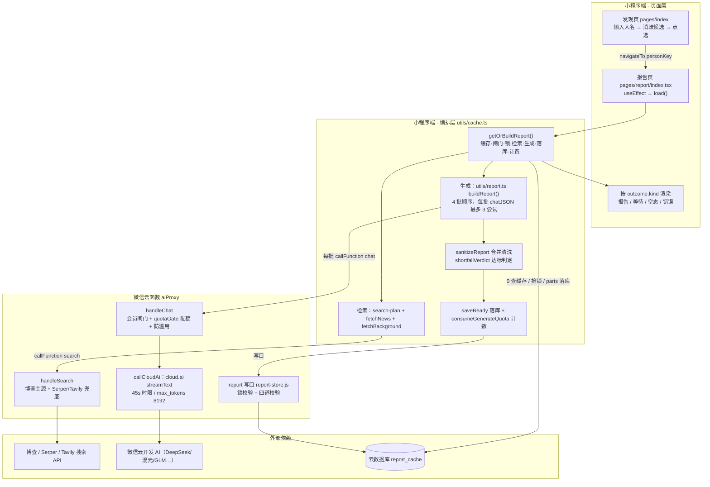
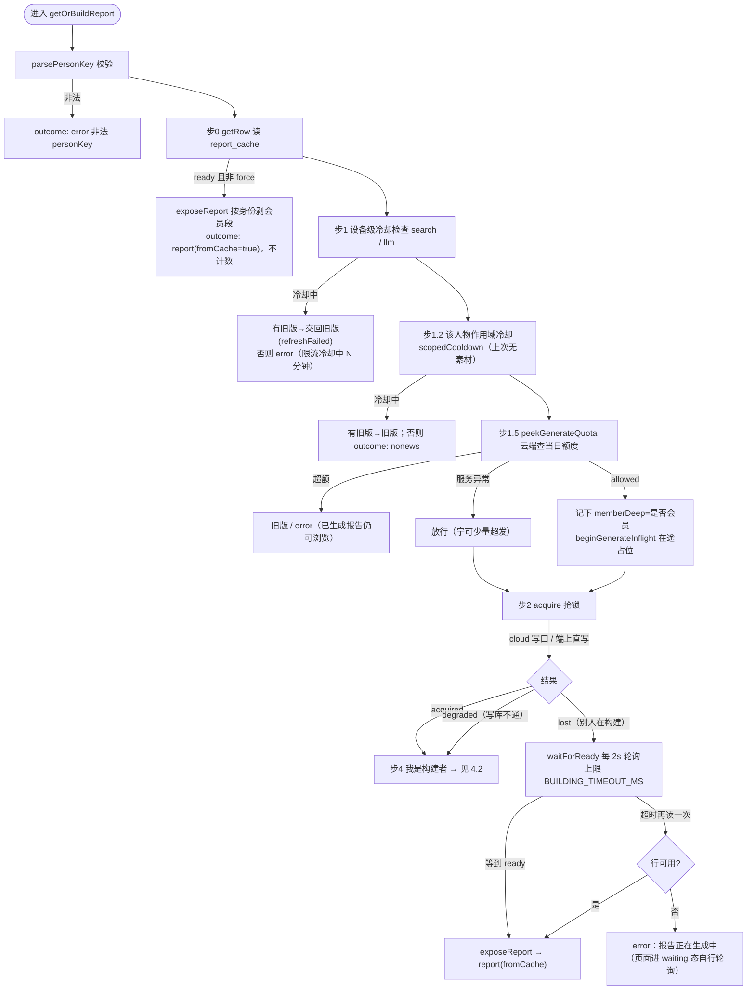
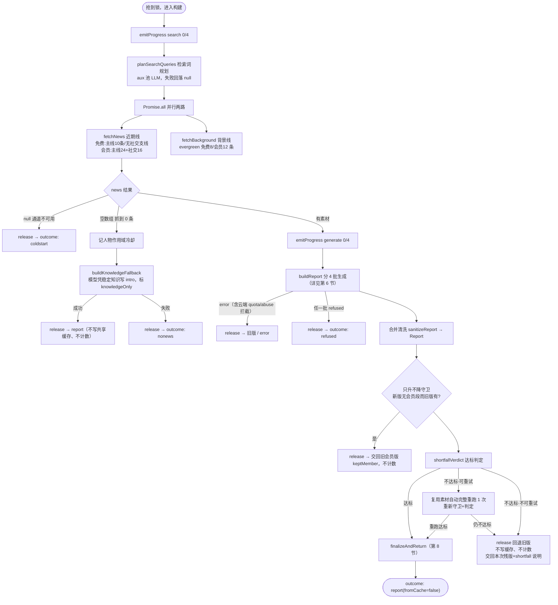
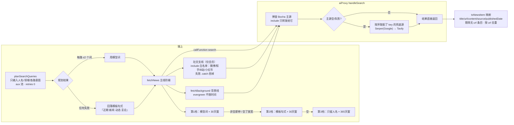
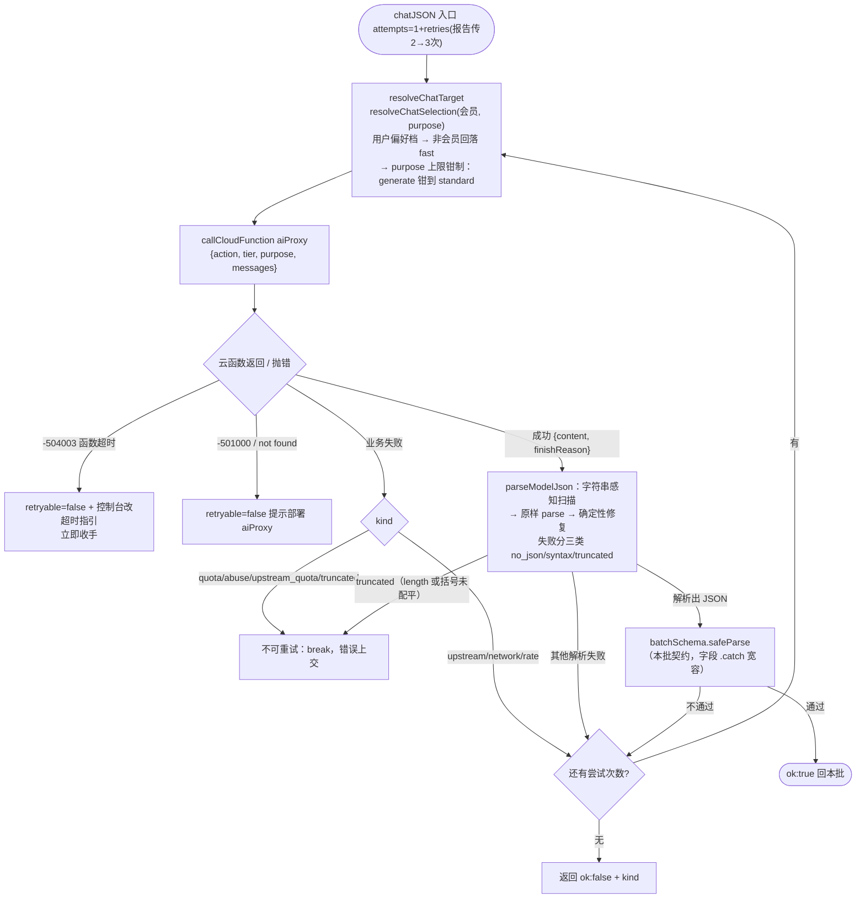
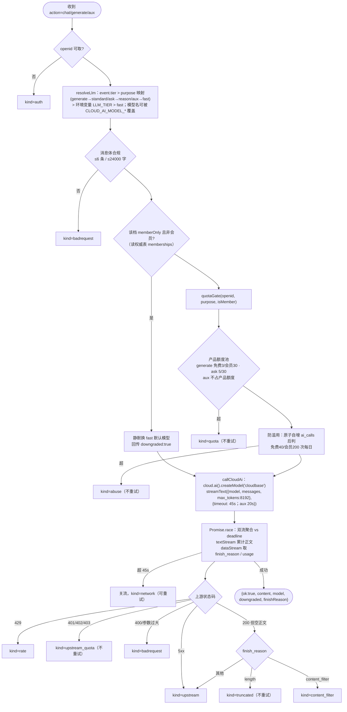
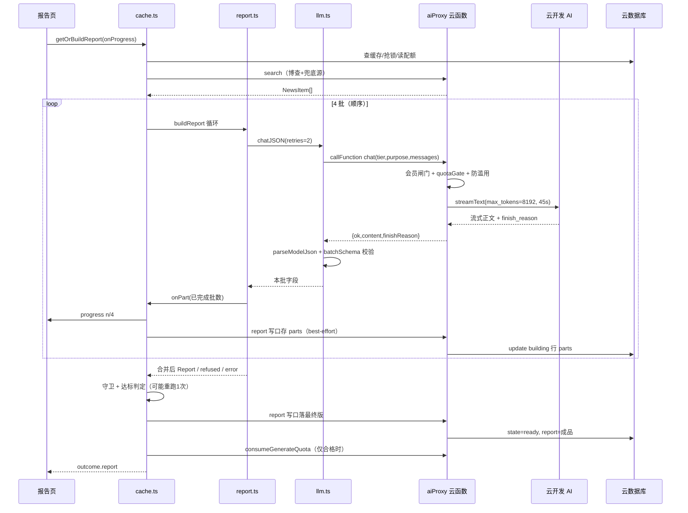
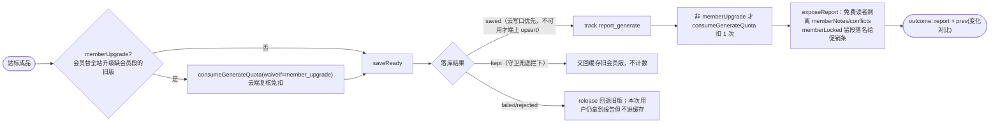
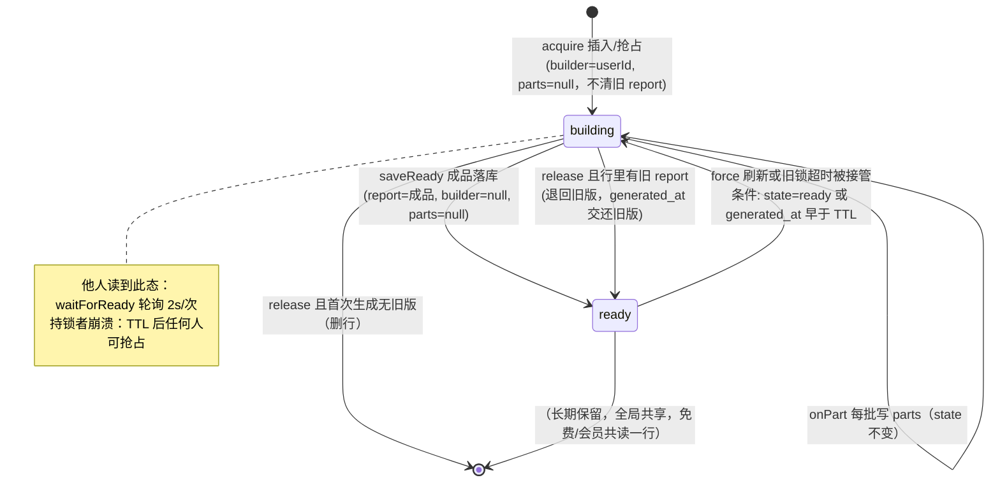

# 名人雷达 · 报告生成完整链路（从点击到落库）

> 版本对应：schema v2 / 分批生成 P0-B（2026-10-11）/ 云开发 AI 单通道
> 阅读对象：需要改动报告生成链路的开发者。本文只描述**当前代码的真实行为**，所有结论附文件与行号。
> 涉及代码：端上 `celebrity-radar/src/`，云函数 `celebrity-radar/cloudfunctions/aiProxy/`。

---

## 0. 一句话总览

用户在发现页选名人 → 报告页 `load()` 调 `getOrBuildReport()` →
**查缓存 → 过冷却/配额 → 抢分布式锁 → 检索素材（检索词规划 + 近期线 + 背景线）→ 大模型分 4 批顺序生成 JSON（每批最多 3 次尝试）→ 合并清洗 → 质量达标判定（不达标可自动重跑 1 次）→ 落共享缓存 → 扣生成额度 → 按读者身份剥离会员段后返回页面渲染**。

任一环节失败都有明确的降级出口，且**只有用户拿到合格报告才扣额度**。

---

## 1. 全景流程图



---

## 2. 起点：发现页 → 报告页（人物是怎么确定的）

代码：[pages/index/index.tsx](file:///c:/workspace/celebrity-radar/celebrity-radar/src/pages/index/index.tsx)、[utils/disambiguate.ts](file:///c:/workspace/celebrity-radar/celebrity-radar/src/utils/disambiguate.ts)

1. 用户输入人名 → 调 `disambiguate()`（走 **aux 配额池**的小模型请求，不占生成额度）：本地敏感名单先判，政治军事类直接 `refused`；否则让模型给出同名候选人。
2. **不自动判定唯一**：0 候选 → 未找到；≥1 个（哪怕只有 1 个）都弹「TA 是哪一位」候选列表，用户点选。
3. 点选后 `personKey = 名字#领域码`（如 `张三#tech`），跳转：
   `Taro.navigateTo('/pages/report/index?personKey=...&focus=...')`（index.tsx L215-L219）。
   - 复访历史名人时历史里已存 personKey，直接跳（L223-L225）。
4. `focus` 是生成侧重：`all / dynamics / quotes / timeline`，会进每批提示词的补充要求。

> personKey 是报告全局共享缓存的**唯一键**：免费用户和会员读的是同一行缓存，差别只在返回前剥不剥离会员段。

---

## 3. 报告页入口：load()

代码：[pages/report/index.tsx L382-L519](file:///c:/workspace/celebrity-radar/celebrity-radar/src/pages/report/index.tsx#L382-L519)

- `useEffect` 触发 `load(false)`，同时 `addHistory()` 写浏览历史（L477-L480）。
- force 刷新有在途锁（连点丢弃）；force 时**不清屏**，旧报告留在原地，顶部挂刷新提示。
- 唯一一次 await：

```ts
const outcome = await getOrBuildReport(personKey, { force, focus, onProgress: setProgress })
```

- `onProgress` 把真实进度 `{stage:'search'|'generate', done, total:4}` 直送等待动画；结束立即清空。
- 整个调用被 `.catch` 折成 `kind:'error'`，防止内部读库抛错后页面永远转圈。
- 返回后按 `outcome.kind` 分流（见第 9 节）；`'error' 且文案含「正在生成」` 进 `waiting` 态，页面每 5s 用 **force=false** 轮询一次（绝不借机真生成），最长等到与构建锁同值的超时，再落错误态。

---

## 4. 主编排：getOrBuildReport 全流程

代码：[utils/cache.ts L593-L1104](file:///c:/workspace/celebrity-radar/celebrity-radar/src/utils/cache.ts#L593-L1104)。下文「步」与代码注释里的编号一致。

### 4.1 前置闸门流程图（步 0 ~ 步 3）



要点：

- **缓存命中零成本**，不受冷却影响；冷却只拦「重新生成」。
- 三道闸门顺序刻意：设备冷却 → 人物冷却（纯本地零网络）→ 云端配额，避免「先说次数用完、再说没素材」的矛盾。
- **在途占位**（`beginGenerateInflight`）：peek 通过、consume 在几十秒后才发生，占位防同一用户并发生成两个不同人物突破免费额度；TTL 与构建锁同值。
- 抢锁三态：`acquired / lost / degraded`。degraded 表示「写库不通」而不是「有人在构建」，**照常生成**（只是本轮不写缓存），不能让用户白等。

### 4.2 构建者流程（步 4）：检索 → 生成 → 判定 → 落库



---

## 5. 检索子链路（素材从哪来）

代码：[utils/search.ts](file:///c:/workspace/celebrity-radar/celebrity-radar/src/utils/search.ts)、[utils/search-plan.ts](file:///c:/workspace/celebrity-radar/celebrity-radar/src/utils/search-plan.ts)、云函数 [aiProxy/index.js handleSearch（L945-L1060）](file:///c:/workspace/celebrity-radar/celebrity-radar/cloudfunctions/aiProxy/index.js#L945-L1060)



关键语义：

| 返回 | 含义 | 上层处理 |
|---|---|---|
| `null` | **通道不可用**：云函数未部署 / `unconfigured` / 未知 action | 不记冷却、不试知识兜底 → `coldstart` 引导态 |
| `[]` | 通道可用，但全部阶梯 + 兜底源都抓空 | 记人物作用域冷却 → 试知识兜底 → 仍失败 `nonews` |
| 非空数组 | 有素材 | 进入分批生成 |

- 重试：upstream/network 类退避重试 3 次（1s/2s）；429 rate 进 10 分钟冷却；auth/quota 不重试。
- 背景线任何失败都吞成 `null`，上层 `background ?? []`——它只是档案/关系/时间线的补充，判据永远是主线。
- 免费档 `socialCount:0`：**连社交支线请求都不发**；检索词规划也只问 news/profile 两路。

---

## 6. 核心：buildReport 四批生成

代码：[utils/report.ts L1539-L1683](file:///c:/workspace/celebrity-radar/celebrity-radar/src/utils/report.ts#L1539-L1683)；批次定义 [L687-L745](file:///c:/workspace/celebrity-radar/celebrity-radar/src/utils/report.ts#L687-L745)。

### 6.1 四个批次（口径全部从报告模板 REPORT_TEMPLATE/TOC_GROUPS 派生）

| # | 批次 key | 组名 | 模型产出字段 | 背景段 | 会员追加 | 提示词规则条 |
|---|---|---|---|---|---|---|
| 1 | identity | 基本档案 | intro, verdict, reputation, consistency, profile, relations | 是 | — | 2,9,10,16,17 |
| 2 | facts | 事实 | dynamics, quotes | 否 | — | 3,4 |
| 3 | judgement | 判断与风险 | analysisPoints, stance, controversies | 否 | memberNotes, conflicts | 6,7,13 |
| 4 | detail | 细节与延伸 | timeline, watchlist, glossary | 是 | — | 8,11,12 |

> `analysis` 不属于任何一批：模型只产 `analysisPoints` 拆条，正文由清洗时拼出；它只服务于「四批全败」的纯文本降级。

### 6.2 批次执行流程图

```mermaid
flowchart TD
    START(["buildReport 开始<br/>merged={} parts=[] missing=[] done=0"]) --> LOOP{"取下一批<br/>（共 4 批，顺序执行）"}
    LOOP -->|"还有"| B1["batchFields：会员且本批承载会员段<br/>则追加 memberNotes/conflicts"]
    B1 --> B2["buildReportSystem 拼 system：<br/>共用硬约束(角色/出处/第1条/第14条拒答)<br/>+ 本批范围 + 本批规则条 + 第15条写满<br/>+ 本批 JSON 格式 + 侧重提示 + 会员提示"]
    B2 --> B3["buildUserMessage：仅『名人+侧重』两行<br/>（知识模式：不喂检索素材）"]
    B3 --> B4["chatJSON(system,user,batchSchema,<br/>{retries:2}) 最多 3 次尝试<br/>purpose 默认 generate → 档位上限 standard"]
    B4 --> CK1{"结果"}
    CK1 -->|"kind=quota/abuse/upstream_quota"| ABORT["立即中止整份生成<br/>不降级，原样把云端文案交回上层"]
    CK1 -->|"其他失败"| MISS["记 missing.push(批key)<br/>存 lastFail，continue 下一批<br/>（不设冷却）"]
    CK1 -->|"{"refused":true}"| REFALL["整份按拒答返回<br/>敏感人物不能用另外三批拼出来"]
    CK1 -->|"成功"| MERGE["只搬本批契约声明的键进 merged/part<br/>done++"]
    MERGE --> PART["onPart(parts)：<br/>① emitProgress generate n/4<br/>② saveReportParts 中间结果落 building 行<br/>（异常吞掉，不影响生成）"]
    PART --> LOOP
    MISS --> LOOP
    LOOP -->|"4 批跑完"| DCHK{"done 计数"}
    DCHK -->|"0（全败）"| FB["仅 lastFail 可重试/429 时 setCooldown llm<br/>chatText 用 SYSTEM_FALLBACK 再要 ≤150 字纯文本"]
    FB -->|"成功"| DEG["返回 degraded:true 简版报告<br/>（含 coverage 画像，页面只剩警示条+一段文）"]
    FB -->|"失败"| FAIL["返回 error"]
    DCHK -->|"≥1（部分成功也继续）"| SAN["sanitizeReport 合并清洗（第 7 节）"]
    SAN --> MG["missing 非空 → report.missingGroups<br/>页面提示『部分段落缺失，可刷新重试』"]
    MG --> OK(["返回合格形状的 Report"])
```

### 6.3 为什么是「4 批顺序」而不是 1 次或并行

- **1 次要 16 节**时：长 JSON 撞 `max_tokens` 截断即整份报废；任一节失败整份降级。拆开后失败只丢一组、每批输出规模可静态验算（test/cases/20 钉住每批预算）。
- **顺序而非并行**：批次顺序 = 页面卡片顺序，日志里「第几批失败」与用户看到的缺失位置一一对应；也避免 4 路并发同时撞防滥用限速。
- 代价：调用 1→4 次。因报告是全局共享缓存、生成一次全站复用，可接受。

---

## 7. 单次调用细节：chatJSON（端）→ aiProxy（云）

### 7.1 端上 chatJSON 重试循环

代码：[utils/llm.ts L758-L847](file:///c:/workspace/celebrity-radar/celebrity-radar/src/utils/llm.ts#L758-L847)；通道 [chatViaPlatform L276 起](file:///c:/workspace/celebrity-radar/celebrity-radar/src/utils/llm.ts#L276)。



要点：

- **截断永不重试**：重发同一请求只会再撞同一上限，白等 30~40s。两种证据都认：`finish_reason==='length'`，或括号扫到末尾未配平。
- **每批独立 schema**（`batchSchema`）：`{refused:true}` 分支 ∪ 只含本批字段的对象分支；所有字段 `.catch()` 宽容兜底——模型把某个字段写成 null 不会废掉整批。
- 档位钳制：报告（generate）最高只能到 **standard 结构化档**；reason 推理档只给 AI 提问（ask）；aux 钳 fast。端上这层可被改包绕过，计费/会员闸门以云端为准。

### 7.2 云端 handleChat 内部

代码：[aiProxy/index.js L1237-L1447](file:///c:/workspace/celebrity-radar/celebrity-radar/cloudfunctions/aiProxy/index.js#L1237-L1447)；档位表 [llm.config.js](file:///c:/workspace/celebrity-radar/celebrity-radar/cloudfunctions/aiProxy/llm.config.js)。



> 平台硬天花板：云函数超时 60s（须在控制台手动设置，config.json 不生效），故内部 deadline 取 45s；模型当前映射 fast=hy3-preview、standard=deepseek-v4-flash、reason=deepseek-v4-pro（均为待实测候选，可用环境变量切换，不改代码）。

### 7.3 端云时序图（单批的一次成功调用）



---

## 8. 收尾：清洗 → 守卫 → 落库 → 计费

### 8.1 sanitizeReport（模型原始形状 → 可渲染 Report）

代码：[report.ts L1821 起](file:///c:/workspace/celebrity-radar/celebrity-radar/src/utils/report.ts#L1821)。

- **出处**：构建 URL 归一化 → 媒体名 → 标题三层索引；知识模式（当前恒为 knowledgeMode）下统一写「据公开资料」，不再因指不回素材而剔条目。**命中素材时 `source` 一律取素材的媒体名**（2026-10-17）：`url` 早已强制取素材原串，出处若还听模型的，就会出现「出处写新浪、点开是网易」。
- **枚举归一**：sentiment / stance / relation 越界一律回落中性/other。
- **长度**：有上限走 `clipText`（按字形簇，不切坏 emoji），段落级文本只 `cleanText`；条数全部 `slice` 封顶（上限全部取自 `config/benefits.ts`，2026-10-17 起连 stance / verdict / reputation / consistency 也不再是裸数字）；**`timeline.date` 先归一成 `YYYY-MM-DD` / `YYYY-MM`**（认不出才退回 `clipText`）—— 端上按字符串排序，混写法会按「格式」而不是按「时间」排；timeline 去空条、不重排。
- **兜底也走这里**（2026-10-17）：无素材兜底 `buildKnowledgeFallback` 输出**同一套字段形状**（调 `sanitizeReport(..., { knowledgeOnly: true })`），不再自己拼一份 `Report` —— 于是「指不出素材也不剔除」「空数组不落键」「文本卫生」只有一处口径。
- **端上派生，不信模型**：`analysis` 由 analysisPoints 拼出；`sources` 从全报告真正引用到的素材反查生成（不让模型抄 URL）；`heat` 热度与 `coverage` 报道画像**只用近期 news 计算**，背景素材不许混入。

### 8.2 两道落库前守卫

1. **只升不降**（`shouldKeepMemberVersion`）：本次产物不含会员段、而缓存旧版含会员段 → 不覆盖，交回旧版（`keptMember`，不计数）。落库前判一次，`saveReady` 内再兜底判一次。
2. **达标判定**（`shortfallVerdict`，[L2250-L2291](file:///c:/workspace/celebrity-radar/celebrity-radar/src/utils/report.ts#L2250-L2291)）：

| 判定 | 可重试? |
|---|---|
| knowledgeOnly（无素材知识版） | 否（检索已穷尽） |
| degraded 纯文本简版 | 是 |
| 缺 intro / 缺 analysis 骨架 | 是 |
| dynamics+quotes+timeline 条数不足 | 仅当 coverage 素材数本身够门槛才「是」 |
| 会员档却无任何会员专享段 | 同上 |

- 可重试 → **复用刚抓到的素材自动完整重跑 1 次**（不重新检索），仍不达标则交回最新残版。
- 不达标一律：**不写共享缓存、不扣额度**，release 把行退回 ready 保留旧版，返回带 `shortfall` 说明的本次残版。

### 8.3 finalizeAndReturn（[cache.ts L1056-L1098](file:///c:/workspace/celebrity-radar/celebrity-radar/src/utils/cache.ts#L1056-L1098)）



- `saveReady` 用 **upsert（整篇替换）** 而不是 where update：占位行的 report 是 null，点号更新子字段会被库拒绝，会导致 state 永久卡 building。
- 云写口（aiProxy `report` action / report-store.js）拒绝（非会员写会员段、体积超限、锁被接管）时**不回退端上直写**；只有「函数不可用」才回退。
- 中间结果 `parts` 随成品落库清空；成品写入即对全站读者可见。

---

## 9. 终点：页面如何消费 outcome

[pages/report/index.tsx L438-L472](file:///c:/workspace/celebrity-radar/celebrity-radar/src/pages/report/index.tsx#L438-L519)

| outcome.kind | 含义 | 页面 phase / 行为 |
|---|---|---|
| `report` | 成功（新生成或缓存） | `ready` 渲染 15 节卡片；带 prev → 变化对比；shortfall → 顶部「本次未达标未扣次数」条；memberLocked → 会员促销条；missingGroups → 「部分段落缺失」提示 |
| `coldstart` | 搜索通道不可用（null） | 钥匙空态：联网能力未配置/暂无报告 |
| `nonews` | 确认无公开素材（[]） | 纸箱空态：暂未检索到公开信息 |
| `refused` | 敏感人物拒答 | 拒答空态 |
| `error` | 各类失败；文案含「正在生成」→ waiting（5s 轮询，最长与锁同值）；有旧报告时只挂失败条不清屏 | error / waiting |

渲染层另有独立的降级适配：老报告缺字段、降级简版、会员段分档目录（`buildReportTocGroups`）都由 [utils/report-toc.ts](file:///c:/workspace/celebrity-radar/celebrity-radar/src/utils/report-toc.ts) 的模板 `visible` 谓词控制。

---

## 10. report_cache 行状态机



---

## 11. 失败分支速查表（排查用）

| 现象 / kind | 触发点 | 重试? | 冷却? | 计数? | 缓存? |
|---|---|---|---|---|---|
| 缓存命中 | 步0 | — | 不受限 | 否 | 读 |
| search/llm 设备冷却中 | 步1 | — | — | 否 | — |
| 人物作用域冷却（无素材） | 步1.2 | — | — | 否 | — |
| 生成额度超 | quotaGuard | 否 | — | 否 | — |
| 抢锁 lost | 他人构建中 | 轮询等待 | — | 否 | — |
| news=null | 通道不可用 | 否 | 否 | 否 | coldstart |
| news=[] | 全源抓空 | 否 | 记人物冷却 | 否 | 知识兜底不落库 |
| knowledge fallback 成功 | 模型稳定知识 | — | — | 否 | **不写共享缓存** |
| 云端 quota/abuse/upstream_quota | handleChat 闸门 | 否，立即中止 | 否 | 否 | — |
| 单批 upstream/network/rate | chatJSON | 批内最多 3 次 | 仅全败时设 llm 冷却 | 否 | 成功批 parts 已落 |
| 单批 truncated | finish_reason=length | **否** | 否 | 否 | parts |
| 四批全败 | buildReport | chatText 纯文本抢救 1 次 | 可重试类设 llm 冷却 | 否 | degraded 不达标不落库 |
| 任一批 refused | 敏感人物 | 否 | — | 否 | — |
| shortfall 不达标 | 落库前判定 | 可重试类自动重跑 1 次 | — | **否** | **不写**，旧版保留 |
| 只升不降拦截 | 旧版含会员段 | — | — | 否 | 保留旧版 |
| 落库 rejected/failed | 写口拒绝/DB 错 | — | — | 否 | 用户拿到报告但不进缓存 |
| 合格成品 | finalize | — | — | **扣 1 次** | state=ready 全站可见 |

---

## 12. 关键常量与时延预算

代码：[cache.ts L61-L106](file:///c:/workspace/celebrity-radar/celebrity-radar/src/utils/cache.ts#L61-L106)、[benefits.ts](file:///c:/workspace/celebrity-radar/celebrity-radar/src/config/benefits.ts)

| 常量 | 值 | 含义 |
|---|---|---|
| 批次数 | 4 | REPORT_BATCHES，页面进度 total |
| 单批尝试 | 最多 3（retries=2） | chatJSON attempts |
| 完整重跑 | 最多 2 轮 | shortfall 可重试时 |
| 云端单次时限 | 45s（aux 20s） | 平台天花板 60s |
| 构建锁 TTL | 4×3×2×45s + 15s + 30s = **1125s（约 18.75 分）** | 必须覆盖最坏构建，否则正常长构建被抢锁 |
| 等待方轮询 | 2s/次，上限同 TTL；页面 waiting 态 5s/次 | 正常构建实测约 40~100s |
| chatMaxTokens | 8192（三档同值） | reasoning 预留 40%，正文预算约 4915 token，test/cases/20 校验 |
| 生成额度 | 免费 3 / 会员 30 每日 | ask 5/30；防滥用 40/200；检索条数钳 20/40 |
| 素材条数 | 免费主线 10、无社交、背景 8；会员 24+16、背景 12 | 云端再钳一次 |

---

## 13. 文件与函数索引

| 层 | 文件 | 关键导出 |
|---|---|---|
| 页面入口 | src/pages/index/index.tsx | 消歧 → openPerson（L215） |
| 页面消费 | src/pages/report/index.tsx | load（L382）、outcome 分发（L438）、waiting 轮询（L502） |
| **编排** | src/utils/cache.ts | getOrBuildReport（L593）、acquire/release（L343/L429）、saveReady（L481）、saveReportParts（L550）、finalizeAndReturn（L1056） |
| 检索 | src/utils/search.ts | fetchNews（L361）、fetchBackground（L450） |
| 检索词规划 | src/utils/search-plan.ts | planSearchQueries |
| 消歧 | src/utils/disambiguate.ts | disambiguate |
| **生成** | src/utils/report.ts | buildReport（L1539）、REPORT_BATCHES（L740）、buildReportSystem（L968）、sanitizeReport（L1821）、shortfallVerdict（L2250）、buildKnowledgeFallback（L1109） |
| 模板真源 | src/utils/report-toc.ts | REPORT_TEMPLATE、TOC_GROUPS、SEARCH_LANES |
| LLM 通道 | src/utils/llm.ts | chatJSON（L758）、chatViaPlatform（L276）、resolveChatSelection（L199）、parseModelJson |
| 云调用 | src/utils/cloud.ts | callCloudFunction（L94）、cloudTimeoutHint |
| 配额/冷却 | src/utils/quota.ts、cooldown.ts、quota-guard.ts | peek/consumeGenerateQuota、setCooldown |
| 云函数入口 | cloudfunctions/aiProxy/index.js | main 分发（L1466）、handleChat（L1237）、callCloudAi（L1105）、handleSearch（L945） |
| 云函数配置 | cloudfunctions/aiProxy/llm.config.js、quota.config.js | TIERS、PURPOSE_TIER、resolveLlm、配额池 |
| 云函数写口 | cloudfunctions/aiProxy/report-store.js | 锁/会员/体积四道校验 |
