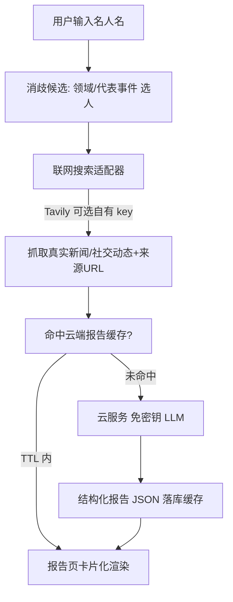
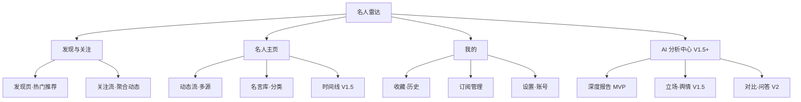

# 名人雷达 · 微信小程序设计与研发方案（增强版）

> 版本：v1.3 ｜ 日期：2026-10-04 ｜ 形态：Taro（React）+ Taro UI 小程序 + WorkBuddy 云服务
> 状态：方案设计阶段（未开工）
> v1.1 变更：新增 §六 合规与内容安全；重划 MVP 范围；报告 Schema v2（消歧 / 缓存 / 热度口径 / 模式标注）；修正图表与 RAG 选型错误；新增缓存与成本模型；补充重名消歧机制。
> v1.2 变更：组件库由 NutUI-React-Taro 改回 **Taro UI**（用户决策，2026-10-04）。
> v1.3 变更（评审收口）：新增 §3.8 数据模型与工程收口（collection 结构 / 主包预算 / zod / 埋点）；§1.6 补领域码枚举与 heat 归一公式；§2.4 补冷启动、缓存击穿、敏感输入三条边界；§3.3 补 Taro UI 版本矩阵；§4.1 补 TabBar 与路由规划；§5.3 补三条风险；§5.4 扩为可执行验收用例；§六 新增输入侧过滤；§5.2 补埋点任务。

---

## 0. 概述

「名人雷达」是一款面向微信生态的**名人动态情报台**小程序。用户输入任意名人名字（如雷军），小程序先**联网抓取**该名人近期的新闻、公开演讲、社交平台动态，再交由 **AI 提炼**成一份结构化报告——经典名言/语录、近期动态、AI 点评、时间线与信息来源。在此基础上，方案进一步扩展为「**关注—聚合—分析—沉淀—分享**」的产品级闭环，而非单一「查一人出报告」的最小功能。

> **产品定位口径（合规前提，见 §六）**：本产品定位为「AI 信息整理工具」，不是资讯平台。所有内容均为「用户主动查询时生成、附带来源链接、明确标注 AI 生成仅供参考」的个性化结果，不做公众可见的社区 / 评论 / 资讯分发。

核心链路：



---

## 一、需求规划

### 1.1 背景与目标
- **痛点**：名人的公开言论、动态分散在新闻、微博、发布会、访谈中，缺乏一个聚合 + 提炼的轻量入口。
- **目标**：输入任意名人名字 → 自动联网抓取近期公开信息 → AI 提炼成「名言/动态/点评/趋势」结构化报告；并支持关注多个名人、长期沉淀与分享。

### 1.2 用户画像（细分）
| 角色 | 诉求 |
|---|---|
| 内容创作者 | 找金句、做选题、写稿前快速掌握某人立场 |
| 投资人 / 分析师 | 跟踪创始人公开发言，辅助判断态度与风向 |
| 普通用户 | 碎片时间看「今天雷军说了啥」 |

### 1.3 核心场景（5 个）
1. 关注雷军，每天打开看聚合动态流。
2. 一键生成某人的「深度分析报告」。
3. 收藏雷军关于「创业 / 管理」的名言，生成分享卡片。
4. 对比「雷军 vs 马斯克」的公开立场与热度。**（V2）**
5. 订阅后收到「本周关注名人动态周报」。**（V2）**

### 1.4 范围界定（v1.1 重划）
- **MVP（本次落地，收敛为 3 条主线）**：
  - **主线 1 查报告**：搜索（含消歧）→ 深度报告（六段 + 缓存）→ 名人主页简版（动态/名言两 Tab）。
  - **主线 2 关注沉淀**：关注 / 取关 → 关注流（**云端缓存优先，节流刷新**）→ 收藏 / 历史。
  - **主线 3 账号设置**：微信登录、搜索源 key 管理、隐私设置。
  - MVP **不含**：AI 问答、两人对比、词云、热度折线图、分享长图（canvas 卡片仅做 P1 验证性实现）。
- **V1.5**：手动周报、分享卡片完善、动态多域名源过滤。
- **V2**：AI 问答（RAG 式）、对比看板、热度趋势、自动订阅推送（轻量后端）、多语言。

> 收敛理由：原 MVP 含 7 大模块（问答 / 对比 / 可视化齐上），首版交付风险高且 LLM 成本不可控；问答与对比强依赖语料库规模，宜在语料沉淀后（V1.5+）再开。

### 1.5 成功指标（v1.1 补基线）
| 指标 | MVP 目标（上线 4 周） |
|---|---|
| 次周留存率 | ≥ 15% |
| 人均关注数 | ≥ 2 |
| 报告生成次数 / 周活用户 | ≥ 3 |
| 报告缓存命中率 | ≥ 50%（成本核心指标） |
| 分享率（V1.5 起） | ≥ 8% |

### 1.6 关键名词口径（v1.1 新增，v1.3 补公式与枚举）
- **热度值 `heat`**：`heat = round(60 × norm(N30) + 40 × norm(N7))`，归一函数 `norm(N) = min(1, log10(1 + N) / 2)`（对数缩放，N ≥ 99 封顶 1，防单条爆款拉满分），N30 / N7 为 Tavily 结果集中近 30 天 / 近 7 天条数。取 0–100，MVP 不引入额外声量接口，公式写进报告页脚注。
- **消歧（disambiguation）**：同名名人通过「领域 + 国籍 + 一句代表事件」候选卡片区分；用户选定后生成稳定 `personKey`（`名字#领域码`），后续关注 / 缓存 / 报告均挂 `personKey` 而非裸名字。候选列表末位固定追加「都不是 TA → 补充领域关键词」兜底入口；LLM 生成的候选若与素材零印证（领域 / 事件在素材中无任何呼应），降级为「未识别到该名人」。
- **领域码枚举（v1.3）**：`tech`（科技）/ `business`（商业）/ `ent`（文娱）/ `sports`（体育）/ `academia`（学术）/ `other`（兜底）。消歧候选的领域字段仅允许从该枚举取值，保证 `personKey` 稳定可重放。

---

## 二、功能设计

### 2.1 功能模块（7 大模块，标注 MVP 取舍）

**M1 发现与关注**（MVP：搜索 + 关注 + 关注流）
- 搜索任意名人 → **消歧候选列表**（LLM 生成领域/代表事件，用户选定）→ 关注 / 取关
- 热门 / 分类（科技·商业·文娱·体育）发现页（MVP 仅静态运营位，V1.5 数据化）
- 相似名人推荐 **（V2）**
- 关注流：所有关注对象的动态按时间聚合（**读取云端缓存，用户手动下拉刷新触发抓取，单日每账号限 N 次**，见 §3.7）

**M2 名人主页**（MVP 简版：动态 / 名言两 Tab）
- 信息卡（头像占位、简介、标签、热度值——口径见 §1.6）
- MVP Tab：**动态 / 名言**；时间线 Tab **（V1.5）**、数据 Tab **（V2）**
- 一键生成深度报告

**M3 动态与语料**
- 动态流：多源（Tavily news + 微博 / 知乎等域名过滤）抓取，带来源、时间
- 名言库：按主题（创业 / 管理 / 人生 / 产品）分类、收藏、复制（MVP）；卡片生成 **（P1）**
- 事件时间线 **（V1.5）**

**M4 AI 分析中心**
- 深度报告（简介 / 动态 / 名言 / 点评 / 时间线 / 来源）**（MVP）**
- 立场与舆情（对热点话题态度、情绪走向）**（V1.5，先在报告 `analysis` 段内轻量体现）**
- 关键词云 + 高频观点 **（V2）**
- 热度趋势折线图 **（V2）**
- 两名人横向对比 **（V2）**
- 基于该名人语料的 AI 问答 **（V2，依赖语料库沉淀）**

**M5 订阅与推送**
- 关注即订阅
- MVP：打开读缓存 + 手动「生成周报」**（P1）**
- V2：定时抓取 + 微信订阅消息推送（需轻量后端，见 §三）

**M6 分享与沉淀**
- 生成名言卡 / 报告长图（canvas）**（P1）**
- 导出 / 复制全文（MVP）
- 我的收藏（名言 + 报告）、历史归档（MVP）

**M7 设置与账号**（MVP）
- 微信登录（云 Auth）
- 搜索源 key 管理、模型选择
- 推送频率、隐私设置

### 2.2 优先级
- **P0** = M1（搜索/消歧/关注/关注流缓存版）+ M2 简版 + M3 动态/名言 + M4 深度报告 + M7
- **P1** = M5 手动周报 + M6 分享卡片
- **P2** = M4 问答 / 对比 / 趋势 / 词云 + M5 自动推送

### 2.3 AI 报告 Schema v2（产品核心）
```json
{
  "personKey": "雷军#tech",
  "name": "雷军",
  "mode": "realtime",              // realtime | knowledge（knowledge 时页面强制显示警示条）
  "generatedAt": "2026-10-04T12:00:00+08:00",
  "heat": 78,                       // 口径见 §1.6，0-100
  "intro": "一句话简介",
  "dynamics": [
    { "date": "2026-09-20", "title": "...", "summary": "一句摘要",
      "source": "新浪科技", "url": "https://...", "sentiment": "positive" }
  ],
  "quotes": [ { "text": "名言", "context": "出处场合/时间", "source": "url 或 据公开资料" } ],
  "analysis": "AI 综合点评（风格 / 近期态度 / 热点）",
  "timeline": [ { "date": "2026-08-01", "event": "发布会宣布新车交付" } ],
  "sources": [ { "title": "...", "url": "https://..." } ],
  "disclaimer": "内容由 AI 基于公开网络信息生成，仅供参考，不代表本平台立场。"
}
```
**系统提示词硬约束（v1.1 加强）**：仅基于提供的真实素材作答；不编造日期与来源；`quotes` 必须逐条带 `source`（素材 URL 或显式「据公开资料」）；`dynamics`/`sources` 中的 URL 必须来自 Tavily 返回结果原文，禁止模型自行拼写域名；`sentiment` 仅允许 `positive | neutral | negative` 三值。

### 2.4 异常与边界（v1.1 扩充）
| 场景 | 处理 |
|---|---|
| 网络失败 / 超时 | 提示并允许重试（指数退避，最多 2 次） |
| 超配额 | 提示 + 当日降频（冷却 10 分钟） |
| 内容被拦截 | 提示换措辞 |
| 抓取为空 | **默认不进入知识模式**；提示「暂未检索到近期公开信息」，用户可在设置中显式开启「知识模式（无实时来源，结果可能不准确）」 |
| 重名 | 消歧候选列表；无法消歧时要求用户补充领域关键词 |
| 无 key + 缓存为空（冷启动 / 长尾名人） | 不进入生成流程；展示「暂无报告」引导态：说明内容需联网检索生成 + 跳设置页配置搜索源 key / 或从热门运营位换人；禁止空态死循环 |
| 同一 personKey 并发生成（缓存击穿） | 生成前先条件写入 `report_cache` 的 `state=building` 占位，**只有写入成功者执行 Tavily + LLM**；其余请求轮询等待 ≤30s，超时提示「稍后查看」；完成后置 `state=ready`（见 §3.8） |
| 输入命中敏感名单（政治 / 军事等敏感人物） | 前置拦截，不发起 Tavily / LLM：返回「暂不支持查询该人物」；两级拦截见 §六.7 |
| LLM 输出非法 JSON | 丢弃流式方案，非流式重试一次 + `response_format: json_object`；仍失败则展示分段纯文本降级渲染 |
| 命中缓存 | 报告页顶部显示「生成于 xx 前 · 查看最新」双入口 |

---

## 三、技术选型

### 3.1 为什么引入开源框架（快速开发导向）
原生小程序能跑，但列表、卡片、状态、请求都要手写，重复劳动多。引入成熟**开源框架 + 组件库 + 工具链**可把开发量砍掉一大半：UI 用现成组件，AI 用免密钥云服务，团队只需聚焦「联网抓取 + 报告编排 + 缓存成本控制」这一核心差异点。

### 3.2 框架候选对比（已选定 Taro）
| 方案 | 语言 / 构建 | 跨端能力 | 生态 | 与云 SDK 契合度 | 选定 |
|---|---|---|---|---|---|
| 原生 + TDesign / Vant | WXML / JS | 仅微信 | 官方 + 社区组件库 | 最佳 | 备选 |
| uni-app（Vue3 + Vite） | Vue3 | 微信 + H5 + App | 插件市场极大（uni-ui / uView / uCharts） | 需验证 | 备选 |
| **Taro（React）+ Taro UI** | React / TypeScript | 微信 + H5 + RN | Taro UI（Taro 官方团队出品，与框架零缝隙集成，组件风格统一） | 需验证 npm 打包（见 3.4） | **✓ 选定** |

> v1.2 修正：组件库按用户决策采用 **Taro UI**（Taro 官方团队出品、与 Taro 框架深度集成、主题定制走 SCSS 变量）。NutUI-React-Taro 降为备选。

### 3.3 推荐技术栈（v1.1 修正）
- **框架**：**Taro（React + TypeScript）+ Taro UI**。
- **构建链**：Taro CLI + Node.js；`taro build --type weapp` 产出原生小程序工程 `dist/`。
- **组件库**：Taro UI（`AtSearchBar / AtCard / AtTabs / AtList / AtTag / AtToast / AtButton / AtLoadMore` 等，主题通过覆盖 `taro-ui` 的 SCSS 变量定制）。
- **Taro UI 版本矩阵（v1.3，开工前锁定）**：`taro-ui@3.x` 官方仅对齐 `@tarojs/taro@3.x`；**MVP 一律锁 Taro 3.x 全家桶**（CLI / taro / taro-components / taro-ui 均 3.x），不采用 Taro 4.x（taro-ui 对 4.x 无官方兼容声明，验证成本 > 收益）。样式策略：组件从 `taro-ui` 具名按需 import，全局样式仅引一次 `taro-ui/dist/style/index.scss`；**主包预警线 1.5MB**，超线即拆分包（见 §3.8）。
- **状态管理**：**zustand**（React 轻量首选）。
- **图表（V2 再引入）**：~~echarts-for-react~~ → **uCharts（含 Taro 适配）或 echarts 的 Taro 定制版 `@tomiaa/echarts-taro`**；**词云不做 canvas 方案，用 CSS 标签墙降级实现**（flex 布局按词频映射字号，稳定且免 canvas 兼容坑）。
- **HTTP 封装**：统一 `Taro.request`（跨端一致；云 SDK 内部已走 `wx.request`，无需手写）。
- **工具库**：`dayjs`（日期）、`marked`（H5 报告渲染；小程序侧用 rich-text / 自研分段渲染，见 §4.3）。
- **AI / 后端**：WorkBuddy 云服务**免密钥 LLM**（SDK `@tencent-ai/workbuddy-cloud-sdk`，dev 频道）。~~LangChain.js~~ → **不引入**（其依赖 Node 运行时，小程序端不可用）；V2 的 AI 问答用「DB 语料关键词检索 + Top-K 片段拼 prompt」的轻量 RAG，必要时由 V2 后端承接。
- **后端（V2 自动推送）**：轻量定时服务（Node + 云函数），承接 Tavily 抓取 + LLM 摘要 + 微信订阅消息。

### 3.4 Taro 工程结构与云 SDK 集成
- **目录结构（Taro 标准）**
  ```
  celebrity-radar/
  ├─ config/            # Taro 编译配置（dev / index / prod）
  ├─ src/
  │  ├─ app.tsx / app.config.ts        # 入口与全局页面注册（pages 清单）
  │  ├─ pages/          # index 搜索与消歧 / report 报告 / profile 名人主页 / feed 关注流 ...
  │  ├─ components/     # 自定义组件
  │  ├─ stores/          # zustand（auth / follows / report-cache）
  │  ├─ utils/cloud.ts                 # 云 SDK 初始化
  │  ├─ utils/workbuddy-cloud-diagnostics.ts
  │  ├─ utils/search.ts               # Tavily 适配器（Taro.request）
  │  ├─ utils/disambiguate.ts         # 重名消歧
  │  ├─ utils/report.ts               # LLM 报告生成 + JSON 校验
  │  ├─ utils/cache.ts                # 报告/动态缓存（云 DB + 本地内存二级）
  │  └─ styles/
  ├─ package.json
  ├─ tsconfig.json
  └─ project.config.json              # 微信小程序工程配置（miniprogramRoot 指向 dist）
  ```
- **云 SDK 集成（mini-program 形态）**：Taro 编译产物运行在 `wx` 运行时，按云 SDK 的 `/miniprogram` 子包初始化，把全局 `wx` 注入客户端：
  ```ts
  import { createMiniProgramWorkBuddyCloud } from '@tencent-ai/workbuddy-cloud-sdk/miniprogram'
  import { createDiagnosticWx } from './workbuddy-cloud-diagnostics'
  export const cloud = createMiniProgramWorkBuddyCloud({
    endpoint: publicConfig.endpoint,
    publishableKey: publicConfig.publishableKey,
    wx: createDiagnosticWx(wx),
  })
  ```
- **发布说明**：Taro 源码在 `src/`，`taro build --type weapp` 生成 `dist/`（标准原生小程序工程）。**发布以 `dist/` 作为小程序工程**：可在微信开发者工具上传，或在「绑定已有小程序」后走审核发布；试用小程序同理以构建产物为准。

### 3.5 关键技术权衡
- **定时推送的边界**：当前云服务四模块（DB / Auth / Storage / LLM）**不含定时任务执行器**。自动订阅推送需一个最小后端。MVP 务实方案：打开小程序读缓存 + 手动刷新 + 手动「生成周报」；V2 在 WorkBuddy 上将其发布为 HTTP 服务承接定时调用。
- **多源抓取**：Tavily 支持 `domain` 过滤，从而聚合新闻 / 微博 / 知乎等不同来源，无需逐个接 API。
- **key 安全**：用户搜索源 key 仅存**本地 storage**（v1.1 明确：不提供「云端加密配置」——将第三方 key 上传云端引入平台安全责任，收益有限；换设备需重填，属可接受摩擦）。key 绝不进前端源码或公网；小程序包可被反编译，运行时请求可被代理抓到 key，**此风险须在设置页明示用户**（建议用户使用低额度 key）；V2 后端代理后此风险消除。
- **Taro 与云 SDK 契合**：Taro 编译产物运行在 `wx` 运行时，云 SDK 的 `/miniprogram` 子包按 `wx.request` 工作，初始化时把全局 `wx` 注入即可；与托管发布的对接以 `dist/` 构建产物为准。
- **流式与 JSON 的取舍（v1.1）**：报告需合法 JSON 落库缓存，`stream + response_format: json_object` 组合在部分模型上不稳。**报告生成用非流式 + json_object**；「打字机效果」由前端对已成 JSON 的分段做**逐段动画**模拟，体验等价且不牺牲正确性。

### 3.6 信息架构


### 3.7 缓存与成本模型（v1.1 新增，MVP 必做）

**两级缓存**（核心目的：把「按查询次数付费」变成「按名人数量付费」）：
1. **云 DB 报告缓存**：collection `report_cache`，主键 `personKey`，字段含 `report JSON / generatedAt / searchMeta`。**TTL 24h**：TTL 内任何用户查同一名人直接命中，不触发 Tavily 与 LLM。报告页显示「生成于 xx 前 · 刷新最新」。
2. **云 DB 动态缓存**：collection `feed_cache`，主键 `personKey`，存最近一次 Tavily 原始结果（**不存 LLM 产物**，动态列表只需结构化映射，无需 LLM）。关注流打开时仅读缓存；下拉刷新按 `personKey` 逐个更新，**每账号每日主动刷新上限 10 次**（DB 计数器 collection `refresh_quota`）。

**无 key 用户**：读同一 `personKey` 的共享缓存（有 key 用户已生成的报告），实现「无 key 也能看最近报告，有 key 才能强制刷新」的自然分层。

**成本估算口径**（上线前用真实数据校准）：
- Tavily：1000 次免费/月 → 缓存命中率 50% 时约支撑 2000 次报告查询 + 有限关注流刷新。
- LLM：仅未命中缓存的报告触发；按 token 计，预估单报告 4–6k token（素材 3k + 输出 1.5k）。
- 超限表现：统一「今日已达上限」提示 + 引导明日再看（不做排队）。

### 3.8 数据模型与工程收口（v1.3 新增）

**云 DB Collections（主键均为显式 `_id`）**

| collection | 主键 `_id` | 字段 | 说明 |
|---|---|---|---|
| `report_cache` | `personKey` | `report`（Schema v2 JSON）/ `generatedAt` / `state`（`building` \| `ready`）/ `builder`（openid）/ `searchMeta` | 全局共享；TTL 24h；`state=building` 作生成互斥锁（条件写入，见 §2.4） |
| `feed_cache` | `personKey` | `items`（Tavily 结果结构化映射）/ `fetchedAt` | 只存映射，不存 LLM 产物 |
| `refresh_quota` | `{openid}#{yyyy-mm-dd}` | `count` | 每账号每日主动刷新 ≤10 次，原子自增 |
| `follows` | `{openid}#{personKey}` | `personKey` / `name` / `domain` / `followedAt` | 按 `openid` 前缀查询关注列表 |
| `favorites` | `{openid}#{type}#{hash}` | `type`（`quote` \| `report`）/ `payload` / `personKey` / `createdAt` | `hash` = 内容摘要 md5 前 8 位，天然防重 |
| `history` | `{openid}#{ts}` | `personKey` / `name` / `ts` | 每账号仅保留最近 50 条，写入时裁剪 |
| `users` | `openid` | `nickname` / `avatarUrl` / `settings`（knowledgeMode、模型偏好等）/ `createdAt` | Auth 登录后首次进入时初始化 |
| `events` | `{ts}#{rand6}` | `openid` / `event` / `personKey?` / `props` | 埋点（见下），支撑 §1.5 指标 |

**埋点事件枚举**：`search / disambiguate_selected / report_hit_cache / report_generate / follow / unfollow / favorite / refresh_feed / share`。上线首日即采集；缓存命中率 = `report_hit_cache / (report_hit_cache + report_generate)`，次周留存 / 人均关注数从 `events` + `follows` 出数。

**Schema 校验器**：`zod`（TS 原生、体积小）。报告全字段校验 + URL 白名单过滤 + `heat`/`sentiment` 校验统一收口在一个 `sanitizeReport()`（附录 B），不信任提示词。

**主包体积预算**：MVP 单主包（5 页 + taro-ui 按需样式）预估 < 1.5MB；预警线 1.5MB、硬限 2MB，超线把报告页 + 名人主页拆为分包（`subpackages`），TabBar 三页留主包。

**环境变量**：`src/config/public.ts` 存 `endpoint / publishableKey`（非敏感、可进包，即 §3.4 代码中的 `publicConfig`）；用户级 Tavily key 仅本地 `Taro.setStorageSync`（§3.5），两者严格区分。

**H5 范围声明**：Taro 构建顺带产出 H5，但 **MVP 仅承诺微信端**；H5 不做适配测试、不进验收。

---

## 四、产品设计

### 4.1 核心页面（MVP 5 页）
搜索与消歧页、关注流、名人主页（2 Tab）、深度报告页、我的（收藏 / 历史 / 设置）。

**TabBar 与路由（v1.3）**：TabBar 三页 = 发现（含搜索与消歧）/ 关注流 / 我的；名人主页与报告页为普通页，路由 `/pages/profile/index?personKey=xxx`、`/pages/report/index?personKey=xxx`，可从搜索结果、关注流、收藏、历史多处进入。

### 4.2 关键交互流
- **搜索**：输入名 → LLM 消歧候选卡（领域/国籍/代表事件）→ 选定 → 查 `personKey` 缓存 → 命中即渲染 / 未命中走生成。
- **关注流**：打开 → 读 `feed_cache` 各关注对象 → 按时间归并展示；下拉刷新（受配额）→ 逐人更新。
- **报告生成**：名人主页 → 「生成报告」→ 骨架屏 → 分段渲染 → 可复制 / 分享；顶部缓存时间与刷新入口。
- **分享（P1）**：选中名言 / 报告 → canvas 生成卡片 → 存云 Storage → 分享 / 保存。**分享文案固定带「AI 生成，仅供参考」角标**。

### 4.3 UI / 可视化规范
- 浅色卡片风、圆角 12~16px、留白充足；加载用骨架屏，空 / 错态有插画位与行动按钮。
- 来源 URL 可长按复制；名言区块可单独「复制这句」（复制内容自动附来源）。
- **免责条常驻**：报告页底部固定「内容由 AI 基于公开网络信息生成，仅供参考」；`mode=knowledge` 时顶部橙色警示条。
- 富文本：小程序侧不引 `marked`，报告为结构化 JSON 直接映射原生组件（卡片/标签/列表），天然规避 rich-text 兼容问题；H5 端可用 marked。
- 趋势折线与词云均为 V2（口径见 §1.6 与 §3.3）。

---

## 五、研发流程与里程碑

### 5.1 分阶段（v1.1 重排）
- **MVP（本交付）**：M1（搜索/消歧/关注/缓存版关注流）+ M2 简版 + M3 动态/名言 + M4 深度报告 + M7，**缓存与配额体系随首个迭代同步落地**。
- **V1.5**：M5 手动周报 + M6 分享卡片 + 时间线 + 立场轻量分析。
- **V2**：M4 问答 / 对比 / 趋势 / 词云 + M5 自动推送（轻量后端）+ 搜索源代理。

### 5.2 任务分解（映射开发清单）
| 任务 | 内容 | 支撑模块 |
|---|---|---|
| #2 项目骨架 | Taro 脚手架（config/ + src/ + app.config.ts + package.json + tsconfig + project.config.json） | 全部页面 |
| #3 SDK + 诊断 | 云 SDK `/miniprogram` 子包 + 诊断助手 | Auth / DB / Storage / LLM |
| #4 搜索适配 + 消歧 | Tavily 适配器（可配置 key，无 key 降级）+ 消歧候选 | M1 / M3 |
| #5 报告生成 + 缓存 | 非流式 + json_object、Schema v2 校验、`report_cache` / `feed_cache` / 刷新配额 | M4 / 成本 |
| #6 UI | 搜索与消歧页 + 报告页 + 关注流 / 主页 | M1 / M2 / M4 |
| #7 隐私 + 合规 | 隐私清单 + 免责文案 + key 风险提示 + **敏感输入两级过滤**（见 §六） | 交付 / 审核安全 |
| #8 登录 + 收藏 | Auth 登录、收藏 / 历史 DB 模型 | M7 / M6 |
| #9 埋点 | `events` 采集（§3.8 事件枚举），支撑 §1.5 指标出数 | 数据 |

### 5.3 风险与对策（v1.1 扩充）
| 风险 | 对策 |
|---|---|
| **微信审核类目（资讯/舆情资质）** | 见 §六：定位 AI 工具类目、避开资讯分发形态、准备免责与来源可溯材料；必要时个人主体不通过则走企业主体 |
| 试用版外部域名受限 | 实时搜索需「绑定小程序」+ 加 `api.tavily.com` + 填 key（已记录） |
| 模型编造来源 | 提示词硬约束 + **URL 白名单校验（输出 URL 必须存在于 Tavily 结果集，代码层强制，非仅提示词）** + 名言标注出处 |
| 配额 / 成本 | §3.7 缓存 + 每账号刷新配额 + 报告 TTL |
| key 被提取滥用 | 设置页明示风险 + 建议低额度 key + V2 后端代理根治 |
| 定时推送限制 | MVP 用「读缓存 + 手动刷新」规避，V2 再补后端 |
| LLM 输出非法 JSON | 非流式 + json_object + 重试一次 + 纯文本降级渲染 |
| 内容安全（AI 生成内容） | §六：MVP 形态规避（无公众可见 UGC）+ V1.5 分享前接入 `security.msgSecCheck` |
| **Taro UI 低维护 / 与 Taro 4 不兼容** | 锁 Taro 3.x 全家桶（§3.3 版本矩阵）；若后续必须升 Taro 4，届时评估迁移 TDesign-Taro |
| **主包超 2MB 硬限** | taro-ui 按需样式 + 预警线 1.5MB 即拆分包（§3.8） |
| **敏感人物查询（审核一票否决项）** | 本地静态名单前置拦截 + LLM 兜底拒答，不进生成链路（§六.7） |

### 5.4 验收（v1.3 扩为可执行用例清单）
1. **消歧**：同名查询出 ≥1 候选卡 + 「都不是 TA」兜底入口；选定后 `personKey = 名字#领域码` 且领域码 ∈ §1.6 枚举；同一人重复选定生成相同 `personKey`。
2. **缓存命中**：TTL 内二次查询不触发 Tavily / LLM（`events` 无 `report_generate`），页面显示「生成于 xx 前 · 查看最新」双入口。
3. **缓存未命中**：首次生成走 Tavily → LLM → zod 校验 → 落库；`dynamics`/`sources` 的 URL 100% ∈ Tavily 结果集（白名单剔除后为准）；`quotes.source` 逐条为素材 URL 或「据公开资料」。
4. **并发互斥**：两账号同时触发同一 `personKey` 生成，Tavily / LLM 各只执行 1 次（`state=building` 条件写入生效）；后到方 30s 内拿到同一份缓存，超时有提示。
5. **冷启动**：无 key + 缓存为空 → 展示引导态（说明 + 跳设置），无报错、无空态循环；有 key 可正常生成。
6. **刷新配额**：单账号第 11 次主动刷新被拒并提示「今日已达上限」；次日自动恢复。
7. **敏感输入**：名单内人物查询返回「暂不支持查询该人物」拒答态，`events` 无 Tavily / LLM 侧事件。
8. **知识模式**：默认关闭；显式开启后抓取为空才进 `mode=knowledge` 生成，报告页顶部橙色警示条。
9. **错误态**：网络失败重试 2 次（指数退避）、超配额冷却 10 分钟、LLM 非法 JSON 重试一次后降级纯文本——三条路径均有 UI 呈现。
10. **免责与合规**：报告 / 分享文案 / 周报均带「AI 生成，仅供参考」；隐私清单、「清空我的数据」、举报入口可用；用户 key 仅存本地 storage。
11. **体积与埋点**：主包 < 2MB（预警 1.5MB）；§3.8 埋点事件在上述用例中均有落库。

---

## 六、合规与内容安全（v1.1 新增，开工前必须过一遍）

1. **类目与主体**：本产品形态接近「资讯 / 舆情」，微信对此要求企业主体 + 相关资质（如互联网新闻信息服务许可）。规避路径：
   - 类目申报为 **工具 > 效率 / AI 生成工具**，而非「资讯」；
   - 产品形态上去掉一切「公众可见的分发」：无评论、无广场、无排行（热门页为静态运营位）——内容只在「用户主动查询」后对本人可见；
   - 审核材料中强调：输出为 AI 整理 + 全部带原文来源链接 + 免责声明。
   - 若审核仍不通过：个人主体放弃，改企业主体提交。
2. **AI 生成内容标注**：遵守生成式 AI 内容管理规定——报告、分享卡片、周报均固定标注「AI 生成，仅供参考」；报告页提供「查看全部来源」入口（可溯源性是核心答辩材料）。
3. **内容安全检测**：MVP 形态（查询后本人可见、无 UGC 社区）风险较低；**V1.5 分享卡片发布前**，报告文本与名言须经 `security.msgSecCheck`（该接口需小程序服务端 access_token，WorkBuddy 四模块暂无云函数，届时以轻量后端或微信云开发函数承接——已列入 V1.5 任务）。
4. **名誉权与肖像权**：不抓取、不缓存名人头像（占位符方案）；「立场 / 情绪」类定性输出限制在报告 `analysis` 文本内、措辞中性、带来源；不做「名人负面榜」类聚合形态。
5. **隐私**：用户 key 仅本地 storage（§3.5）；隐私清单声明收集项：微信昵称/头像（可选授权）、搜索记录、关注列表；提供「清空我的数据」入口。
6. **举报与反馈**：「我的」页常驻「内容举报 / 反馈」入口（小程序内客服会话），收到涉名人名誉投诉时可下线对应 `personKey` 缓存。
7. **输入侧敏感过滤（v1.3 新增，审核一票否决项的前置防线）**：在消歧之前执行两级拦截——
   - **第一级（本地静态名单）**：随包内置敏感名单（在世政治 / 军事人物、涉政涉军关键词），命中直接返回「暂不支持查询该人物」，**不发起 Tavily / LLM**；名单随发版更新，不做云端下发（避免自身成为可探测接口）。
   - **第二级（LLM 兜底）**：系统提示词硬约束「若查询对象属政治、军事类敏感人物，仅返回 `{refused: true}`」，前端据此展示拒答态；`refused` 路径同样不落缓存。
   - 失败策略：名单误拦（正常名人被拒）可接受（用户可反馈），漏拦不可接受（第二级兜底 + V1.5 引入 msgSecCheck 后闭环）。

---

## 七、交付与下一步
- **已就绪**：云服务环境（小程序类型，`applicationId: wbapp_HiLJGZwGoeXSW1X2mHZ9Wy`）。
- **下一步**：按 §5.1 MVP 范围一次写完全部代码（含登录 / DB 模型 / 缓存体系），最后写隐私清单、合规文案（§六）、交付产物卡片并附「如何预览和发布」。

### 待确认项（默认按所列）
1. 搜索源默认 **Tavily**（可改 SerpAPI / NewsAPI / Bing）。
2. 确认 **MVP 收敛范围（v1.1 版）**：砍掉 AI 问答 / 对比 / 词云 / 趋势图，移至 V2。
3. 确认 **知识模式默认关闭**（v1.1 改为默认关闭、设置中显式开启）。
4. ~~确认组件库主选改 **NutUI-React-Taro**（原 Taro UI）~~ → **已确认（2026-10-04）：使用 Taro UI**。

---

## 附录 A：Tavily 适配器（伪代码，v1.1 修正为 Taro.request）
```js
// utils/search.ts
import Taro from '@tarojs/taro'

async function fetchNews(personKey, name, apiKey) {
  if (!apiKey) return null // 降级：读共享缓存，无则提示（知识模式需用户显式开启）
  const res = await Taro.request({
    url: 'https://api.tavily.com/search',
    method: 'POST',
    data: {
      api_key: apiKey,
      query: `${name} 近期 新闻 动态 言论`,
      topic: 'news',
      days: 30,
      max_results: 10,
      // domain_filter: ['weibo.com', 'zhihu.com'] // V1.5 多源分域
    },
  })
  return res.data.results.map(r => ({
    title: r.title, url: r.url, content: r.content, source: hostOf(r.url),
  }))
}
```

## 附录 B：报告生成 + URL 白名单（伪代码，v1.1）
```js
// utils/report.ts
async function buildReport(personKey, name, news) {
  const system = '你是名人动态分析师。仅基于提供的素材作答，不编造日期与来源。'
    + '输出 JSON：{intro,dynamics,quotes,analysis,timeline,sources,heat,sentiment 见各字段规范}。'
    + 'dynamics/sources 的 url 只能从素材 url 原样复制；quotes 逐条带 source。'
  const user = news && news.length
    ? `名人：${name}\n素材：\n${news.map(n => `- ${n.title}（${n.source}）${n.url}\n${n.content}`).join('\n')}`
    : null // 抓取为空 → 默认不发 LLM，直接返回「未检索到」态
  // cloud.llm.chat.completions.create({ model, messages, stream: false, response_format: { type: 'json_object' } })
  const report = await callLLM(system, user)
  // 代码层强制校验（不信任提示词）：
  // 1. report.dynamics/sources 的每个 url ∈ news 的 url 集合，否则剔除该条
  // 2. quotes.source 为 url 或 '据公开资料'，否则剔除
  // 3. heat/sentiment 数值与枚举校验
  // 校验后写 report_cache（personKey 主键，TTL 24h），再返回
  return sanitizeReport(report, news)
}
```

## 附录 C：缓存读写（伪代码，v1.1 新增）
```js
// utils/cache.ts
const REPORT_TTL = 24 * 3600 * 1000

async function getOrBuildReport(personKey, { force = false }) {
  const cached = await cloud.db.get('report_cache', personKey)
  if (!force && cached && Date.now() - cached.generatedAt < REPORT_TTL) {
    return { ...cached.report, fromCache: true }
  }
  const news = await fetchNews(personKey, cached?.name, getLocalKey())
  const report = await buildReport(personKey, cached?.name, news)
  await cloud.db.put('report_cache', { _id: personKey, report, generatedAt: Date.now() })
  return report
}
// 关注流：读 feed_cache 全量 → 归并展示；下拉刷新检查 refresh_quota（每账号/日 ≤10）后逐 personKey 更新
```
